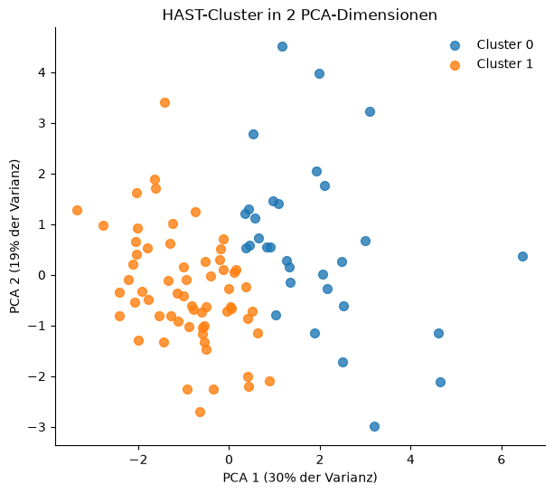

# Stationscluster

**Notebook 07:** `notebooks/3_clustering/07_stationscluster.ipynb` · **Code:** keine Logik in `src/`, nur pandas,
numpy, matplotlib und scikit-learn

Das Notebook gruppiert die HAST mit K-Means nach ihrem Betriebsverhalten. Grundlage ist die Kennzahlentabelle
`data/processed/hast_features.csv` aus Notebook 00, eine Zeile je Station (siehe
[Daten aufbereiten](../aufbereitung/schritte.md#6-kennzahlen-je-station)). Ziel ist, gesunde von auffälligen Stationen
zu trennen, nicht große von kleinen.

## Merkmale

Notebook 00 verdichtet jede Stundenreihe auf 14 Kennzahlen. Geclustert wird auf **10** davon.

| Kennzahl | Rechnung | im Clustering |
|---|---|---|
| `rt_mean_winter` | Mittel der Rücklauftemperatur im Winter (Dezember bis März) | ja |
| `rt_p95` | 95.-Perzentil der Rücklauftemperatur | nein |
| `rt_above_50_share_loaded` | Anteil der Stunden unter Last mit Rücklauf über 50 °C | nein |
| `dt_mean_loaded` | Mittel der Spreizung unter Last | ja |
| `dt_std_loaded` | Streuung der Spreizung unter Last | ja |
| `summer_flow_baseline` | Median des Durchflusses im Sommer (Juni bis August), Hinweis auf Dauerdurchfluss | ja |
| `summer_flow_share` | Anteil der Sommerstunden mit Durchfluss über 5 l/h | nein |
| `flow_ceiling_slope_per_month` | Trend des oberen Durchflusses (95.-Perzentil je Monat, nur Monate mit mindestens 200 Messstunden), Hinweis auf einen zusetzenden Filter | ja |
| `flow_short_cycle_power` | Anteil der 4- bis 12-Stunden-Schwingung im Durchfluss (FFT), Hinweis auf Regelhysterese | ja |
| `idle_share` | Anteil der Stunden mit weniger als 0,2 kW | ja |
| `peak_load_share` | Spitzenlast geteilt durch den Anschlusswert | ja |
| `p95_load_share` | 95.-Perzentil der Leistung geteilt durch den Anschlusswert | ja |
| `energy_kwh_year` | Wärme aus den Zählerständen, auf ein Jahr hochgerechnet | nein |
| `full_load_hours` | Volllaststunden: Jahreswärme geteilt durch die Spitzenlast | ja |

- Unter Last heißt über 0,5 kW.
- Anteile zählen nur die gemessenen Stunden (siehe [Änderungen 2](../aufbereitung/kennzahlen.md)).

Bewusst weggelassen sind:

- `rt_p95` und `rt_above_50_share_loaded`, weil sie dasselbe messen wie `rt_mean_winter`,
- `summer_flow_share`, der Zwilling von `summer_flow_baseline`,
- `energy_kwh_year`, ein reines Größenmaß. Damit würde K-Means groß gegen klein trennen statt gesund gegen auffällig.

## Vorverarbeitung

- **Fehlende Werte:** 6 von 93 Stationen haben eine Lücke. `peak_load_share` und `p95_load_share` fehlen bei 6 HAST
  ohne Anschlusswert, die Spreizungsmerkmale bei einer HAST, die nie über 0,5 kW lief. K-Means kann mit Lücken nicht
  rechnen, deshalb wird mit dem Median aufgefüllt. Der Median reagiert weniger auf Ausreißer. Nebenwirkung: Aufgefüllte
  Stationen rücken zur Mitte.
- **Extremwerte kappen:** am 1. und 99. Perzentil. Das betrifft nur 1 bis 2 Werte je Merkmal, kappt aber stark
  (`summer_flow_baseline` 7.820 auf 2.714 l/h). Nötig, weil K-Means quadrierte Abstände nutzt. Ein einzelner Ausreißer
  zieht sonst ein ganzes Zentrum zu sich.
- **Standardisieren:** Die Merkmale streuen in ganz verschiedenen Einheiten, der Sommer-Durchfluss um 437 l/h,
  `idle_share` um 0,19. Ohne Standardisierung bestimmen Durchfluss und Volllaststunden fast allein den Abstand. Danach
  hat jedes Merkmal eine gleich starke Stimme.
- **Zu diskutieren:** `rt_mean_winter` und `dt_mean_loaded` hängen eng zusammen (r = −0,87). Das Thema Auskühlung
  zählt im Abstand damit doppelt. [Notebook 09](validierung.md#gewichtung-der-merkmale-auf-stationsebene) prüft das.

## Wie viele Cluster?

K-Means bestimmt die Zahl der Cluster nicht selbst. Getestet werden k = 2 bis 8 mit je 20 Starts.

| k | 2 | 3 | 4 | 5 | 6 | 7 | 8 |
|---|---|---|---|---|---|---|---|
| Silhouette | **0,237** | 0,219 | 0,157 | 0,165 | 0,185 | 0,170 | 0,194 |

- Die **Silhouette** misst je Station, wie klar sie zu ihrem Cluster gehört, von −1 bis 1. Über 0,5 heißt starke
  Struktur, 0,25 bis 0,5 schwache, **unter 0,25 keine echte Struktur**.
- Alle Werte liegen unter 0,25. Auch die Inertia (Summe der quadrierten Abstände) zeigt keinen Knick, sie fällt
  gleichmäßig um 9 bis 13 % je Schritt.
- **Früher sah es besser aus:** Mit BHKW und Kesseln lag k = 2 bei 0,599. Das Verfahren hatte nur drei Ausreißer
  abgetrennt, darunter das BHKW (97/3). Der hohe Wert war ein Effekt des Stationstyps, keine Struktur in der Flotte.
  Seit Notebook 00 die Zähler ausschließt, die keine Hausstation sind, ist er weg.

## Ergebnis bei k = 2

| Kennzahl | Cluster 0 (31 HAST) | Cluster 1 (62 HAST) | Flotte |
|---|---|---|---|
| Rücklauf im Winter `rt_mean_winter` | **55,4 °C** | 42,2 °C | 44,5 °C |
| Spreizung unter Last `dt_mean_loaded` | **15,9 K** | 28,3 K | 26,2 K |
| Sommer-Durchfluss `summer_flow_baseline` | **48 l/h** | 0 l/h | 0 l/h |
| Leerlaufanteil `idle_share` | 0,25 | 0,43 | 0,38 |
| Volllaststunden `full_load_hours` | 1.106 | 944 | 982 |

- **Cluster 0 ist auffällig:** hoher Rücklauf, geringe Spreizung, Durchfluss auch im Sommer. Das Bild einer Station,
  die durchgehend umwälzt, ohne viel Wärme abzugeben. Das passt zu Zirkulationsverlusten, einem hydraulischen
  Kurzschluss oder einem Ventil, das nicht schließt. Für das Netz ist das teuer, weil ein hoher Rücklauf die
  Temperatur in der ganzen Rücklaufleitung hochzieht.
- **Cluster 1 ist Normalbetrieb:** Die Station öffnet bei Bedarf und ist sonst zu.
- Getrennt wird nach Rücklauf, Spreizung und Sommer-Durchfluss, nicht nach der Größe.
- Der höhere `flow_short_cycle_power` in Cluster 1 (0,21 gegen 0,10) ist kein Widerspruch: Wer taktet, hat kurze
  Zyklen. Wer durchläuft, hat keine.
- **Passt zur Label-Regel:** Cluster 0 zeigt genau das Muster der Regel aus
  [Notebook 03](../begehungen/labels.md#die-regel). Von den sechs Stationen mit den meisten auffälligen Monaten dort
  (22 bis 27) liegen fünf in Cluster 0, nur 72167783 nicht.
- **k = 2 ist keine klare Entscheidung.** k = 3 liegt dicht dahinter. Dort spaltet sich ein Kleinst-Cluster mit drei
  Stationen ab, darunter 58202380 und 66761022.

Die Profile sind Mediane in echten Einheiten, gerechnet auf den Originalwerten mit ihren Lücken. Die aufgefüllten
Werte würden die Unterschiede verwischen. Dafür schwankt die Fallzahl je Merkmal leicht.

## Die Cluster im Bild

Jede Station hat 10 Merkmale, liegt also in einem Raum mit 10 Dimensionen. Um das zeichnen zu können, dreht eine
Hauptkomponentenanalyse (PCA) die Punktwolke so, dass die größte Streuung auf der x-Achse liegt (PC1) und die
zweitgrößte auf der y-Achse (PC2).

**So liest man das Bild:**

- Jeder Punkt ist eine Station. Blau ist Cluster 0 (31 HAST, auffällig), orange Cluster 1 (62 HAST, Normalbetrieb).
- Nahe Punkte sind Stationen mit ähnlichem Betriebsverhalten. Die Achsen haben keine Einheit, sie mischen alle 10
  Merkmale. Es zählen nur Abstände und Nachbarschaften.
- **x-Achse (PC1, 29,8 %): Rücklauf-Durchfluss-Achse.** Rechts liegen Stationen mit hohem Winterrücklauf,
  Durchfluss auch im Sommer, wenig Leerlauf und kleiner Spreizung, links das Gegenteil.
- **y-Achse (PC2, 18,7 %): gemischt.** Oben liegen Stationen mit hoher Spitzenlast im Verhältnis zum Anschlusswert,
  unten solche mit vielen Volllaststunden und großer Spreizung.
- Beide Achsen zusammen zeigen 48,5 % der Streuung. Rund die Hälfte fehlt im Bild. Es ist eine
  Plausibilitätsprüfung, kein Beweis.

**Was man sieht:**

- K-Means trennt entlang der x-Achse: Orange reicht von −3,4 bis 0,9, Blau von 0,4 bis 6,5.
- Die orangen Stationen liegen enger beieinander. Normalbetrieb sieht bei den meisten Stationen ähnlich aus. Die
  blauen streuen weiter, sie sind auf unterschiedliche Weise auffällig.
- Zwischen 0 und 1 gehen beide Gruppen ohne Lücke ineinander über. Das ist die schwache Silhouette von 0,24 als Bild:
  K-Means schneidet eine durchgehende Wolke, statt zwei getrennte Gruppen zu finden.
- Ganz rechts liegen drei Stationen weit draußen: 81050517, 58202380 und 66761022. Das ist der Kleinst-Cluster, der
  sich bei k = 3 abspaltet.

## Was offen bleibt

- **Die Wahl von k:** k = 2 und k = 3 liegen dicht beieinander.
- **Die Abdeckung nutzen:** Sie reicht je Station von 46 % bis 100 %. Derzeit zählen alle Stationen gleich.
- **Abgleich mit den Begehungen:** Er wurde für die alte 97/3-Aufteilung gerechnet und ist dort gegenstandslos, weil
  alle begangenen Stationen im großen Cluster lagen. [Notebook 08](benchmark.md) rechnet ihn für die aktuellen Daten.

## Was daraus folgte

Die erste Fassung des Notebooks endete mit vier Wegen, wie es weitergehen kann. Drei davon hat das Projekt genommen:

- **Die Zeitachse nutzen:** Eine Zeile je Station dampft bis zu 4,7 Jahre Stundendaten auf eine Zahl ein. Die
  [Stundencluster](validierung.md) und die [Tagescluster](tagescluster.md) nutzen die Zeit.
- **Das Label reparieren:** Daraus wurde die Regel aus Messdaten in [Notebook 03](../begehungen/labels.md) und die
  Auswertung der Freitexte.
- **Von Fehlererkennung zu Rücklaufoptimierung:** Der Rücklauf ist gemessen, hat kein Label-Problem und ist der
  direkte wirtschaftliche Hebel. Diese Sicht nehmen Netzvergleich und Tagesmonitor auf (Notebooks 19 und 20): Sie
  fragen, welche Station schlechter läuft als die anderen oder als früher.

## Ausgabe

- `data/processed/hast_clusters.csv`: Zählernummer, Adresse, Cluster, Abdeckung und die 10 Merkmale. **Enthält
  Adressen**, bleibt lokal.
- `data/processed/hast_clusters.json`: gewähltes k, Silhouette, Seed, Vorverarbeitung, Clustergrößen und
  Merkmalsliste. Wichtig, weil k automatisch gewählt wird und sich mit neuen Daten ändern kann.
