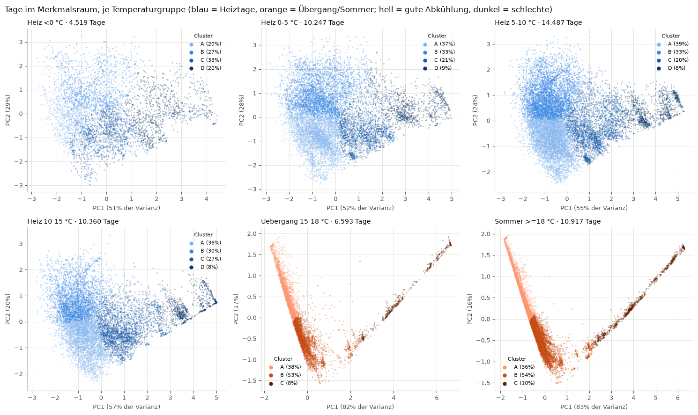
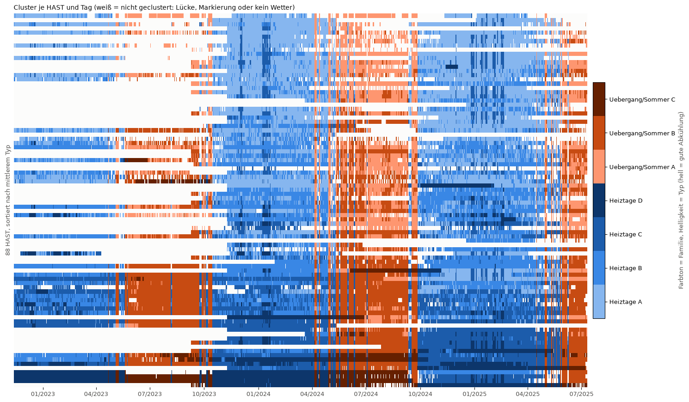

# Tagescluster

**Notebook 10:** `notebooks/3_clustering/10_tagescluster.ipynb` · **Code:** alles im Notebook, keine Abhängigkeit zu
`src/`

Eine Zeile je Station dampft Jahre an Stundendaten auf eine Zahl ein. Dieses Notebook gibt jeder HAST **für jeden Tag
eine Zeile** mit wenigen, gut lesbaren Merkmalen. Die Tage werden nach Außentemperatur in Gruppen geteilt und je Gruppe
mit K-Means geclustert. Die Frage:

> Welche Tagestypen gibt es, und liegen die Tage einer HAST zusammen?

Die Begehungen sind bewusst noch nicht dabei. Ob die Typen mit Begehungen oder Reparaturen zusammenhängen, ist der
nächste Schritt.

## Zwei Arten von Messwerten

Der Export enthält zwei Arten von Werten, und das bestimmt, woraus die Tagesmerkmale kommen:

- **Zählerstände** (Energie in kWh, Volumen in m³) zählen ununterbrochen weiter, wie der Kilometerzähler im Auto. Die
  Differenz zweier Stände ist genau das, was dazwischen geflossen ist.
- **Momentanwerte** (Durchfluss, Leistung, Temperaturen) sind Momentaufnahmen zur vollen Stunde, wie ein Blick auf den
  Tacho. Sie sind keine Stundenmittel.

Eine Momentaufnahme kann zufällig eine kurze Warmwasserzapfung treffen oder genau die Pause. Duscht jemand 10 Minuten
bei 600 l/h, fließen 100 Liter. Trifft die Aufnahme die Dusche, zählt die Stunde 600 Liter, verfehlt sie sie, 0 Liter.
24 solcher Aufnahmen zu einem Tag summiert liegen im Winter um bis zu ±30 % daneben, im Sommer noch mehr.

Deshalb:

- **Tagesenergie und Tagesvolumen** kommen aus den Zählerständen, Stand um Mitternacht minus Stand der Mitternacht
  davor. Das ist exakt.
- **Die Streuung über den Tag** kommt aus den Momentaufnahmen. Hier sind sie sogar von Vorteil, weil sie zeigen, wie
  stark die Werte tatsächlich springen. Ein Stundenmittel würde das glätten.

## Tage nach Wetter gruppieren

- Die Tagesmitteltemperatur stammt von der DWD-Station Kitzingen, rund 13 km von Wiesentheid entfernt
  (`python -m src.weather`). Sie reicht bis zum 31.12.2025, Tage danach bekommen keine Gruppe.
- Jeder Tag fällt in genau eine von **sechs Gruppen**: Heiztage unter 0 °C, 0 bis 5, 5 bis 10 und 10 bis 15 °C,
  Übergang 15 bis 18 °C und Sommer ab 18 °C. Unter −5 °C gab es so wenige Tage, dass alles unter 0 °C eine Gruppe ist.
- Verglichen und geclustert wird nur innerhalb einer Gruppe, damit kein Sommertag neben einem Wintertag landet. Die
  Außentemperatur selbst ist kein Merkmal.

## Merkmale je Tag

| Merkmal | Bedeutung | Heiztage | Übergang und Sommer |
|---|---|---|---|
| `kwh_pro_m3` | Abkühlung, entspricht der mengengewichteten Spreizung × 1,15 | ✓ | ✓ |
| `volumen_m3_pro_kw` | Tagesvolumen je kW Anschlusswert, unabhängig von der Hausgröße | ✓ | ✓ |
| `spreizung_p90_p10_k` | wie stark die Spreizung über den Tag schwankt | ✓ | |
| `fluss_cv` | wie stark der Durchfluss über den Tag schwankt (Standardabweichung ÷ Mittelwert) | ✓ | |
| `nachtfluss_lh_pro_kw` | kleinster Durchfluss zwischen 0 und 6 Uhr je kW | | ✓ |

- **Anschlusswert:** Der vertraglich vereinbarte Höchstwert in kW, typisch 5 bis 17 kW bei Wohnhäusern. Er ist nur
  eine Größenangabe. Erst das Volumen je kW zeigt das Verhalten: Ein 8-kW-Haus mit guter Abkühlung braucht bei 0 bis
  5 °C rund 1,8 m³ am Tag, mit Dauerdurchfluss 8 bis 10 m³. Der Anschlusswert kommt über die Zählernummer aus
  `Nodes_Edges.ods`, bei getauschten Zählern über die Adresse aus `Zuordnung.xlsx`. Zähler ohne Anschlusswert fallen
  aus dem Clustering, das betrifft 5 von 93. Geclustert werden 88 HAST.
- In Übergang und Sommer ersetzt der **Nachtfluss** die beiden Streuungen: Nachts sollte kaum Wasser fließen, und an
  vielen warmen Tagen läuft die Station zu selten für eine Streuung.
- Die Spreizung selbst wird mitgeführt, aber **nicht** geclustert. Sie ist kWh/m³ ÷ 1,15 und würde die Abkühlung
  doppelt zählen.

## Tage markieren statt löschen

Aus dem Stundenraster entstehen **85.983 Tageszeilen von 93 Zählern** (November 2021 bis Juli 2026). Jeder Tag wird auf
acht Probleme geprüft. Gelöscht wird nichts: Markierte Tage bleiben in der Tabelle, gehen aber nicht ins Clustering.

| Markierung | Bedeutung |
|---|---|
| `kein_zaehlerstand` | kein Zählerstand nahe Mitternacht |
| `ruecksprung` | Zählerstand sinkt: Zählertausch oder Reset |
| `zaehler_steht` | Zählerstand bewegt sich nicht, obwohl laut Momentaufnahmen Wasser fließt |
| `nach_stillstand` | Tag nach einem stehenden Zähler, dort holt er meist auf |
| `wenig_energie` | unter 5 kWh am Tag, die Rundung auf ganze kWh macht kWh/m³ ungenau |
| `unplausibel` | über 70 kWh/m³ |
| `wenig_stunden` | weniger als 12 gemessene Stunden |
| `ohne_wetter` | kein Tagesmittel vorhanden |

- **Nutzbar sind 62.734 Tage (73 %).**
- Am meisten kostet `wenig_stunden` mit 16.045 Tagen. 15.416 davon (96 %) stammen aus der Zeit vor November 2022,
  als 45 Zähler nur einen Wert am Tag lieferten (siehe
  [Zählerdaten](../datengrundlage/zaehlerdaten.md#zeitraum-und-abdeckung)). Ab November 2022 sind es nur 629 Tage.
- An zweiter Stelle steht `wenig_energie`, vor allem im Sommer: Kleine Häuser brauchen dann wenig Warmwasser.
- Die Zählerstände selbst sind fast immer in Ordnung, Rücksprünge, stehende Zähler und unplausible Werte gibt es nur
  vereinzelt.
- Im Sommer sind nur 60 % der Tage nutzbar. Es bleiben eher größere, verbrauchsstarke Stationen übrig, die
  Sommerergebnisse sind etwas in diese Richtung verzerrt.

## Wie viele Cluster?

| Gruppe | Silhouette bei K = 2 | bei K = 3 | bei K = 4 |
|---|---|---|---|
| Heiztage (vier Gruppen) | 0,33 bis 0,41 | 0,29 bis 0,30 | 0,27 bis 0,30 |
| Übergang | 0,739 | 0,494 | 0,529 |
| Sommer | 0,743 | 0,503 | 0,540 |

- K ist **fest gesetzt**, nicht automatisch nach der höchsten Silhouette: 4 an Heiztagen, 3 in Übergang und Sommer.
  Kleine Unterschiede in der Silhouette sind Rauschen. In Übergang und Sommer läge K = 4 zwar etwas höher,
  zerlegt aber den Dauerdurchfluss in zwei Cluster (siehe [Wie das Notebook gewachsen ist](#wie-das-notebook-gewachsen-ist)).
- An Heiztagen ist die Struktur schwach, Übergang und Sommer trennen sich klar. Das zeigt auch das Bild unten.
- **Einheitliche Buchstaben:** Jede Gruppe wird für sich geclustert. Danach bekommen die Cluster über die Gruppen hinweg
  dieselben Buchstaben, abgeglichen an der Gruppe mit den meisten Tagen. Die Heiztage teilen sich A bis D, Übergang und
  Sommer haben eigene Merkmale und A bis C. Ein A im Sommer ist also nicht dasselbe wie ein A an Heiztagen. Bei Frost
  passen die Typen schlechter zur Referenz (mittlerer Abstand 1,12, sonst 0,27 oder weniger).

**So liest man das Bild:** Jedes der sechs Felder ist eine Temperaturgruppe. Jeder Punkt ist ein Tag einer HAST. Wie
beim [Stationscluster](stationscluster.md#die-cluster-im-bild) dreht eine PCA die Merkmale so, dass die größten
Unterschiede auf den beiden Achsen liegen. Die Achsen haben keine Einheit, es zählen nur Abstände. Die Farbe ist der
Tagestyp: Blau für Heiztage, Orange für Übergang und Sommer, hell heißt gute Abkühlung, dunkel schlechte. Die Prozente
in der Legende sind die Anteile der Tage.

**Was man sieht:**

- **Heiztage (blau):** eine zusammenhängende Wolke. A (hell) und B liegen links und gehen ineinander über, B etwas
  höher, weil die y-Achse die Schwankung der Spreizung misst. C liegt in der Mitte. D (am dunkelsten) zieht als
  Ausläufer weit nach rechts, das ist viel Wasser bei schlechter Abkühlung. Die Typen schneiden die Wolke, sie sind
  keine getrennten Gruppen. Daher die schwache Silhouette.
- **Übergang und Sommer (orange):** zwei klar getrennte Äste. Links liegen A und B auf einer gemeinsamen Linie, rechts
  läuft C (Dauerdurchfluss) als eigener Ast davon. Dazwischen liegen kaum Tage. Daher die hohe Silhouette.

## Die Tagestypen

**An Heiztagen** (Zahlen aus der Gruppe 5 bis 10 °C, für ein 8-kW-Haus):

| Typ | Anteil der Tage | Bild | mögliche Ursache |
|---|---|---|---|
| **A** gute Abkühlung | rund 40 % | rund 30 K Spreizung, Rücklauf rund 41 °C, rund 1,5 m³ am Tag, nachts kaum Durchfluss | so soll eine HAST laufen |
| **B** stark schwankend | rund 33 % | wenig Wasser wie A, aber die Spreizung schwankt über den Tag um rund 23 K (A: rund 10 K), Rücklauf rund 49 °C | unruhige Regelung oder Wechsel zwischen Heizen und Warmwasser |
| **C** gleichmäßig schwach | rund 20 % | doppelt so viel Wasser bei halber Abkühlung (rund 15 K), Rücklauf rund 57 °C, ruhiger Betrieb | zu hoher Durchfluss, fehlender Abgleich oder zu hohe Heizkurve |
| **D** Dauerdurchfluss | rund 8 %, 16 HAST | rund 9 m³ am Tag, rund 370 l/h ohne Pause, rund 3,5 K Spreizung, Rücklauf rund 72 °C, auch nachts | Ventil schließt nicht oder Bypass |

**In Übergang und Sommer** (Zahlen aus der Gruppe Sommer, die Übergangszeit sieht fast gleich aus):

| Typ | Anteil der Tage | Bild |
|---|---|---|
| **A** gut | rund 36 % | rund 20 K Spreizung, Rücklauf rund 52 °C, nachts kein Durchfluss |
| **B** mäßig | rund 54 % | rund 12 K, Rücklauf rund 57 °C, normaler Warmwasserbetrieb mit etwas Zirkulationsverlust |
| **C** Dauerdurchfluss | rund 10 %, 14 HAST | unter 1 K Spreizung, Rücklauf rund 76 °C, auch nachts viel Durchfluss, dasselbe Bild wie D im Winter |

- **Dauerdurchfluss grenzt sich klar ab** (D an Heiztagen, C im Sommer). Diese Stationen sind erste Kandidaten für eine
  Begehung.
- A, B und C gehen fließend ineinander über. Das sind Betriebsweisen, noch keine Diagnose.

## Worauf die Typen beruhen

- Gemessen wird, welchen Anteil der Unterschiede in einem Merkmal die Clusterzugehörigkeit erklärt (η², wie in einer
  Varianzanalyse).
- **Heiztage:** Volumen je kW am stärksten (58 bis 81 %, je milder, desto stärker), Streuung der Spreizung (61 bis
  68 %) und Abkühlung (55 bis 69 %) etwa gleichauf, die Schwankung des Durchflusses am schwächsten (40 bis 61 %).
- **Übergang und Sommer:** alle drei Merkmale stark, Nachtfluss 83 bis 85 %, Volumen 82 bis 84 %, Abkühlung 74 bis
  75 %.
- Kein Merkmal ist überflüssig, jedes erklärt mindestens 40 % seiner Unterschiede.
- Im [Bild der PCA](#wie-viele-cluster) ist an Heiztagen die erste Achse die **Dauerdurchfluss-Achse** (viel
  Wasser, gleichmäßiger Fluss, schlechte Abkühlung, Typ D liegt am Rand), die zweite die **Schwankungs-Achse** (fast
  nur die Streuung der Spreizung). Deshalb entsteht Typ B als eigener Typ.

## Liegen die Tage einer HAST zusammen?

- **Konzentration** einer HAST = Anteil ihrer Tage im häufigsten Cluster. 100 % heißt: alle Tage im selben Typ.
- **Vergleich mit Zufall:** Die Zuordnung wird innerhalb der Gruppe 200-mal gemischt, bei gleichen Clustergrößen.
  Berücksichtigt werden HAST mit mindestens 10 Tagen in der Gruppe.

| | tatsächlich | bei Zufall |
|---|---|---|
| Median der Konzentration | 0,68 bis 0,88 | 0,35 bis 0,54 |
| HAST mit mindestens 80 % ihrer Tage in einem Typ | 30 bis 60 % | 0 % |

- **Die Station prägt ihre Tage.** Die Typen beschreiben zu einem großen Teil die Station selbst, Stationsprofile sind
  deshalb sinnvoll.
- An milden Heiztagen (10 bis 15 °C) wechseln die HAST am häufigsten. Dort haben nur 30 % mindestens 80 % ihrer Tage
  in einem Typ.
- Interessant sind die HAST, die zwischen Typen wechseln. Laut Aufgabenstellung der ÜZ deutet ein Wechseln eher auf ein
  Regelproblem, gleichbleibend schlechte Tage eher auf einen Defekt.

## Zeitverlauf

**So liest man das Bild:**

- Jede **Zeile** ist eine der 88 HAST, jede **Spalte** ein Tag. Die Farbe ist der Tagestyp an diesem Tag.
- **Farbton = Familie:** Blau für Heiztage (A bis D), Orange für Übergang und Sommer (A bis C). **Helligkeit = Typ:**
  hell heißt gute Abkühlung, dunkel schlechte. Die Legende rechts ordnet jede Farbe einem Typ zu.
- **Weiß** heißt: an diesem Tag nicht geclustert, weil Daten fehlen oder der Tag markiert ist.
- Oben stehen die HAST mit überwiegend guten Tagen, unten die mit überwiegend schlechten. Zählernummern sind bewusst
  nicht beschriftet.

**Was man sieht:**

- **Waagerechte Bänder:** Viele HAST behalten über Monate dieselbe Helligkeit. Das ist die Konzentration aus dem
  Abschnitt oben als Bild: Die Station prägt ihre Tage.
- **Dunkle Zeilen ganz unten:** HAST mit Dauerdurchfluss, im Winter dunkelblau (D), im Sommer dunkelbraun (C).
- **Senkrechte Streifen** kommen vom Wetter, nicht von den Stationen. Ob ein Tag blau oder orange ist, hängt nur von
  seiner Tagestemperatur ab und ist deshalb für alle HAST am selben Tag gleich. Ein kühler Tag unter 15 °C im
  Sommerhalbjahr wird so zu einem blauen Streifen mitten im Orange.
- **Weiße Flächen links:** Bei 50 der 88 HAST beginnt das Band erst ab August 2023, vor allem weil 43 Zähler erst im
  Herbst 2023 dazukamen.
- Das Bild reicht vom 13.11.2022 bis zum 10.07.2025. Davor liefern die Zähler nur einen Wert am Tag (zu wenige
  Stunden), danach fehlen die Zählerstände.

Ein Farbwechsel ab einem bestimmten Datum heißt: Der Zustand einer HAST ändert sich, etwa nach einer Reparatur. Solche
Wechsel sind die Brücke zu den Begehungen. Ob sie zu bekannten Ereignissen passen, etwa zum Ventilfall 68956351 im
September 2024, ist noch nicht geprüft.

## Wie das Notebook gewachsen ist

Der erste Lauf zeigte schon dieselben vier Typen an Heiztagen. Für den zweiten Lauf wurden einige Einstellungen
geändert, jeweils mit Grund aus dem ersten:

| Einstellung | Lauf 1 | Lauf 2 | Grund |
|---|---|---|---|
| Mindeststunden je Tag | 20 | 12 | 17.339 Tage nur wegen zu weniger Stunden markiert. Die Zählerstände brauchen keine vollständigen Tage. |
| Mindestenergie je Tag | 10 kWh | 5 kWh | Im Sommer lagen 46 % der Tage unter 10 kWh. Der Rundungsfehler bleibt unter 20 %. |
| Merkmale Übergang | wie Heiztage | wie Sommer | Einem Drittel der Übergangstage fehlte die Streuung. |
| K Übergang und Sommer | 4 | 3 | Bei K = 4 zerfiel der Dauerdurchfluss in zwei Cluster. Bei K = 2 trennt der Sommer klar Normalbetrieb und Dauerdurchfluss. |
| Buchstaben | je Gruppe nach Abkühlung | über die Gruppen abgeglichen | Derselbe Typ hieß bei Frost C, in den anderen Heizgruppen B. |
| Farben Übergang und Sommer | Blaustufen | Orangestufen | Sonst mit den Heiztag-Typen verwechselbar. |

## Was offen bleibt

- **Zählertausch** ist nicht zusammengeführt. Eine HAST mit Tausch erscheint als zwei Zähler.
- Die Streuung stammt aus Momentaufnahmen und enthält auch zufällige Warmwasserzapfungen.
- Kostet die Energieschwelle im Sommer zu viele Tage, wären Wochenwerte statt Tageswerte eine Option.

## Ausgaben

- `data/processed/hast_tage.csv`: alle 85.983 Tageszeilen mit Merkmalen, Markierungen und Tagestyp.
- `data/processed/hast_tage_clusteranteile.csv`: je HAST und Gruppe der Anteil ihrer Tage je Typ. Das ist die
  Grundlage für Stationsprofile nach den drei Handlungsklassen der Aufgabenstellung.
- `data/processed/hast_tage.json`: Parameter, K, Silhouette und Zeilenzahlen des Laufs.

Die Tageszeilen nutzen später das Normalverhaltensmodell (Notebook 18) und die Notebooks 30, 34 und 39. Die Dateien
liegen wie alle Ausgaben unter `data/processed/` nicht im Repository.
