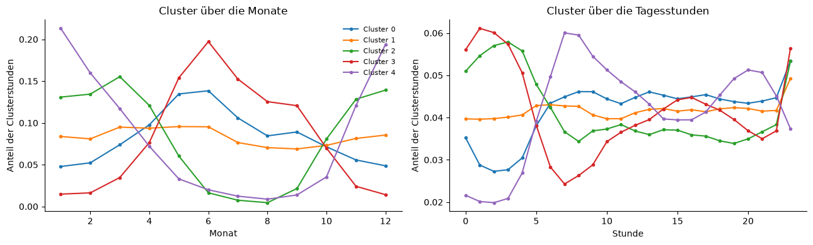

# Stundencluster und Validierung

**Notebook 09:** `notebooks/3_clustering/09_clustervalidierung.ipynb` · **Code:** `src/clustervalidierung.py`, Tests in
`tests/test_clustervalidierung.py` · **Vorher ausführen:** Notebook 00 und `python -m src.main` (für
`inspections_tidy.csv`)

Statt einer Zeile je Station wird hier **jede Betriebsstunde einzeln** geclustert. Das Notebook prüft dann, ob die
Stundencluster Betriebszustände abbilden oder nur Jahres- und Tageszeit (Abschnitte 1 bis 7). Danach geht es zurück
auf die Stationsebene: Ändert eine andere Gewichtung der Merkmale oder eine Trennung nach Leistungsklassen etwas
(Abschnitte 8 bis 10)?

## Stundenpanel und Merkmale

- Alle Betriebsstunden aller Zähler in einer Tabelle: **1.676.633 Stunden von 92 Zählern**, November 2021 bis
  Juli 2026. Ein Zähler mit weniger als 100 vollständigen Stunden fällt heraus (58202380).
- Fünf Merkmale: Leistung und Durchfluss, beide auf das 95. Perzentil der eigenen Station normiert, dazu Spreizung,
  Vorlauf und Rücklauf. Normiert wird nicht auf den Anschlusswert, weil er hier bei 8 Zählern fehlt. Das Notebook
  nimmt ihn nur direkt aus `Nodes_Edges.ods`. Notebook 00 findet für zwei davon den Wert über die Adresse, deshalb
  sind es dort nur 6 (siehe [Stationscluster](stationscluster.md#vorverarbeitung)).
- Durch die Normierung ist die Größe des Hauses schon herausgerechnet.

## Fünf Betriebszustände

K-Means mit k = 5, Silhouette 0,399 (k = 4 und 6 liegen mit 0,399 und 0,400 gleichauf).

| Zustand | Kennzeichen | Anteil der Stunden |
|---|---|---|
| Stillstand | Leistung praktisch null, Vorlauf 35 °C | 19 % |
| effizienter Normalbetrieb | Spreizung 33,8 K, Rücklauf 33 °C | 25 % |
| Teillast | wenig Leistung, Spreizung 11,9 K, Rücklauf 54 °C | 25 % |
| Hochlast | hohe Leistung, Spreizung 23,3 K | 18 % |
| **Verdacht hydraulischer Kurzschluss** | viel Durchfluss bei wenig Leistung, Spreizung 4,2 K, Rücklauf 71 °C | **13 %** |

Der letzte Zustand passt zu einem Kurzschluss, einem offenen Ventil oder einer defekten Regelung. Welche Ursache
dahintersteckt, zeigt die Messung nicht.

## Ist das nur die Jahreszeit?

**So liest man das Bild:** Jede Linie ist ein Zustand. Sie zeigt, wie sich dessen Stunden auf die zwölf Monate (links)
bzw. die 24 Tagesstunden (rechts) verteilen. Eine flache Linie heißt: Der Zustand kommt das ganze Jahr bzw. den
ganzen Tag über gleich oft vor. Die Legende nennt nur Nummern:

| Nummer | Farbe | Zustand |
|---|---|---|
| 0 | blau | Teillast |
| 1 | orange | **Verdacht hydraulischer Kurzschluss** |
| 2 | grün | effizienter Normalbetrieb |
| 3 | rot | Stillstand |
| 4 | lila | Hochlast |

Der Sprung aller Linien um 23 Uhr ist kein Betriebsmuster. Bis Ende Oktober 2022 liefern 45 Zähler nur einen Wert am
Tag, immer um 23 Uhr (siehe [Zählerdaten](../datengrundlage/zaehlerdaten.md#zeitraum-und-abdeckung)). Das sind rund
15.400 zusätzliche Stunden zu dieser Uhrzeit.

- **Stabilität:** Neu gezogene Stichproben ergeben fast dieselbe Aufteilung (Bootstrap-ARI 0,851). Bei so vielen
  Stunden ist das zu erwarten. Es zeigt, dass das Ergebnis nicht am Zufallsstart hängt, nicht, dass es fachlich etwas
  bedeutet.
- **Tageszeit (Bild rechts):** nur ein schwacher Zusammenhang (Cramérs V 0,10). Hochlast steigt morgens zwischen 5
  und 8 Uhr stark an, Stillstand ist nachts am häufigsten. Der Kurzschlussverdacht ist über den Tag gleich verteilt.
- **Jahreszeit (Bild links):** Ein Teil der Aufteilung ist Saison (Cramérs V 0,31). Der Lift sagt, wie viel häufiger
  ein Zustand in einer Jahreszeit vorkommt als im Schnitt aller Stunden (1 = genauso oft). Stillstand und Teillast
  häufen sich im Sommer (Lift 1,99 und 1,47), Hochlast und Normalbetrieb im Kernwinter (2,02 und 1,44). **Nur der
  Kurzschlussverdacht ist in allen Jahreszeiten etwa gleich häufig** (Lift 0,89 bis 1,07).
- **Wie viel erklärt das Wetter allein?** Ein einfacher Entscheidungsbaum, der den Zustand nur aus der
  Außentemperatur vorhersagt, trifft 37,5 % der Stunden. Immer den häufigsten Zustand zu raten, trifft 25 %, die
  Merkmale selbst 91,8 %. Die Temperatur holt also nur 19 % des Abstands. Mit Monat und Stunde steigt der Wert nur auf
  41 %.
- **Gegenprobe im Kernwinter:** Nur Dezember bis Februar geclustert ist die Struktur schwächer (Silhouette 0,285) und
  weniger stabil (ARI 0,474). Der Kurzschlussverdacht ist aber auch dort ein eigener Zustand, in reiner Form ab k = 7
  (Spreizung 4,1 K, Rücklauf 70 °C, 9 % der Stunden).
- **Folgerung:** übers ganze Jahr clustern, die Saison als Kontext mitführen und den Kernwinter als Gegenprobe nutzen.

## Abgleich mit den Begehungen

- 56 Stationen, davon nur 13 ohne dokumentierte Maßnahme (Basisrate 77 %). Kein Zustand ist bei Stationen mit
  Maßnahme signifikant häufiger (kleinstes p 0,15).
- Beim Kurzschlussverdacht liegen beide Gruppen gleichauf (Median 2,6 % und 2,2 % der Stunden). Bei 68956351 stand
  ein Ventil drei Jahre offen, die Reparatur steht aber nur im Freitext. Das ist ein Befund über die Labels, nicht
  über das Clustering.
- **Rangliste nach Zeitanteil im Kurzschlussverdacht:** 18 von 92 Zählern liegen über 20 %, an der Spitze 80912182
  (89 %) und 72167793 (82 %), 68956351 mit 62 % auf Platz 6. Die Liste taugt, um Prüfungen vor Ort zu priorisieren.
  Ein Nachweis ist sie nicht.

## Gewichtung der Merkmale auf Stationsebene

Korrelierte Merkmale zählen in K-Means dieselbe Richtung mehrfach, eine ungeplante Gewichtung. Das betrifft auch
[Notebook 07](stationscluster.md#vorverarbeitung). Verglichen werden drei Wege auf 21 Stationsmerkmalen:

| Weg | Silhouette bei k = 3 | Stabilität (ARI) |
|---|---|---|
| alle Merkmale gleich | 0,261 | 0,865 |
| Redundanzabbau (15 Merkmale, keine Paare mit \|r\| ≥ 0,8) | 0,272 | 0,532 |
| PCA auf 90 % der Varianz (8 Komponenten) | 0,307 | 0,852 |

- Zwölf Merkmalspaare hängen mit einer Korrelation von mindestens 0,8 (Betrag) zusammen, vor allem die Größe
  (Jahresenergie, Leistung, Volumen) und die Auskühlung.
- Die PCA ergibt fast dieselbe Aufteilung wie „alle gleich“ (ARI 0,96), ist aber schlechter lesbar.
- Bei k = 2 kommen „alle gleich“ und PCA auf 0,61 und 0,64. Sie trennen dabei aber nur die vier extremsten Stationen
  ab (89/4), das ist keine Typisierung.
- Ab k = 3 liegen alle Wege unter 0,35. Die beiden Ausreißer 58202380 und 66761022 sitzen bei k = 2 bis 4 im
  kleinsten Cluster, der Rest bleibt ein Kontinuum. **Die Gewichtung erklärt nicht, warum es keine Stationstypen gibt.**

## Leistungsklassen

- Klassen über den Anschlusswert, mit Grenzen bei 5 und 10 kW: bis 5 kW 1 Station, 5 bis 10 kW 52, über 10 kW 32,
  ohne Anschlusswert 8. Die Grenzen sind fachlich noch festzulegen.
- **Stundenebene:** Je Klasse entstehen dieselben fünf Zustände mit ähnlicher Silhouette (0,407 bis 0,412).
- **Stationsebene:** Je Klasse getrennt zu clustern verschlechtert das Ergebnis (Silhouette 0,15 bis 0,26 gegen 0,31
  für alle zusammen), weil die Klassen zu klein sind.
- Die Leistungsklasse taugt als Kontext, nicht als Trennlinie.

## Einordnung

- **Belastbar:** Die Stundenzustände sind kein Artefakt von Jahres- oder Tageszeit. Der Kurzschlussverdacht ist
  saisonneutral und auch im Kernwinter erkennbar, das ist der stärkste Einzelbefund.
- **Schwach:** Vier der fünf Zustände prägt die Saison, nur der Kurzschlussverdacht nicht. k = 4 und k = 5 sind fast
  gleich stabil (0,805 und 0,851), k = 5 stützt sich auf Silhouette und Lesbarkeit. Der Abgleich mit den Begehungen
  bleibt ohne p < 0,05, bei nur 13 Stationen ohne Maßnahme ist das zu erwarten.
- **Empfehlung des Notebooks:** für die Fehlererkennung K-Means auf Stundenebene mit k = 5 über das ganze Jahr, Saison
  und Leistungsklasse als Kontext, eine Rangliste über den Zeitanteil im Kurzschlussverdacht. Für eine
  Stationstypisierung k = 3 auf der redundanzbereinigten Auswahl, weil sie sich besser lesen lässt.

## Ausgabe

- `data/processed/clustervalidierung.csv`: je Station der Anteil ihrer Stunden in den fünf Zuständen. Die
  Stundenreihe selbst wird nicht gespeichert.
- `data/processed/clustervalidierung.json`: Lauf-Kontext mit Parametern und Prüfergebnissen.
