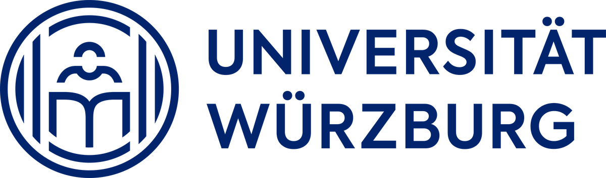

{ .titel-logo }

# Ausgangslage

Die ÜZ Mainfranken betreibt ein Fernwärmenetz, das Gebäude über Hausanschlussstationen (HAST) mit Wärme versorgt. An
jeder Station gibt das heiße Wasser aus dem Netz seine Wärme an das Gebäude ab und fließt abgekühlt zurück. Ein
Wärmezähler misst dabei jede Stunde unter anderem Vorlauf- und Rücklauftemperatur, Durchfluss und Leistung.

Wie gut eine Station arbeitet, zeigt sich vor allem an der Rücklauftemperatur. Kommt das Wasser zu warm zurück, hat die
Station die Wärme schlecht ausgenutzt. Für das Netz heißt das: Es muss mehr Wasser umgewälzt werden, die Leitungen
verlieren mehr Wärme und die Erzeugung arbeitet weniger effizient. Typische Ursachen sind ein klemmendes Regelventil
oder eine schlecht eingestellte Regelung.

Im Betrieb fallen solche Fehler kaum auf, denn das Gebäude wird trotzdem warm. Gefunden werden sie bei einer Begehung:
Ein Monteur prüft die Station vor Ort, ändert Einstellungen oder tauscht Bauteile und hält das Ergebnis fest. Jede
Begehung kostet Zeit, und ohne Auswertung der Messdaten bleibt offen, welche Station sie am dringendsten braucht.

Für ein Teilnetz hat die ÜZ dem Projekt folgende Daten bereitgestellt:

- Stundenwerte von 101 Zählern, davon 93 Hausanschlussstationen. Die ältesten Reihen beginnen im November 2021, fast
  alle enden im Juli 2025.
- Protokolle von 65 Begehungen mit den geänderten Einstellungen und dem Freitext des Monteurs
- den Leitungsplan des Netzes und Tabellen, die Zähler, Adressen und Anschlusswerte verbinden

Daraus ergibt sich die Frage dieses Projekts: Lassen sich Fehler an einer Station schon aus den Zählerdaten erkennen,
bevor ein Monteur ausrückt?
