# Mein Strang: vom einfachen Modell zum Endmodell

Auf dieser Seite erzähle ich meinen Teil des Projekts als eine Geschichte: von der Frage, was ein
Modell überhaupt beantworten soll, über das erste LSTM bis zum Endmodell im Dashboard. Dazu gehören
die Umwege: was ich zuerst gedacht habe, was davon nicht stimmte und wie ich weitergekommen bin.

Die Seite hat zwei Teile:

- **Teil 1 · Nachbau zum Verstehen (A bis G).** Meine Notebooks 27 bis 31 gab es schon, die erste
  Fassung ist vom 18. und 19.10.2026. Um sie wirklich zu verstehen, habe ich die Modellarbeit vom 20.
  bis 23.10. Schritt für Schritt selbst nachgebaut: erst die Daten und eine einfache Baseline, dann
  Sequenzen und zuletzt das LSTM. Der Code steht in `notebooks/lernpfad/`, ein Notebook pro Phase,
  jede Entscheidung ausführlich in `notebooks/lernpfad/PROTOKOLL.md`. Die Daten sind dieselben wie
  in den Notebooks 27 bis 32.
- **Teil 2 · Vom Nachbau zur Abgabe (H bis K).** Wie aus vielen einzelnen Prüfungen ein fairer
  Vergleich wurde, warum die ersten Zahlen zu gut waren, welches Modell wofür ins Dashboard kam und
  warum manche Fehler gar nicht erkennbar sind.

| Phase | Worum es geht | Abgabe-Notebook | Protokoll | mehr dazu |
|---|---|---|---|---|
| A | Frage und Daten | 27 | Schritte 1 bis 5 | [Daten](daten.md) |
| B | Erste Baseline mit scikit-learn | 27, 31 | Schritte 6 bis 8 | |
| C | Vom Tag zur Sequenz | 29, 30 | Schritte 9 bis 11 | |
| D | Das erste LSTM | 29 | Schritte 12 bis 14 | |
| E | Embedding zur Fehlererkennung | 29, 31 | Schritte 15 bis 17 | |
| F | Der Wächter | 30, 32 | Schritte 18 bis 20 | |
| G | Ergebnis nach Folie 5 | 28, 31 | Schritte 21 bis 24 | |
| H | Alle Modelle auf einem Prüfstand | 38 | | [Modellvergleich](modellvergleich.md) |
| I | Endmodell nach Aufgabenstellung | 39 | | [Endmodell](endmodell.md) |
| J | Warum manche Fehler nicht erkennbar sind | 41 | | [Negativbefunde](negativbefunde.md) |
| K | Vom Modell ins Dashboard | 40 | | [Dashboard](dashboard.md) |

**Welche Zahlen gelten.** In Teil 1 vergleiche ich mit dem Teamstand vom 19.10. Am 24.10. wurden die
Notebooks 27 bis 32 auf die gemeinsame Datenbasis aus Notebook 00 umgestellt, danach kamen die
strengeren Prüfungen aus Teil 2. Die heutigen Zahlen stehen in Teil 2 und im Abschluss. Für Aussagen
zur Fehlerart gelten die Zahlen aus Notebook 39.

## A · Frage und Daten

> **Im Abgabestand:** Notebook 27 · **Protokoll:** Schritte 1 bis 5 · **Notebook:** `A_frage_und_daten.ipynb`

### 1. Was soll das Modell überhaupt beantworten?

Bevor ich Code geschrieben habe, habe ich die Fragestellung festgelegt. Das Projekt hat zwei
Fragen:

| | Diagnose | Überwachung |
|---|---|---|
| Frage | Hatte eine HAST einen Fehler, z. B. ein Ventil, das nicht schließt? | Verhält sich eine HAST heute anders als sonst? |
| ein Sample | eine HAST | ein Tag einer HAST |
| Label | Befund aus dem Begehungsprotokoll | keins nötig |
| Aufteilung | nach Station | nach Zeit |

**Umwege:** Zuerst hatte ich als Sample eine Gruppe von HAST angenommen. Es ist aber eine einzelne
HAST, denn nur sie bekommt bei der Begehung einen Befund. Außerdem dachte ich, die Überwachung
braucht Labels, „weil dort die Fehler sind“. Sie lernt aber nur das normale Verhalten, Labels
braucht man erst zum Prüfen. Und Leakage hatte ich mit Overfitting verwechselt: Overfitting heißt,
die Übungsaufgaben auswendig zu lernen. Leakage heißt, dass in der Prüfung die Lösung daneben
liegt, also Daten von nach der Begehung, in denen die Station schon repariert ist.

Was daraus folgt: Für die Diagnose gibt es 56 begangene HAST. Rund 24.000 Messtage ändern daran
nichts, weil jede HAST nur einen Befund hat. Ein großes Netz würde diese wenigen Fälle auswendig
lernen. Das LSTM soll deshalb nicht direkt klassifizieren, sondern vorhersagen. Und es dürfen nur
Tage vor der Begehung verwendet werden.

Bei der Begehung wurden sechs Arten von Befunden notiert:

| Befund | was gemacht wurde | Fälle |
|---|---|---|
| Ventil | Stellventil oder Stellmotor getauscht, oder Ventilbefund im Freitext | 11 |
| Dämmung | Leitungen gedämmt | 23 |
| Filter | Filter gereinigt | 26 |
| Durchfluss | Durchfluss neu eingestellt | 20 |
| Temperatur | Rücklauf-Sollwert tagsüber gesenkt | 36 |
| Überdimensioniert | Vertragsleistung verkleinert | 9 von 37 |

### 2. Stationen anschauen

Um zu sehen, wie ein Fehler in den Daten aussieht, habe ich zuerst ausführlich eine Station mit
Ventilbefund angeschaut, die erste in den Labels: Zähler 68956351. Bei der Begehung am 09.09.2024
wurde dort der Stellmotor getauscht.

Jede Zeile der Daten ist eine Stunde. `Energy` und `Volume` werden immer größer, das sind
Zählerstände wie beim Stromzähler, die ich nicht brauche. Der Vorlauf ist immer wärmer als der
Rücklauf, weil die Station dem Wasser Wärme entzieht.

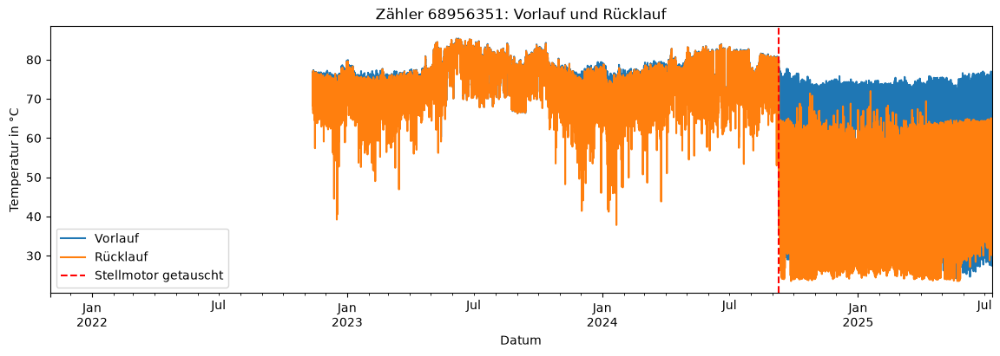

Beim Tausch fällt der Rücklauf von etwa 75 °C auf etwa 37 °C. Vorher war er fast so heiß wie der
Vorlauf, das Wasser ist ungenutzt durchgelaufen.

**Umweg:** Für den Durchfluss hatte ich erwartet, dass er nach dem Tausch steigt: Wenn der Rücklauf
kälter ist, muss mehr Wasser fließen, um die Temperatur zu halten. Es ist umgekehrt. Die Wärme ist
ungefähr Durchfluss mal Spreizung. Kühlt das Wasser stärker ab, reicht weniger davon.

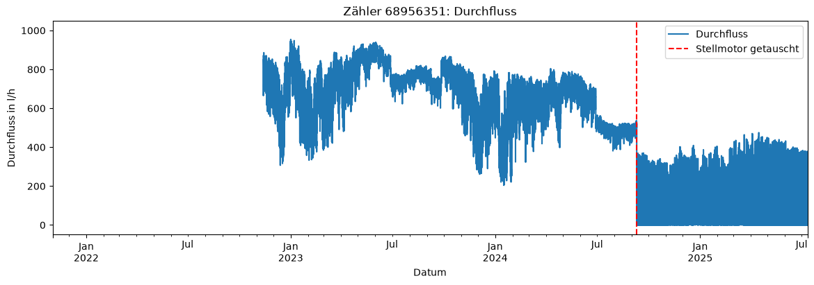

Der Durchfluss ging von etwa 480 auf 100 l/h zurück (Januar 2024 gegen Januar 2025). In beiden
Bildern fiel mir außerdem auf, dass vor November 2022 nichts zu sehen ist, obwohl die Daten schon
2021 anfangen.

Für die anderen fünf Befundarten habe ich je eine Station gesucht, bei der möglichst nur dieser
eine Befund notiert ist und das Begehungsdatum bekannt ist. Beim Ventil gibt es so eine Station
nicht, deshalb die erste Ventilstation oben.

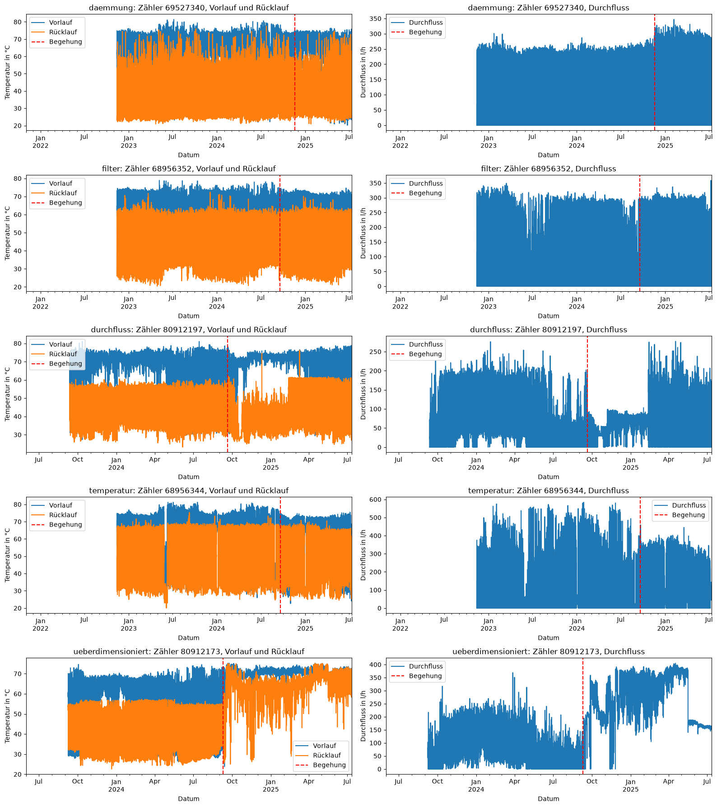

- **Dämmung (69527340):** An der Begehung ändert sich nichts Sichtbares.
- **Filter (68956352):** Auf den ersten Blick auch kaum etwas.
- **Durchfluss (80912197):** Der Verlauf ändert sich nach der Begehung. Von Januar bis März 2025
  läuft der Durchfluss fast konstant bei etwa 80 l/h.
- **Temperatur (68956344):** In den Stundenwerten sieht man nichts. Erst im Tagesprofil: Tagsüber
  liegt der Rücklauf im Winter nach der Begehung 1 bis 3 Grad niedriger, nachts ist er gleich.
- **Überdimensioniert (80912173):** Der Vertrag wurde von 10 auf 8 kW verkleinert. Selbst in den
  1 % stärksten Stunden des Winters brauchte die Station nur etwa 6,7 kW. Das sieht man nur im
  Vergleich mit dem Vertrag, nicht am Verlauf.

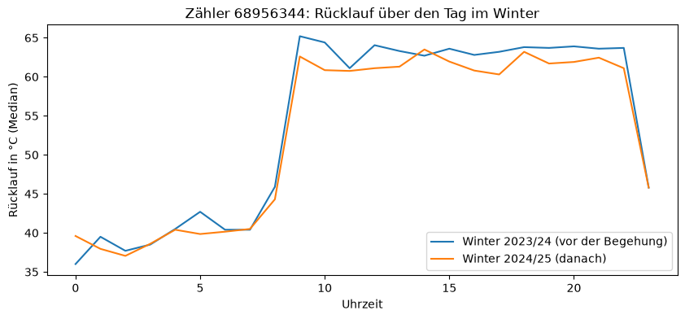

### 3. Datenqualität

Bei 68956351 fehlen 27 % der Stunden. Gezählt pro Jahr hatten 2021 und 2022 sehr wenige Werte.

**Umweg:** Zuerst dachte ich, der Zähler wurde einfach erst Ende 2021 eingebaut. Dann fiel auf,
dass es in November und Dezember 2021 genau 61 Werte gibt, so viele wie Tage. Meine nächste
Vermutung war, dass sich Zeilen überlappen. Erst ein Blick auf die Uhrzeiten hat es gezeigt: Alle
Werte stehen um 23 Uhr. Bis Ende Oktober 2022 gibt es nur einen Wert pro Tag, danach Stundenwerte.
Deshalb ist in den Bildern davor nichts zu sehen, einzelne Punkte werden nicht verbunden.

Ich habe überlegt, die fehlenden Stunden aufzufüllen (Imputation). Bei 23 von 24 fehlenden Stunden
müsste man aber den ganzen Tagesverlauf erfinden. Nutzbar ist deshalb November 2022 bis zur
Begehung, und dort fehlen nur noch rund 2 %.

Über alle 96 Zähler fehlen im Mittel 26 %, die Station ist also normal. Am schlechtesten sind
72135441 und 72135443 mit je 83 %. 72135441 hat einen Ventil- und einen Dämmungsbefund und im
Sommer 2024 nur noch den Juni. Bei jeder Befundart haben höchstens zwei Fälle mehr als die Hälfte
Lücken, bei der Überdimensionierung keiner. Beim Ventil tut schon einer weh, weil es nur 11 Fälle
gibt.

**Unmögliche Werte:** Die Spreizung geht bis −17 °C, die Leistung bis −6 kW. In diesen Stunden
fließt im Median gar kein Wasser. Das Wasser steht, und die beiden Fühler kühlen unterschiedlich
schnell ab. Das ist ein Messeffekt, kein Fehler der Station. Die Spreizung werte ich deshalb nur
aus, wenn Wasser fließt. Bei anderen Zählern gibt es außerdem Durchflüsse bis −999 l/h, das sind
Fehlercodes.

### 4. Sommernacht

Ein Ventil, das nicht schließt, sieht man am besten im Sommer nachts. Dann wird nicht geheizt und
kaum Warmwasser gebraucht, eigentlich sollte fast nichts fließen. Bei 68956351 waren es im Sommer
2024 zwischen 0 und 5 Uhr im Median 520 l/h.

Ob das viel ist, sieht man erst im Vergleich mit einer Station ohne Befund.

**Umweg:** Als Vergleich hatte ich zuerst 80912202 gewählt, weil ich dachte, sie hat keine
Begehung. In der Tabelle fehlte aber nur das Datum, begangen wurde sie trotzdem. Ohne Datum weiß
man nicht, welche Tage vor der Begehung liegen, also wieder die Leakage-Falle. 72135443 fiel wegen
der 83 % Lücken weg. Genommen habe ich 80912169: kein Befund, Begehung erst im November 2024, der
ganze Sommer liegt also davor.

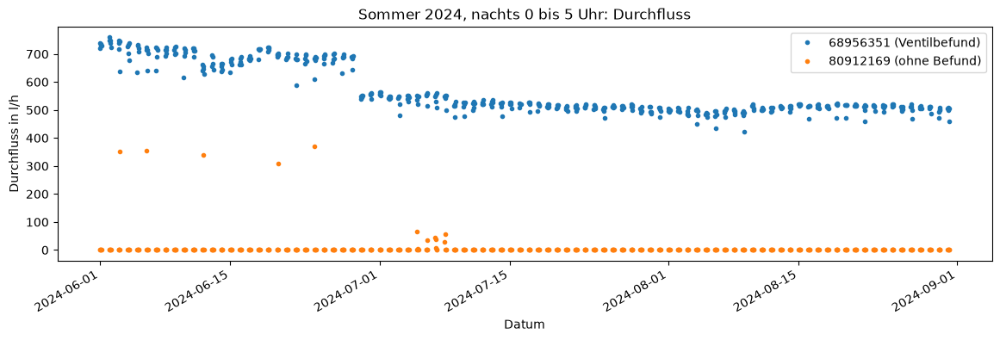

Dort flossen nachts 0 l/h, nur mit ein paar einzelnen Spitzen. Deshalb verwende ich den Median,
den verschieben solche Ausreißer kaum.

Ich habe vermutet, dass es nicht bei allen 11 Ventilstationen so deutlich ist, und das stimmt:
9 der 11 haben nachts Durchfluss, 5 davon über 300 l/h, bei 2 sieht man nichts. Die Gegenprobe
zeigt außerdem: Auch 5 der 42 Stationen ohne Ventilbefund haben nachts Durchfluss (16 bis 121 l/h).
Vielleicht wurde dort bei der Begehung etwas übersehen, die Labels sind also nicht perfekt. Eine
Regel „ab X l/h ist das Ventil kaputt“ ist deshalb immer ein Kompromiss:

| Grenze | Ventilfälle gefunden | Fehlalarme |
|---|---|---|
| über 0 l/h | 9 von 11 | 5 von 42 |
| über 300 l/h | 5 von 11 | 0 von 42 |

Für die anderen Befunde ist die Sommernacht kein Merkmal. Nachts mit Durchfluss:

| Befund | mit Befund | ohne Befund |
|---|---|---|
| Ventil | 82 % | 12 % |
| Dämmung | 32 % | 23 % |
| Filter | 24 % | 29 % |
| Durchfluss | 22 % | 29 % |
| Temperatur | 30 % | 20 % |
| Überdimensioniert | 22 % | 19 % |

### 5. Außentemperatur

Eine andere Erklärung für den Rückgang beim Durchfluss wäre das Wetter: Ein kalter Januar braucht
mehr Wasser als ein milder. Die Außentemperatur kommt von der DWD-Station Kitzingen
(`src/weather.py`). Der Januar 2024 hatte im Mittel 1,5 °C, der Januar 2025 2,7 °C. Ein Grad
erklärt nicht, dass nur noch ein Fünftel fließt.

Sauberer ist es, Tage mit gleicher Temperatur zu vergleichen. Dafür habe ich Station und Wetter
zusammengelegt, Tagesmittel gebildet und den Durchfluss gegen die Außentemperatur gezeichnet:

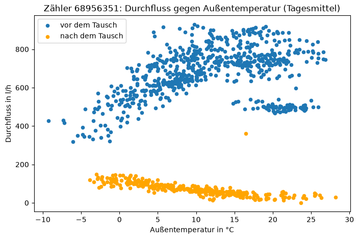

- Nach dem Tausch (orange) fließt an kalten Tagen mehr Wasser, so wie es sein soll.
- Vor dem Tausch (blau) war es umgekehrt: Am meisten floss an warmen Tagen. Das Ventil hat nicht
  nach Bedarf geregelt.
- Bei Tagen um 0 °C flossen vorher etwa 530 l/h, nachher etwa 120 l/h.
- Ab etwa 15 °C wird die orange Kennlinie flach (Heizgrenze). Dann wird nur noch Warmwasser
  gebraucht.

Dieselbe Kennlinie für die Beispielstationen der anderen Befundarten:

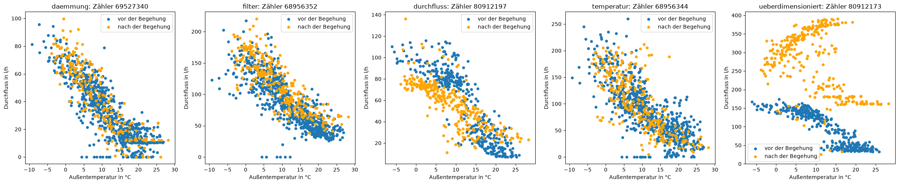

Bei Dämmung, Filter und Temperatur bleibt die Kennlinie fast gleich. Nach dem Einstellen des
Durchflusses fließt bei mittleren Temperaturen weniger Wasser. Bei der Station mit verkleinertem
Vertrag fließt nach der Begehung viel mehr, an warmen Tagen sogar mehr als an kalten, wie beim
kaputten Ventil vorher. Da wurde bei der Begehung wohl etwas verstellt. Mit der Überdimensionierung
selbst hat das nichts zu tun.

### 6. Begehungen und Stichtag

Die meisten Begehungen waren im September 2024 (32 von 51 mit Datum), nur 2 lagen davor. Bei 5
Stationen fehlt das Datum. Deshalb gilt ein gemeinsamer Stichtag, der 01.09.2024: Für die Diagnose
werden nur Daten davor verwendet, bei den 2 früheren Begehungen bis zu ihrem eigenen Datum. So haben
alle Stationen denselben Zeitraum und dasselbe Wetter, auch die ohne Datum.

Viele Stationen haben mehrere Befunde. 6 der 11 Ventilstationen haben auch einen Dämmungsbefund,
und 8 der 9 überdimensionierten Stationen auch einen Durchfluss-Befund. Beim Verkleinern des
Vertrags wurde der Durchfluss wohl gleich mit neu eingestellt. Eine Kennzahl, die eigentlich zu
einem Befund gehört, kann deshalb auch bei einem anderen auffallen.

### Was daraus für Phase B folgt

- Kennzahlen je Station nur aus Daten ab November 2022 und vor dem Stichtag.
- Der Durchfluss in Sommernächten ist ein Ventil-Merkmal. Die anderen Befunde brauchen eigene
  Kennzahlen.
- Die Spreizung nur in Stunden mit Durchfluss auswerten.
- Wie gut eine Regel ist, soll nicht von einer einzelnen Grenze abhängen. Dafür kommt in Phase B
  die AUC.

## B · Erste Baseline mit scikit-learn

> **Im Abgabestand:** Notebooks 27 und 31 · **Protokoll:** Schritte 6 bis 8 · **Notebook:** `B_baseline.ipynb`

### 1. Eine Kennzahl pro Befund

**Umweg:** Zuerst habe ich in Phase B nur Ventil und Dämmung angeschaut, weil aus der Vorarbeit
des Teams bekannt war, dass es dort ein Signal gibt. Dann ist mir aufgefallen, dass das eine Auswahl
mit Vorwissen ist. In echt würde man erst alle Fehlerarten ausprobieren und sich danach auf die
erkennbaren konzentrieren. Deshalb habe ich die Phase für alle sechs Befundarten gemacht.

Damit ich die Kennzahlen nicht nach dem Ergebnis aussuche, habe ich für jeden Befund vorher
aufgeschrieben, woran man ihn erkennen könnte und in welche Richtung die Kennzahl gehen sollte:

| Befund | Idee | Kennzahl | Erwartung bei Befund |
|---|---|---|---|
| Ventil | Ventil schließt nicht, Wasser läuft nachts im Sommer durch | Median Durchfluss Sommer 2024, 0 bis 5 Uhr | höher |
| Dämmung | Wasser verliert im Keller zusätzlich Wärme | Median Rücklauf Winter 2023/24 | niedriger |
| Filter | verstopfter Filter bremst das Wasser, es kühlt stärker ab | Median Spreizung im Winter, nur mit Durchfluss | höher |
| Durchfluss | zu hoch eingestellt, bei viel Bedarf fließt mehr als nötig | 99-%-Wert Durchfluss im Winter / Anschlusswert | höher |
| Temperatur | Rücklauf tagsüber zu hoch | Median Rücklauf im Winter, 8 bis 20 Uhr | höher |
| Überdimensioniert | Vertrag wird nie ausgeschöpft | 99-%-Wert Leistung im Winter / alter Vertrag | niedriger |

Der Winter ist für alle Stationen derselbe, damit gilt auch dasselbe Wetter. Zur Dämmung: Ein
kalter Rücklauf gilt beim Netzbetreiber eigentlich als gutes Zeichen. Eine schlecht gedämmte
Station sieht also auf den ersten Blick aus wie eine besonders gute.

**Umweg:** Bei der ersten Auswertung der Dämmung habe ich gesagt, die Vermutung stimmt nicht. Ich
hatte die Zeilen der Ausgabe verwechselt. Tatsächlich liegt der Winter-Rücklauf mit
Dämmungsbefund bei 38,6 °C und ohne bei 47,6 °C.

Beim Ventil ist es genau umgekehrt: mit Befund etwa 55 °C, ohne etwa 42 °C. Dieselbe Kennzahl
zeigt bei zwei Befunden also in entgegengesetzte Richtungen.

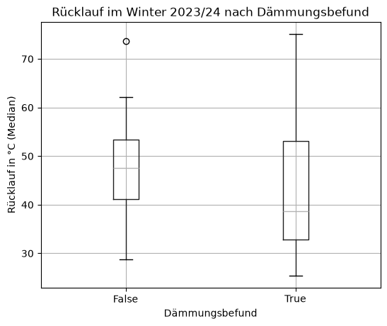

**Umweg:** Im Boxplot sah es für mich zuerst so aus, als könnte man mit einer Grenze bei 40 °C
trennen. Unter 40 °C liegen aber nur 12 der 22 Dämmungsstationen und dazu 7 der 32 ohne Befund.

Für alle sechs Befunde:

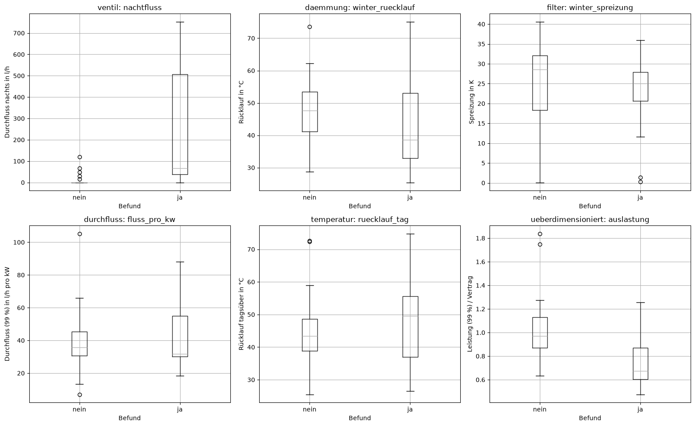

Beim Ventil und bei der Überdimensionierung liegen die Kästen deutlich auseinander. Bei Dämmung und
Temperatur ist die Mitte verschoben, aber sie überlappen stark. Bei Filter und Durchfluss liegen
sie fast übereinander. Beim Filter war die Vermutung sogar falsch: Mit Befund ist die Spreizung
kleiner, nicht größer.

### 2. Grenze oder AUC?

Eine Kennzahl allein ist noch keine Entscheidung. Erst eine Grenze macht daraus einen Alarm, zum
Beispiel: „Fließt nachts mehr als 50 l/h, schau dir das Ventil an.“ Wie gut so ein Alarm ist,
misst man üblicherweise mit Accuracy, Precision und Recall. Beim Ventil (11 Ventile unter 53
Stationen) sieht das je nach Grenze so aus:

| Alarm, wenn nachts mehr fließt als | Alarme | Accuracy | Precision | Recall |
|---|---|---|---|---|
| nie Alarm („alles in Ordnung“) | 0 | 79 % | – | 0 % |
| 0 l/h | 14 | 87 % | 64 % | 82 % |
| 50 l/h | 9 | 89 % | 78 % | 64 % |
| 100 l/h | 6 | 87 % | 83 % | 45 % |
| 300 l/h | 5 | 89 % | 100 % | 45 % |

Die **Accuracy** (Anteil richtiger Entscheidungen) taugt hier nicht. Wer nie Alarm gibt, liegt schon
bei 79 %, weil die meisten Stationen kein kaputtes Ventil haben, und zwischen den echten Grenzen
bewegt sie sich kaum. Aussagekräftiger sind **Precision** (wie viele Alarme sind echt?) und
**Recall** (wie viele Ventile werden gefunden?). Die beiden tauschen sich aber gegeneinander: Mehr
Alarme finden mehr Ventile und bringen mehr Fehlalarme. F1 fasst beide zusammen, gilt aber auch
nur für eine Grenze. Welche Grenze richtig ist, ist eine Frage an den Betrieb: Schafft der
Techniker nur 5 Besuche im Monat, zählt die Precision.

Um Kennzahlen miteinander zu vergleichen, brauche ich deshalb ein Maß, das nicht an einer Grenze
hängt. Das ist die **AUC**. Sie ist die Wahrscheinlichkeit, dass von einem Paar aus einer Station
mit und einer ohne Befund die mit Befund den auffälligeren Wert hat. Damit bewertet sie die
Reihenfolge über alle Grenzen auf einmal. 0,5 heißt Raten, 1 heißt perfekt getrennt. Die Richtung
kommt aus der Tabelle oben, eine AUC über 0,5 heißt also: Die Vermutung geht in die richtige
Richtung.

| Befund | AUC |
|---|---|
| Ventil | 0,88 |
| Überdimensioniert | 0,78 |
| Dämmung | 0,64 |
| Temperatur | 0,60 |
| Durchfluss | 0,50 |
| Filter | 0,36 |

Hier wird nichts gelernt, die Stationen werden nur nach ihrem Wert sortiert. Deshalb sind diese
Zahlen ohne weitere Prüfung ehrlich. Den Filter drehe ich nicht nachträglich um, sonst wäre die
Richtung nach dem Ergebnis gewählt.

**Umweg:** Zuerst habe ich die AUC einfach benutzt, ohne zu fragen, warum nicht Accuracy oder F1.
Die Frage kam mir erst in Phase E. Die Antwort steht trotzdem hier, weil sie hierher gehört.

### 3. Logistische Regression und ehrliche Prüfung

Für die schwachen Befunde wollte ich mehrere Kennzahlen mit einer logistischen Regression
kombinieren. Vorher habe ich ausprobiert, was passiert, wenn man ein gelerntes Modell auf denselben
Stationen prüft, auf denen es gelernt hat: Mit 10 Spalten reiner Zufallszahlen kam eine AUC von
0,75 heraus.

**Umweg:** Diese Zahl habe ich zuerst für „besser“ gehalten als die 0,64 des echten Rücklaufs. Das
Modell hatte sich aber nur gemerkt, welche Station welchen Befund hat. Mit Leave-one-out, bei dem
jede Station von einem Modell vorhergesagt wird, das sie nie gesehen hat, kamen die Zufallszahlen
auf 0,49, also Raten.

Mit Leave-one-out (Kennzahlen skaliert mit `StandardScaler`):

| Befund | eine Kennzahl, ohne Lernen | logistische Regression, 2 Kennzahlen | logistische Regression, 5 Kennzahlen |
|---|---|---|---|
| Ventil | 0,88 | 0,84 | 0,78 |
| Dämmung | 0,64 | 0,67 | 0,64 |
| Filter | 0,36 | | 0,55 |
| Durchfluss | 0,50 | | 0,34 |
| Temperatur | 0,60 | | 0,35 |

Mit mehr Kennzahlen wird es nirgends besser. Bei rund 50 Stationen und so wenigen Fällen muss das
Modell zu viele Gewichte lernen. Werte unter 0,5 heißen hier Raten (siehe Zufallstest). Die
Überdimensionierung fehlt in der Tabelle, weil ihre Kennzahl nur für 35 Stationen existiert. Die
einfache Regel bleibt die Messlatte für alles, was danach kommt.

### 4. Wie belastbar ist das?

**Bootstrap:** 1000-mal die Stationen mit Zurücklegen gezogen und jedes Mal die AUC gerechnet.

| Befund | AUC | 95-%-Bereich |
|---|---|---|
| Ventil | 0,88 | 0,72 bis 0,99 |
| Überdimensioniert | 0,78 | 0,52 bis 0,98 |
| Dämmung | 0,64 | 0,46 bis 0,81 |
| Temperatur | 0,60 | 0,44 bis 0,76 |
| Durchfluss | 0,50 | 0,32 bis 0,66 |
| Filter | 0,36 | 0,22 bis 0,52 |

Nur beim Ventil und bei der Überdimensionierung liegt der ganze Bereich über 0,5. Bei der
Überdimensionierung ist er sehr breit, weil es nur 9 Fälle gibt. Der Unterschied zwischen 0,64 und
0,67 bei der Dämmung sagt nichts.

**Straßen auslassen:** Stationen in derselben Straße hängen am selben Strang und wurden meist vom
selben Techniker begangen. Deshalb habe ich statt einzelner Stationen ganze Straßen ausgelassen
(`LeaveOneGroupOut`). Bei der Dämmung (zwei Kennzahlen) sank die AUC nur von 0,67 auf 0,66, beim
Ventil und der Dämmung mit fünf Kennzahlen änderte sie sich ebenfalls kaum.

**Umweg:** Zuerst hatte ich das andersherum gedeutet. Fiele die AUC stark, hätte das Modell von
der Straße profitiert. Dass sie kaum fällt, heißt: Es funktioniert auch bei Straßen, die es nie
gesehen hat.

**Zufallstest:** Die Dämmungslabels 200-mal durchgemischt und jedes Mal dieselbe
Leave-one-out-AUC der logistischen Regression gerechnet. Nur 1 von 200 Durchläufen kam auf 0,67.
Mit gemischten Labels liegt die AUC bei Leave-one-out im Mittel sogar unter 0,5, bei etwa 0,35.
Das ist eine bekannte Eigenheit bei wenigen Fällen und der Grund, warum man mit gemischten Labels
vergleicht und nicht einfach mit 0,5.

Für die einfachen Regeln habe ich dasselbe mit 1000 Durchläufen gemacht. Wie oft ist der Zufall
mindestens so gut wie die echte Kennzahl?

| Befund | Zufall mindestens so gut |
|---|---|
| Ventil | 0 % |
| Überdimensioniert | 0,8 % |
| Dämmung | 4,7 % |
| Temperatur | 12,5 % |
| Durchfluss | 50 % |
| Filter | 97 % |

**Auswahl:** Hätte ich pro Befund zehn Kennzahlen probiert und die beste berichtet, wäre deren AUC
wieder zu gut, weil die Auswahl die Antworten schon kennt. Deshalb stehen Kennzahl und Richtung
vorher fest. Will man doch auswählen, muss die Auswahl in jedem Durchlauf neu und nur auf den
Trainingsstationen passieren (verschachtelte Kreuzvalidierung).

### Einordnung und was daraus folgt

| Befund | erkennbar mit einfachen Kennzahlen? |
|---|---|
| Ventil | ja, AUC 0,88 |
| Überdimensioniert | ja, AUC 0,78, aber nur 9 Fälle |
| Dämmung | schwach, AUC 0,64 |
| Temperatur | nein, höchstens eine Andeutung |
| Durchfluss | nein |
| Filter | nein, Vermutung falsch |

- Das passt zu Phase A: Bei Dämmung, Filter und Temperatur hat sich an den Beispielstationen durch
  die Begehung kaum etwas geändert. Diese Maßnahmen wurden außerdem bei sehr vielen Stationen
  gemacht (Temperatur bei 36 von 56), das ist eher Wartung als ein Fehler.
- **Ventil:** Die Sommernacht-Regel kommt ohne Lernen auf 0,88, das fertige Modell im Team (Stand 19.10.) auf
  0,89. Jedes Modell, auch das LSTM, muss sich an dieser Regel messen.
- **Überdimensioniert:** 0,78, genau wie im Team mit derselben Regel (Notebook 31, Stand 19.10.: 0,78 [0,53; 0,98]).
- **Dämmung:** Mit zwei Kennzahlen 0,67, im Team mit Kennzahlen allein 0,68 (Notebook 29, Stand 19.10.). Das
  Signal ist echt, aber schwach. Hier hat das LSTM am meisten Luft nach oben.
- Ab Phase C geht es mit ganzen Tagen statt einzelner Kennzahlen weiter. Das LSTM wird dann auf
  allen sechs Befundarten bewertet.

## C · Vom Tag zur Sequenz

> **Im Abgabestand:** Notebooks 29 und 30 · **Protokoll:** Schritte 9 bis 11 · **Notebook:** `C_sequenzen.ipynb`

### 1. Warum ganze Tage?

Bisher hat jede Station ein paar Kennzahlen bekommen, die ich mir ausgedacht habe. Ein Median macht
aber einen ganzen Winter zu einer Zahl. Bei der Temperatur-Station aus Phase A sah man den Effekt
der Begehung erst im Tagesprofil, Stunde für Stunde. Gibt man einem Modell den ganzen Tag, kann es
solche Muster selbst finden. Der Preis: Statt einer Zahl sind es 24 pro Messgröße und Tag. Mit nur
56 Labels würde ein Modell das auswendig lernen. Deshalb soll das LSTM den nächsten Tag
vorhersagen, dafür braucht es keine Labels.

### 2. Ein Tag als Zeile

Mit `pivot` wird aus den Stundenwerten eine Tabelle mit einem Tag pro Zeile und einer Spalte pro
Stunde. Bei 68956351 sind das 1349 Tage, davon 960 vollständig (71 %).

**Umweg:** Zuerst habe ich die Größe mit `head()` abgelesen und kam auf 5 × 24. `head()` zeigt aber
nur die ersten fünf Zeilen an.

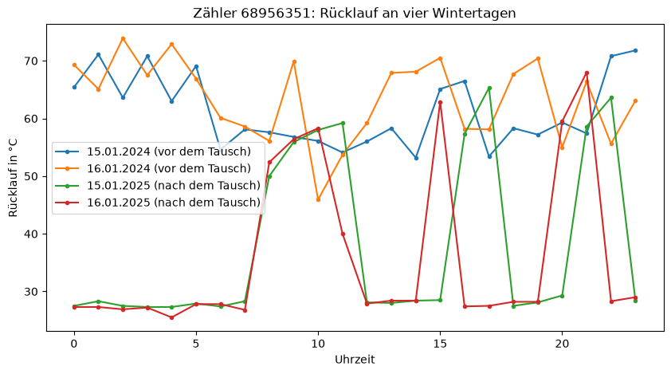

Vor dem Tausch wirkt der Tag ruhiger: Der Rücklauf bleibt den ganzen Tag zwischen 55 und 71 °C.
Nach dem Tausch springt er zwischen etwa 28 und 60 °C hin und her. Gerade das ruhige Bild ist der
Fehler, denn das Ventil hat nie geschlossen. Nach dem Tausch öffnet die Station nur, wenn Wärme
gebraucht wird, dazwischen steht das Wasser und kühlt ab. Dieses Takten ist der Normalbetrieb, und
man sieht es nur in der Sequenz.

### 3. Mehrere Kanäle und Skalierung

Pro Stunde bekommt das Modell mehrere Werte, die Kanäle: Rücklauf, Durchfluss, Vorlauf und später
die Außentemperatur. Für eine Station ergibt das einen Tensor mit 960 Tagen × 24 Stunden ×
3 Kanälen.

Die Kanäle liegen in ganz verschiedenen Größenordnungen (Durchfluss bis fast 1000 l/h, Temperaturen
um 50 °C). Ohne Skalierung würde in einem Netz der Kanal mit den größten Zahlen jede Summe und den
Vorhersagefehler bestimmen. Jeder Kanal wird deshalb auf Mittelwert 0 und Streuung 1 gebracht, mit
Mittelwert und Streuung nur aus der Zeit vor dem Tausch. Sonst steckt Wissen aus der Zukunft in
der Skalierung.

Nach dem Tausch liegen alle drei Kanäle im Mittel 4 bis 6 Streuungen unter dem vorherigen
Normalbetrieb.

**Umweg:** Das habe ich zuerst als „starke Streuung“ gelesen. Es ist aber eine Verschiebung: Die
ganze Station liegt woanders als vorher. Genau das ist die Idee des Wächters in Phase F: lernen, was
normal ist, und melden, wenn eine Station weit davon weg liegt.

Für alle begangenen Stationen, jeweils ab November 2022 und vor dem Stichtag, mit der
Außentemperatur als viertem Kanal: **24.684 Tage × 24 Stunden × 4 Kanäle**. Das sind die rund
24.000 Messtage aus Phase A.

**Umweg:** Ich dachte, es sind alle 56 Stationen. Bei zweien gibt es vor dem Stichtag aber keinen
einzigen vollständigen Tag, es sind also 54.

### 4. Aufteilung nach der Zeit

Ab jetzt wird gelernt, also braucht es Training, Validierung und Test.

**Umweg:** Bei einer zufälligen Aufteilung nach Tagen dachte ich zuerst an Daten nach der Begehung.
Die sind im Tensor aber gar nicht drin. Das Problem sind die Nachbartage: Liegen der 13. und 15.
Januar im Training und der 14. im Test, hat das Modell den Testtag praktisch schon gesehen.

| Teil | Zeitraum | Tage |
|---|---|---|
| Training | November 2022 bis Mai 2024 | 18.689 |
| Validierung | 10 % ganze Kalenderwochen daraus | 1.511 |
| Test | Juni bis August 2024 | 4.484 |

Der Test liegt nach dem Training und vor allen Begehungen, so wie im Team-Notebook 30.

### 5. Messlatten für den nächsten Tag

Vorhergesagt wird der Rücklauf des nächsten Tages, Stunde für Stunde. Gemessen wird, wie viel Grad
die Vorhersage im Mittel danebenliegt.

Meine erste Idee war, den Mittelwert der letzten Tage zu nehmen. Er ist besser als „wie gestern“
(5,2 gegen 5,7 °C über alle Tage), weil er den Zufall des Taktens glättet. Dann habe ich
verschiedene Fensterlängen ausprobiert, auf der Validierung:

| Fenster | 1 Tag | 3 Tage | 7 Tage | 14 Tage | 30 Tage |
|---|---|---|---|---|---|
| Fehler in °C | 6,05 | 5,38 | **5,32** | 5,52 | 6,20 |

Zu kurze Fenster nehmen den Zufall von gestern mit, zu lange das Wetter von vor Wochen. Ausgewählt
habe ich 7 Tage, und zwar auf der Validierung, nicht im Test. Erst danach einmal im Test: 4,28 °C
(wie gestern 4,66).

Als erstes gelerntes Modell eine Ridge-Regression. Sie bekommt einen ganzen Tag und die
Außentemperatur von morgen, die es im Einsatz als Wettervorhersage gibt.

| | Ridge | wie gestern |
|---|---|---|
| Validierung | **5,31** | 5,85 |
| Test (Sommer 2024) | 4,84 | **4,71** |

Auf der Validierung ist Ridge besser, im Sommer schlechter als die einfachen Regeln. Der Grund
steht in den Trainingsdaten: Nur 1.833 Tage stammen aus Juni bis August, aber 6.218 aus Dezember
bis Februar. Ridge hat vor allem den Heizbetrieb gelernt, und im Test sieht es anders aus als im
Training. Das 7-Tage-Mittel hat das Problem nicht, weil es sich jede Woche von selbst an die
Jahreszeit anpasst.

### Was daraus für Phase D folgt

- Die Messlatte für das LSTM ist das 7-Tage-Mittel: 5,32 °C auf der Validierung, 4,28 °C im Test.
- Den Sommer getrennt prüfen. Im Training ist er unterrepräsentiert, und gerade dort liegt das
  Ventilsignal.
- Skalierung und alles andere, was aus Daten berechnet wird, nur aus dem Training. Stellschrauben
  nur auf der Validierung wählen.

## D · Das erste LSTM

> **Im Abgabestand:** Notebook 29 · **Protokoll:** Schritte 12 bis 14 · **Notebook:** `D_lstm.ipynb`

### 1. Was ein LSTM tut

Ein LSTM liest einen Tag Stunde für Stunde und trägt dabei ein Gedächtnis mit, einige Zahlen, die
es nach jeder Stunde neu schreibt. Das Gedächtnis nach der letzten Stunde ist die Zusammenfassung
des ganzen Tages. Für eine Vorhersage kommt dahinter eine lineare Schicht, die daraus den Rücklauf
von morgen macht, Stunde für Stunde. Als Eingabe bekommt das LSTM die 4 Kanäle von heute und die
Außentemperatur von morgen.

**Umweg:** Bei einem Gedächtnis von 8 Zahlen dachte ich zuerst, das LSTM braucht 8 Tage, bis sich
das Gedächtnis füllt. Die 8 ist aber die Größe des Gedächtnisses. Gefüllt wird es Stunde für
Stunde, schon nach einem Tag ist es 24-mal aktualisiert.

**Umweg:** Bei der Außentemperatur von morgen habe ich gefragt, woher man die im Einsatz kennen
soll. Berechtigt: Dort gäbe es nur die Wettervorhersage. Nachgeprüft: Ohne diesen Kanal oder mit
absichtlich 1,5 Grad Fehler ändert sich der Vorhersagefehler nur um wenige Hundertstel Grad. Das
Wetter von heute steckt schon in den anderen Kanälen.

### 2. Lernkurve und Early Stopping

Trainiert wird in Runden: vorhersagen, Fehler messen, Gewichte ein Stück korrigieren. Mit einem
großen Gedächtnis (256 Zahlen) und 150 Runden sieht man Overfitting deutlich:

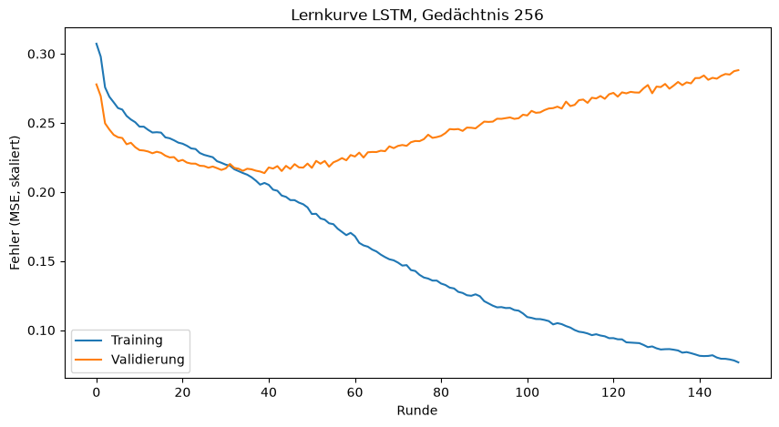

Ab etwa Runde 40 sinkt der Trainingsfehler weiter, der Validierungsfehler steigt wieder. Das Modell
lernt die Trainingstage auswendig. Early Stopping merkt sich nach jeder Runde den besten Stand und
hört nach 20 Runden ohne Verbesserung auf. Hier bricht es in Runde 59 ab und nimmt Runde 39. Fertig
eingebaut gibt es das in PyTorch nicht, deshalb von Hand wie im Team-Notebook 29.

### 3. Schlägt das LSTM die Messlatte?

Fehler beim Rücklauf in °C, alle Varianten auf denselben Tagen:

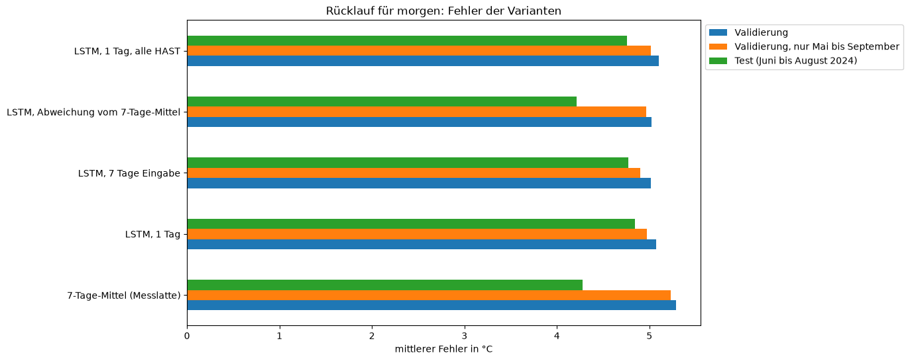

| Variante | Validierung | Validierung Mai–Sep | Test (Sommer 2024) |
|---|---|---|---|
| 7-Tage-Mittel (Messlatte) | 5,29 | 5,23 | 4,28 |
| LSTM, 1 Tag | 5,07 | 4,98 | 4,84 |
| LSTM, 7 Tage Eingabe | 5,02 | 4,90 | 4,77 |
| LSTM, Abweichung vom 7-Tage-Mittel | 5,02 | 4,97 | 4,21 |
| LSTM, 1 Tag, alle HAST | 5,10 | 5,01 | 4,76 |

**Umweg:** Zuerst habe ich gesagt, das LSTM schlägt die Messlatte. Das stimmte nur auf der
Validierung, im Test verlor es. Meine nächste Erklärung war, dass die Validierung vor allem aus dem
Winter kommt. Auch das stimmt nur halb, denn auf den Sommertagen der Validierung gewinnen alle LSTMs
ebenfalls. Der eigentliche Grund ist die Lage in der Zeit: Die Validierungswochen liegen zwischen
Trainingswochen, das Modell muss also nur eine Lücke füllen. Der Test liegt nach dem ganzen
Training, da muss es wirklich in die Zukunft vorhersagen.

Zwei Ideen habe ich selbst eingebracht: dem LSTM mehrere Tage zu zeigen und auf allen HAST statt
nur auf den begangenen zu lernen. Mehrere Tage helfen auf der Validierung etwas, im Test kaum. Alle
HAST bringen nichts, es bleibt also bei der Vorgabe der Betreuung.

Gewählt habe ich die Variante, die nur die Abweichung vom 7-Tage-Mittel vorhersagt. Auf der
Validierung liegt sie gleichauf mit „7 Tage Eingabe“, sie startet aber bei der Messlatte und kann
eigentlich nur besser werden. Ehrlicherweise habe ich den Test von allen Varianten gesehen, bevor
ich mich entschieden habe. Für spätere Auswahlen wäre eine Validierung besser, die zeitlich nach dem
Training liegt.

### 4. Engpass von 8 Zahlen

Für die Fehlererkennung braucht jede Station einen kurzen Steckbrief. Dafür wird das Modell zu
einem Encoder–Decoder umgebaut: Der Encoder (LSTM) presst einen Tag auf 8 Zahlen, der Decoder sagt
nur aus diesen 8 Zahlen und dem Wetter von morgen Rücklauf, Durchfluss und Vorlauf von morgen
vorher. Alle drei Kanäle sind das Ziel, damit auch der Durchfluss im Steckbrief steckt, denn dort
sieht man das Ventil.

| | Validierungsfehler | Rücklauf | Durchfluss | Vorlauf |
|---|---|---|---|---|
| ohne Engpass (256 Zahlen) | 0,1896 | 5,07 °C | 50 l/h | 3,9 °C |
| mit Engpass (8 Zahlen) | 0,1925 | 5,22 °C | 50 l/h | 4,0 °C |

Der Engpass kostet kaum etwas. Fast alles, was das Modell über einen Tag wissen muss, passt in
8 Zahlen. Diese 8 Zahlen pro Tag sind das Embedding.

**Umweg:** Wie man prüft, ob in 8 Zahlen ohne Namen etwas Sinnvolles steckt, wusste ich zuerst
nicht. Die Antwort ist, an dem zu prüfen, was man damit machen kann: dieselbe Station in einem
anderen Zeitraum wiedererkennen und die Befunde finden. Das ist Phase E.

## E · Embedding zur Fehlererkennung

> **Im Abgabestand:** Notebooks 29 und 31 · **Protokoll:** Schritte 15 bis 17 · **Notebook:** `E_embedding.ipynb`

### 1. Ein Steckbrief pro Station

Aus Phase D hat jeder Tag 8 Zahlen. Für die Fehlersuche braucht aber jede Station einen
Steckbrief. Er ist der Durchschnitt der 8 Zahlen über die Tage der Station, so wie die Zeugnisnote
aus den einzelnen Noten.

**Umweg:** Zuerst habe ich gedacht, jeder Tag behält einfach seine 8 Zahlen. Dass man über die Tage
mitteln muss, wurde mir erst mit dem Vergleich zur Zeugnisnote klar.

Über alle Tage zu mitteln wäre aber unfair. Je nachdem, wann die Daten einer Station anfangen und
aufhören, liegen 42 bis 65 % ihrer Tage im Winter. Ein Durchschnitt mit vielen Wintertagen ist
„kälter“, ohne dass mit der Station etwas anders ist. Deshalb nehme ich nur Tage von November bis
März. Jede Station hat davon mindestens 141.

### 2. Erkennt man eine Station ein Jahr später wieder?

Die 8 Zahlen haben keine Namen. Wenn sie beschreiben, wie eine Station tickt, muss man die Station
damit ein Jahr später wiedererkennen. Dafür habe ich einen Steckbrief aus dem Winter 2022/23
(23 Stationen) und einen aus dem Winter 2023/24 (alle 54) gebaut. Für jede Station aus dem ersten
Winter suche ich im zweiten den Steckbrief mit dem kleinsten Abstand, also der kürzesten Luftlinie
zwischen den beiden Listen von 8 Zahlen. Ist das dieselbe Station, ist sie wiedererkannt.

Zum Vergleich gibt es zwei einfache Steckbriefe ohne LSTM: die Mittelwerte von Rücklauf,
Durchfluss und Vorlauf (3 Zahlen) und den typischen Wintertag, bei dem jede Stunde einzeln
gemittelt wird (24 × 3 = 72 Zahlen).

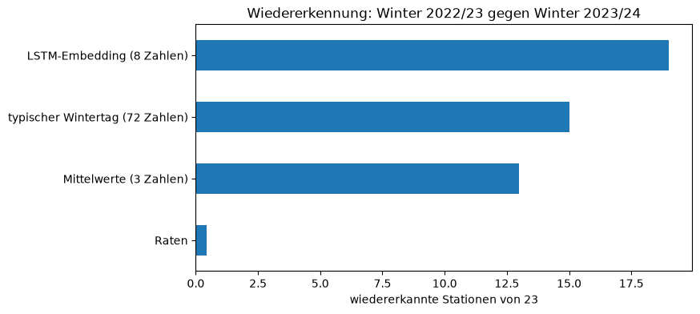

| Steckbrief | Zahlen | wiedererkannt von 23 |
|---|---|---|
| Raten | | 0,4 |
| Mittelwerte | 3 | 13 |
| typischer Wintertag | 72 | 15 |
| LSTM-Embedding | 8 | 19 |

Das Modell hat nie gesehen, welcher Tag zu welcher Station gehört. Es hat nur gelernt, den nächsten
Tag vorherzusagen, und trotzdem stecken in den 8 Zahlen Eigenheiten, die über ein Jahr gleich
bleiben. Das LSTM erkennt alle 15 Stationen des typischen Wintertags und 4 weitere, umgekehrt keine.
Mit nur 4 Stationen Unterschied ist das allerdings wie viermal Kopf beim Münzwurf, was in 1 von 16
Fällen auch zufällig passiert. Es ist ein deutlicher Hinweis, aber kein Beweis.

**Umweg:** Hier lag ich gleich mehrmals daneben. Bei blindem Raten habe ich 54 Treffer erwartet.
Es sind aber 23 × 1/54 ≈ 0,4, weil jede Station nur eine Chance von 1 zu 54 hat. Bei den
Mittelwerten ohne Standardisieren dachte ich, der Rücklauf bestimmt den Abstand. Es ist der
Durchfluss, weil er in l/h gemessen wird und damit große Zahlen hat (Streuung 142 l/h gegen 10 °C).
Und ich habe erwartet, dass der typische Wintertag mit 72 Zahlen das LSTM schlägt. Es waren 15
gegen 19, mehr Zahlen allein bringen es also nicht.

Eine Station fällt völlig heraus: Bei 68956372 landet die richtige Station erst auf Platz 51 von 54.
Zwischen den Wintern stieg der Rücklauf von 41 auf 70 °C und der Durchfluss von 51 auf 318 l/h.
Das Wasser läuft durch, ohne seine Wärme abzugeben. Bei der Begehung im Oktober 2024 wurde dort ein
Ventilbefund festgestellt.

**Umweg:** Dass diese Station nicht wiedererkannt wird, habe ich zuerst für eine Schwäche des
Embeddings gehalten. Es ist aber genau richtig so: Die Station verhält sich seit dem Schaden
wirklich anders. Ein Steckbrief, der sie trotzdem wiedererkennt, hätte den Schaden übersehen. Diese
Idee, eine Station mit sich selbst zu vergleichen, ist der Ausgangspunkt für den Wächter in
Phase F.

### 3. Findet der Steckbrief die Befunde?

Für die Befunde nehme ich nur den Steckbrief aus dem Winter 2023/24: Er liegt am nächsten an den
Begehungen, alle 54 Stationen haben ihn, und alle Tage liegen vor der Begehung. Darauf kommt wie in
Phase B eine logistische Regression mit Leave-one-out, für alle sechs Befundarten, dazu der
Zufallstest mit 100 gemischten Befunden. Zum Vergleich dieselbe Rechnung mit den 3 Mittelwerten
aus demselben Winter und die Regel aus Phase B.

Vorher habe ich festgelegt, was ich erwarte: Ventil, Dämmung und Überdimensionierung ja, Filter,
Durchfluss und Temperatur nein.

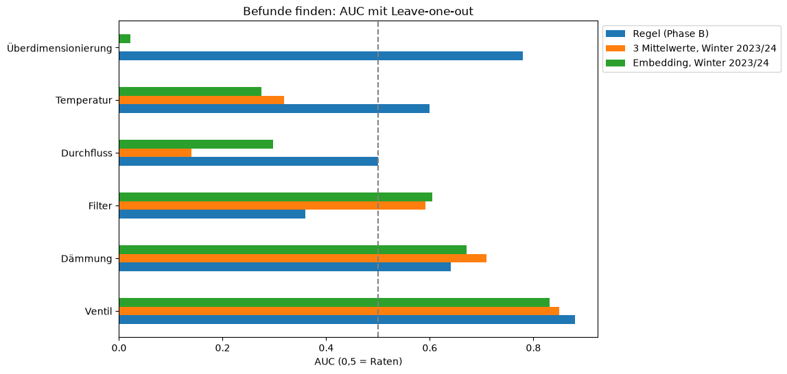

| Befund | Regel (Phase B) | 3 Mittelwerte | Embedding | Zufall mindestens so gut (Embedding) |
|---|---|---|---|---|
| Ventil | 0,88 | 0,85 | 0,83 | 0 von 100 |
| Dämmung | 0,64 | 0,71 | 0,67 | 1 von 100 |
| Filter | 0,36 | 0,59 | 0,60 | 18 von 100 |
| Durchfluss | 0,50 | 0,14 | 0,30 | 88 von 100 |
| Temperatur | 0,60 | 0,32 | 0,28 | 92 von 100 |
| Überdimensionierung | 0,78 | 0,00 | 0,02 | 100 von 100 |

Echt sind nur Ventil und Dämmung, und dort liegen alle drei Ansätze gleichauf. Die Unterschiede
sind viel kleiner als die Unsicherheit aus dem Bootstrap in Phase B (Dämmung 0,46 bis 0,81). Für
die Befunde bringt das LSTM nichts, was nicht schon in den Mittelwerten steckt.

Warum ist das LSTM beim Wiedererkennen besser, bei den Befunden aber nicht? Zum Wiedererkennen
braucht man viele kleine Eigenheiten, ungefähr wie einen Fingerabdruck: wann die Heizung morgens
hochfährt, wie tief die Nachtabsenkung ist. Ein offenes Ventil ist dagegen eine grobe Abweichung,
wie Fieber, und dafür reicht ein Thermometer. Außerdem lernt die logistische Regression bei 11
Ventilfällen aus 3 klaren Zahlen leichter als aus 8 ohne Namen.

**Umweg:** Die Überdimensionierung hatte ich erwartet, und die 0,02 habe ich zuerst als Bestätigung
gelesen. 0,5 ist aber Raten, 0,02 ist fast genau falsch herum. Überdimensioniert heißt, dass die
Station viel weniger braucht, als ihr Vertrag erlaubt. Den Vertrag kennt das Embedding nicht, die
Regel aus Phase B hat ihn benutzt. Als fehlende Information hatte ich zuerst das Alter des Hauses
vermutet. Die 0,02 einfach umzudrehen, wäre nicht erlaubt: Die Richtung lernt die logistische
Regression selbst, und hinterher umdrehen hieße, auf die Antworten zu schauen.

**Umweg:** Den Filter mit 0,60 hielt ich zuerst für besser als Zufall. In 18 von 100 Durchgängen
waren aber gemischte Befunde mindestens so gut. Und bei der Dämmung habe ich 0,67 gegen 0,64 als
Gewinn für das LSTM gesehen. Genau diesen Unterschied hatte ich in Phase B schon als bedeutungslos
eingestuft.

### 4. Warum kein LSTM direkt auf die Befunde?

Das LSTM aus Phase D hat 283.856 gelernte Zahlen. Für das Ventil gibt es 11 Fälle. Direkt auf die
Befunde trainiert, würde es sich jede Station einzeln merken. Schon 10 Spalten Zufallszahlen haben
in Phase B gereicht, um auf den Lernstationen eine AUC von 0,75 vorzutäuschen. Deshalb der Umweg:
Das LSTM lernt aus 24.684 Tagen, den nächsten Tag vorherzusagen, und braucht dafür keine Befunde.
Die Befunde sieht nur die logistische Regression, die 9 Zahlen lernt. Das ist wie bei einem
Medizinstudenten, der erst an vielen gesunden Patienten lernt, wie ein Körper funktioniert, und
die seltene Krankheit dann an wenigen Fällen.

**Umweg:** Als Grund hatte ich zuerst Data Leakage genannt. Das ist ein anderes Problem, bei dem
Informationen ins Training rutschen, die man im Einsatz nicht hätte. Hier geht es um die Größe des
Modells im Vergleich zur Zahl der Beispiele.

### 5. Varianten ohne Befunde auswählen

In Phase D habe ich den Engpass auf 8 Zahlen gesetzt, genauso gut könnten es 4 oder 16 sein. Wer
bei den Befunden die beste Variante aussucht, hat wieder auf die Antworten geschaut. Es gibt aber
zwei Messungen, die ganz ohne Befunde auskommen: den Validierungsfehler beim Vorhersagen und die
Wiedererkennung. Vor dem Training habe ich die Regel festgelegt: Gewählt wird der kleinste
Validierungsfehler. Erwartet habe ich, dass mehr Zahlen ab einem Punkt schlechter werden.

| Engpass | Validierungsfehler | wiedererkannt von 23 |
|---|---|---|
| 4 Zahlen | 0,2013 | 17 |
| 8 Zahlen | 0,1925 | 19 |
| 16 Zahlen | 0,1906 | 20 |

Bei 8 kommen genau die Werte aus Phase D und aus Abschnitt 2 heraus, das Training ist also
wiederholbar. Meine Erwartung hat sich nicht bestätigt: Bis 16 wird es mit jeder Stufe leicht
besser. Von 8 auf 16 ist der Gewinn aber winzig. Nach der Regel habe ich 16 gewählt und erst danach
bei den Befunden geprüft: Ventil 0,79, Dämmung 0,68, also nicht besser als mit 8 Zahlen. Besser
vorhersagen und wiedererkennen heißt nicht besser Fehler finden.

Überraschend kam der Filter mit 16 Zahlen auf 0,69, und gemischte Befunde waren nur in 2 von 100
Fällen so gut. Ich habe inzwischen aber 12 Tests gemacht (6 Befunde mal 2 Varianten). Mit der
Grenze von 5 von 100 erwartet man dabei 12 × 0,05 = 0,6 Zufallstreffer. Ein Treffer, den ich vorher
nicht erwartet habe und der nur in einer Variante auftaucht, ist deshalb nur ein Hinweis.

**Umweg:** Als Messung ohne Befunde hatte ich zuerst den Zufallstest genannt. Der mischt aber die
Befunde, er braucht sie also. Bei 12 Tests habe ich 2 Zufallstreffer erwartet statt 0,6.

### Was daraus für Phase F folgt

- Das Embedding beschreibt eine Station gut: 19 von 23 werden ein Jahr später wiedererkannt, im
  Team-Notebook 29 waren es damals 86 % (heute 83 %, siehe Abschluss).
- Für die Befunde ist es nicht besser als drei Mittelwerte oder die Regel. Ventil und Dämmung sind
  erkennbar, die anderen vier nicht, und die Überdimensionierung braucht den Vertrag.
- Seine Stärke zeigt sich bei 68956372: Wenn eine Station sich verändert, verändert sich ihr
  Steckbrief. Statt Stationen untereinander zu vergleichen, vergleicht der Wächter in Phase F jede
  Station mit sich selbst: Weicht der heutige Tag von dem ab, was das Modell für sie vorhersagt?

## F · Der Wächter

> **Im Abgabestand:** Notebooks 30 und 32 · **Protokoll:** Schritte 18 bis 20 · **Notebook:** `F_waechter.ipynb`

### 1. Jede Station mit sich selbst vergleichen

In Phase E hat sich der Steckbrief von 68956372 nach dem Ventilschaden verändert, bemerkt habe ich
das aber erst ein Jahr später. Ein Wächter soll so etwas Tag für Tag bemerken. Dafür vergleicht er
jede Station mit sich selbst, so wie ein Arzt deinen Blutdruck mit deinem eigenen Normalwert
vergleicht und nicht mit dem anderer Leute.

Der Wächter sagt jeden Tag den Rücklauf vorher und schaut, wie weit die Messung danebenliegt. Als
Vorhersage nehme ich das 7-Tage-Mittel aus Phase C, das das LSTM in Phase D kaum geschlagen hat.
Solange die Station tickt wie immer, liegt die Vorhersage so daneben wie sonst auch. Wird die
Differenz unnormal groß, verhält sich die Station anders.

In den Tageswerten habe ich nachgesehen, wann der Schaden bei 68956372 kam: am 08.08.2023. Davor
flossen nachts etwa 25 l/h, ab dem 19.08. dauerhaft rund 340 l/h. Am Schadenstag lag die Differenz
bei +13 Grad, eine Woche später aber wieder bei 0.

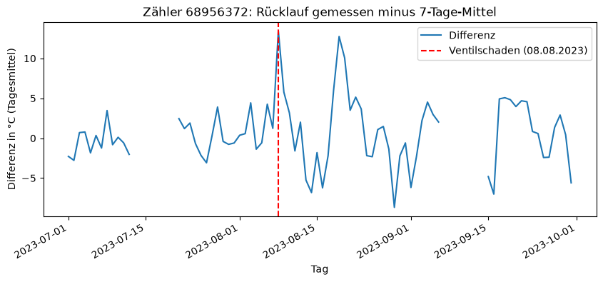

**Umweg:** Den Schadenstag habe ich zuerst mit der Begehung durcheinandergebracht, die war aber
erst im Oktober 2024. Dazwischen lief die Station über ein Jahr mit kaputtem Ventil. Genau das
zeigt das Bild: Nach einer Woche besteht das 7-Tage-Mittel nur noch aus Tagen mit kaputtem Ventil,
und die Vorhersage stimmt wieder. Der Wächter gewöhnt sich an einen Schaden. Er muss in den ersten
Tagen anschlagen oder gar nicht.

### 2. Was ist unnormal?

Bei einer ruhigen Station sind 2 Grad Differenz normal, bei einer taktenden 8 Grad. Eine feste
Grenze passt deshalb nicht. Meine Idee war ein Fenster pro Station: Mittelwert und Streuung ihrer
Differenzen in den letzten 8 Wochen. Die Differenz von heute, gemessen in diesen Streuungen, ist
der z-Wert. Am Schadenstag hatte 68956372 z = 5,9.

Für die Grenze gilt wieder der Kompromiss aus Phase B: Zu hoch heißt kein Alarm, zu niedrig heißt
Alarm bei jeder Kleinigkeit. Ich habe sie nur über die Fehlalarme festgelegt, ohne auf gefundene
Schäden zu schauen. Fast alle Tage sind normal, also sind fast alle Alarme Fehlalarme:

| Grenze | Alarme je Station und Jahr |
|---|---|
| 3 | 5,8 |
| 4 | 2,1 |
| 5 | 1,1 |

Bei einem Budget von 1 bis 2 Alarmen pro Station und Jahr ist das Grenze 5. Damit schlägt der
Wächter bei 68956372 in fast zwei Jahren genau einmal an, am Schadenstag.

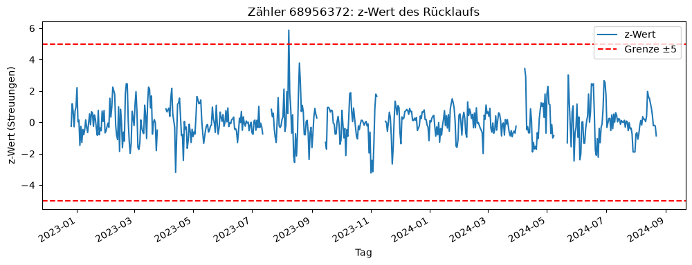

### 3. Woher die Fehlalarme kommen

Die übrigen Alarme häufen sich im Mai und von Oktober bis Dezember, beim Heizende und Heizbeginn.

**Umweg:** Zuerst dachte ich, das liegt am schnellen Wetterwechsel, den das 7-Tage-Mittel nicht
kennt. Nachgerechnet: Zieht man den Wettereinfluss ab, sinken die Alarme nur von 1,13 auf 1,02. Die
eigentliche Ursache ist das Fenster. Im Sommer liegt die Vorhersage etwa ±2,5 Grad daneben, im
Oktober ±4,5. Am 1. Oktober enthält das Fenster aber vor allem August und September und hält ±2,3
für normal. Ein gewöhnlicher Oktobertag, an dem die Heizung anspringt, liegt dann über 4
Streuungen daneben. Das ist wie ein Arzt, der den Puls nur im Schlaf kennt und beim Treppensteigen
Alarm schlägt.

**Umweg:** Meine Lösung war, Heiztage nur mit Heiztagen und Sommertage nur mit Sommertagen zu
vergleichen. Das brachte 1,08 statt 1,13 Alarme, im Oktober zwar 3 statt 10, im Mai aber mehr.
Und der Rückgang im Oktober ist eine Falle: Stationen mit Daten erst ab September 2023 haben vorher
keine Heiztage und bekommen in den ersten Wochen gar keinen z-Wert. Weniger Alarme hieß dort nur,
dass der Wächter weniger hinschaut. Ich bin beim einfachen Wächter geblieben.

### 4. Wie groß muss ein Schaden sein?

Ein erkannter Fall ist kein Beweis. Weitere Schäden mit bekanntem Anfangsdatum gibt es aber nicht.

**Umweg:** Meine erste Idee war, Stationen mit und ohne Befund zu vergleichen. Das zeigt aber,
**welche** Station auffällig ist, nicht **wann** sie sich verändert. Dann kam der Einwand, dass
jede Begehung ein bekanntes Datum hat. Das stimmt, aber die Begehung ist das Ende eines Schadens,
nicht sein Anfang. Die Begehungen kommen deshalb erst in Abschnitt 5.

Stattdessen habe ich Schäden selbst eingebaut, wie beim Rauchmelder-Test mit Prüfspray: Ab einem
Tag steigt der Messwert um einen festen Betrag. Am ersten Tag steigt der z-Wert dann um Sprung
geteilt durch die Streuung des Fensters, und jeder der rund 20.000 Tage kann einmal Schadenstag
sein.

**Umweg:** Ich habe geschätzt, dass ein Sprung von 10 Grad im Rücklauf immer erkannt wird. Es sind
37 %, die Hälfte erst bei etwa 12 bis 15 Grad. Bei einer unruhigen Station sind 10 Grad nur 2
Streuungen.

Beim Ventil ist der Durchfluss das deutlichere Signal. Bei 68956372 stieg der Rücklauf um ein
Viertel, der Durchfluss nachts auf das 14-Fache. Derselbe Wächter auf dem Durchfluss hat 1,3
Fehlalarme pro Station und Jahr und am Schadenstag z = 12,8 statt 5,9:

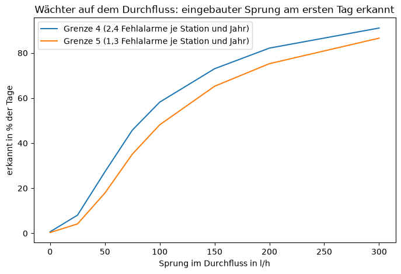

| Sprung im Durchfluss | 50 l/h | 100 l/h | 150 l/h | 300 l/h |
|---|---|---|---|---|
| Grenze 5 | 18 % | 48 % | 65 % | 87 % |
| Grenze 4 | 27 % | 58 % | 73 % | 91 % |

Grenze 4 fände bei 150 l/h 8 Prozentpunkte mehr, kostet aber fast doppelt so viele Fehlalarme. Die
Grenze bleibt bei 5, weil sie vorher über das Budget festgelegt war.

### 5. An den echten Begehungen

Für die Begehungen brauche ich die Tage nach dem Stichtag. Dafür lade ich alle 96 Zähler bis zum
Ende der Daten, jetzt als Tagesmittel, und lasse den Wächter auf Rücklauf und Durchfluss laufen.
Alarm gibt es, wenn einer der beiden |z| ≥ 5 hat. Die meisten Begehungen waren zum Heizbeginn, wo es
ohnehin viele Alarme gibt. Verglichen wird deshalb mit den 40 nie begangenen Zählern im selben
Zeitfenster, wie mit einer Placebo-Gruppe.

| 14 Tage nach der Begehung | Begehungen mit Alarm | Kontrolle | p |
|---|---|---|---|
| unser Wächter | 16 von 41 (39 %) | 20 % | 0,003 |
| Normalverhaltensmodell (Notebook 32, Stand 19.10.) | 39 % | 19 % | 0,008 |
| Prognose-LSTM (Notebook 32, Stand 19.10.) | 18 % | 20 % | kein Signal |

Beim Ventiltausch an 68956351 schlägt unser Wächter am Tag des Tauschs an, das
Normalverhaltensmodell nach 2 Tagen, das LSTM des Teams nach 7.

**Umweg:** Das sah zuerst so aus, als wäre der einfache Wächter so gut wie das
Normalverhaltensmodell. Dann kam der Verdacht, dass die Alarme nur vom Besuch des Technikers
stammen. Nachgesehen: 12 der 16 Treffer liegen am Begehungstag oder am Tag danach. Ohne diese
beiden Tage sind es 9 von 41 gegen 17 %, p = 0,28. Der Wächter bemerkt also den Eingriff selbst,
beim Ventil in 6 von 9 Fällen, aber nicht die kleine bleibende Veränderung danach. Laut Notebook 32
verschiebt eine Begehung den Betrieb im Mittel nur um etwa eine halbe Streuung. Das CUSUM im
Normalverhaltensmodell zählt so eine Verschiebung Tag für Tag auf, eine Grenze von 5 Streuungen
sieht sie nie.

### Grenzen und was daraus folgt

- **Der Wächter gewöhnt sich an jeden Zustand.** Ein Schaden, der schon da war oder sich langsam
  einschleicht, fällt nie auf. Bei 68956351 stand das Ventil etwa drei Jahre offen, bemerkt wurde
  nur der Tausch. Dafür braucht es den Vergleich mit anderen Stationen aus Phase B und E.
- **Er sieht nur große, plötzliche Sprünge.** Kleine bleibende Veränderungen brauchen eine Regel,
  die aufsummiert, wie das CUSUM.
- **Fehlalarme in der Übergangszeit**, weil das Fenster mit einer ruhigeren Zeit vergleicht.
- **Er sagt nur „anders“, nicht „was“.** Was los ist, muss die Diagnose klären.
- Ganz ohne gelerntes Modell fängt ein Wächter aus dem 7-Tage-Mittel große Veränderungen so schnell
  wie die Wächter des Teams. Das passt zu Phase D: Das 7-Tage-Mittel ist schwer zu schlagen.

## G · Ergebnis nach Folie 5

> **Im Abgabestand:** Notebooks 28 und 31 · **Protokoll:** Schritte 21 bis 24 · **Notebook:** `G_folie5.ipynb`

Am Ende soll das Projekt drei Dinge liefern: **Alarm**, **Fehler erkennen** und **Fehler
unterteilen**. Den Alarm gibt es seit Phase F, das Erkennen seit Phase B und E. Es fehlte die
Einteilung jeder Station nach Folie 5 des Projektpartners. Diese Phase habe ich aus Zeitgründen
nicht selbst abgetippt, sondern mit Claude gebaut (`G_folie5.ipynb`). Die Entscheidungen sind hier
begründet.

| Klasse | Empfehlung |
|---|---|
| Station läuft gut | kein Handlungsbedarf |
| läuft schlechter als möglich, Technik in Ordnung | Regelparameter optimieren |
| Regelventil schließt nicht | Regelventil tauschen |

**Umweg:** Vorher war ich unsicher, ob unser Ergebnis überhaupt gut ist, weil nur zwei Befundarten
sicher erkennbar sind. Warum nicht mehr Tuning, ein Modell nur für gute und eins nur für
fehlerhafte Stationen oder ein LSTM pro Fehlerart? Tuning an einem einzigen Schaden mit Datum hieße,
auf die Antworten zu schauen. Und für Modelle pro Fehlerart fehlen Stationen: Nur 5 begangene haben
gar keinen Befund, nur 3 Ventilstationen keinen weiteren. Ein LSTM würde die Stationen lernen,
nicht den Fehler (Phase E). Gegen das Team liegen wir außerdem fast überall gleichauf, mehr dazu im
Abschluss.

### 1. Erst das Ventil

Die Nachtdurchfluss-Regel aus Phase B hat eine AUC von 0,88. Für eine Klasse braucht es eine
Grenze. „Regelventil tauschen“ heißt, dass ein Techniker hinfährt, deshalb zählt die Precision,
aber mehr als die Hälfte der Ventile soll trotzdem gefunden werden. Aus der Tabelle in B.2 ist das
die Grenze 50 l/h: An den begangenen Stationen sind 7 von 9 Verdachtsfällen echt, und 7 der 11
Ventile werden gefunden. Gewählt wurde die Grenze auf denselben Stationen, die Werte sind also eher
zu gut.

Unter den nie begangenen Zählern gibt es 7 mit Verdacht. Drei liegen außerhalb dessen, woran die
Regel geprüft wurde: eine Station mit 50 kW, wo 69 l/h nachts wenig sind, und zwei ohne
Anschlusswert mit 2.100 und 5.100 l/h, die man erst in den Daten ansehen sollte. Bleiben **4 klare
Kandidaten** mit 200 bis 800 l/h nachts und Rücklauf um 70 °C.

### 2. Optimum oder schlechter

Für den Rest gibt es kein Label. Wie im Team (Notebook 28) teilt K-Means die Stationen in zwei
Gruppen, hier nach Winter-Rücklauf und Spreizung, vorher skaliert: 65 Stationen mit etwa 41 °C
Rücklauf und 29 K Spreizung, 25 mit 64 °C und 9 K.

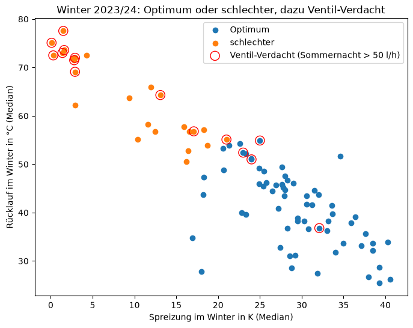

Fast alle Ventil-Verdachtsfälle liegen in „schlechter“. Deshalb kommt das Ventil zuerst, sonst
würde ein kaputtes Ventil als „Regelparameter optimieren“ eingestuft. An den begangenen Stationen
hat „schlechter“ deutlich mehr Ventilbefunde (46 % gegen 12 %, p = 0,02), bei allen anderen
Befunden gibt es keinen Unterschied. Auch Durchfluss und Temperatur, also genau die Eingriffe an den
Regelparametern, hängen nicht mit „schlechter“ zusammen. „Regelparameter optimieren“ heißt also
„hier ist Luft nach oben“, nicht „hier wurde etwas eingestellt“.

### 3. Die Tabelle für alle 96 Zähler

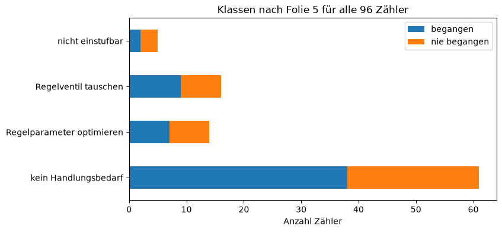

| | Lernpfad | Team (Notebook 31, Stand 19.10.) |
|---|---|---|
| kein Handlungsbedarf | 61 | 62 |
| Regelparameter optimieren | 14 | 8 |
| Regelventil tauschen | 16 | 21 |
| nicht einstufbar | 5 | 5 |

83 % der Zähler bekommen dieselbe Klasse wie im Team. Das Team hat mehr Ventilfälle, weil sein
gelerntes Modell auch bei 10 bis 48 l/h anschlägt: An den begangenen Stationen ist es ein Treffer
mehr, aber auch zwei Fehlalarme mehr (8 von 12 gegen 7 von 9). Unsere zusätzlichen Fälle bei
„Regelparameter optimieren“ liegen an der Grenze zwischen den Gruppen.

Dazu kommt der **Alarm** aus Phase F. Stationen mit Ventil-Verdacht hatten im Jahr vor dem
Stichtag im Schnitt 2,8 Alarmtage, Stationen ohne Handlungsbedarf 0,9. Ein lange offenes Ventil
ist für den Wächter aber normal. Die Klasse beschreibt deshalb den Dauerzustand, der Alarm die
Veränderung, und beide ergänzen sich.

## Vom Nachbau zur Abgabe

Nach dem Lernpfad wusste ich, wie die einzelnen Modelle funktionieren. Offen war, welches Modell des
Projekts für welche Aufgabe das beste ist. Fast jedes Notebook hatte sich nämlich selbst geprüft: mit
eigenem Zeitraum, eigenen Stationen und eigener Alarmmenge. So lassen sich die Zahlen nicht
nebeneinanderlegen.

Den Text von Teil 2 habe ich mit Claude aus den Notebooks 38 bis 41 und meinen Berichten dazu
zusammengefasst.

## H · Alle Modelle auf einem Prüfstand

> **Im Abgabestand:** Notebook 38 · **Seite:** [Modellvergleich](modellvergleich.md)

**Ausgangsfrage:** Welches Modell ist für welche Aufgabe am besten, wenn alle dieselbe Prüfung
bekommen?

**Ein Prüfstand für alle.** Folie 5 verlangt drei Aufgaben: Alarm, Fehler erkennen und Fehler
unterteilen. Für jede Aufgabe habe ich vorher den Prüfstein festgelegt: für den Alarm die
Begehungstermine und eingerechnete Fehler, für die Fehlerart die Befunde der Begehungen. Dann liefen
alle Kandidaten durch dieselbe Prüfung, Regeln eingeschlossen: 15 Wächter, 27 Erkenner und die
Netz-Varianten, auf denselben Stationen und Tagen und mit derselben Alarmmenge. Wer öfter alarmiert,
trifft sonst automatisch öfter.

**Ergebnis.** Kein Modell ist allein das beste.

- Alarm: Nach der Holm-Korrektur über 15 Wächter bleibt nur die Kennlinie mit CUSUM belegt
  (Tagesmonitor, 33 von 43 Begehungen gegen 53 % bei der Kontrolle, Holm 0,017). Das Prognose-LSTM
  mit Schwelle bemerkt 16 von 43 gegen 32 % (p = 0,26).
- Ventil: Vorn liegen die Regression auf Kennzahlen und LSTM-Zahlen (0,89 [0,78; 0,98]) und die
  Sommernacht-Regel (0,88 [0,73; 0,99]). Unterscheiden lassen sie sich nicht.
- Das Netz verbessert keins von beiden.

**Umweg:** Die 0,89 beim Ventil sahen nach einem Erfolg des LSTM aus. Eine Nachprüfung des ganzen
Stands (Audit, 24.10.) hat aber gezeigt, dass der Prüfstand an mehreren Stellen zu gut war:

1. Der LSTM-Encoder hatte die Teststationen beim Lernen gesehen.
2. Die Schwellen waren auf den Testfällen gewählt.
3. Die Auslastung zum Anschlusswert war als Merkmal dabei. Bei 7 von 9 verkleinerten Verträgen ist
   der Anschlusswert aber schon der neue Vertrag. Das Merkmal kennt also die Antwort.
4. Die Skalierung nutzte auch Daten nach dem Lernteil, und an den Grenzen zwischen Lernen und Test
   kamen Rohdatentage doppelt vor.

Die Unterlagen des Audits liegen nicht im Abgabestand. Was sich dadurch geändert hat, steht in
Notebook 39, Abschnitt 16.5.

**Was daraus folgt:** Notebook 38 ist eine erste Landkarte, aber keine Entscheidung. Dafür musste ich
die beiden fertigen Ansätze noch einmal von vorn lernen, mit Regeln, die vor jedem Testergebnis
feststehen. → I

## I · Endmodell nach Aufgabenstellung

> **Im Abgabestand:** Notebook 39 · **Seite:** [Endmodell](endmodell.md)

**Ausgangsfrage:** Im Projekt gibt es zwei fertige Ansätze. Modell Ivelina arbeitet mit Kennlinie,
CUSUM-Konto und Netzvergleich. Modell LSTM besteht aus dem Prognose-LSTM als Wächter und dem
LSTM-Fingerabdruck mit einer Regression für die Fehlerart. Welcher Ansatz übernimmt welche Aufgabe der
Aufgabenstellung?

**Spielregeln vorher.** Beide Modelle lernen aus denselben 93 Reihen aus Notebook 00, auf einer
gemeinsamen Zeitachse:

| Abschnitt | Zeitraum | wofür |
|---|---|---|
| Lernen | bis 31.01.2024 | Kennlinien und Netzgewichte |
| Kalibrieren | 08.02. bis 31.03.2024 | normale Schwankung des LSTM je Station |
| Alarmlast einstellen | April und Mai 2024 | jeder Wächter so viele Alarme wie Modell Ivelina mit h = 5 |
| Test | ab 08.06.2024 | hier liegen alle Begehungen |

Die 7 Tage Abstand sind das Eingabefenster des LSTM. So teilen Lernen und Test keinen Rohdatentag. Für
die Fehlerart gibt es fünf Durchgänge über ganze Stationen. Der LSTM-Encoder wird in jedem Durchgang
ohne die Teststationen neu gelernt, die Grenze ist fest bei p ≥ 0,5, und die Auslastung zum
Anschlusswert bleibt draußen.

**Test A: Merkt ein Wächter echte Veränderungen?** Modell Ivelina meldet nach 18 von 43 Begehungen
„besser“, bei der Kontrolle sind es 24 % (p = 0,006). Das Prognose-LSTM liegt auf Höhe der Kontrolle
(10 von 43 gegen 26 %).

**Umweg:** Auf dem Prüfstand in H kam der Tagesmonitor noch auf 33 von 43. Dort endete seine Referenz
bei vielen Begehungen kurz vorher, und gezählt wurden Alarme in beide Richtungen. Für die
Erfolgskontrolle ist das gewollt, für einen fairen Vergleich nicht. Mit gemeinsamer Zeitachse und nur
der Richtung „besser“ bleiben 18 von 43. Die Fassung „wie gebaut“ läuft nur noch als Gegenprobe mit.

**Test B: Findet ein Wächter eingebaute Fehler?** Dafür schreibe ich Fehler mit bekanntem Beginn in
echte Stundenwerte, auch in die Energie- und Volumenzähler, aus denen Modell Ivelina rechnet.

- Im Winter findet Modell Ivelina bei höchstens 10 % Fehlalarmen am meisten. Einen um 5 K höheren
  Rücklauf findet es zu 47 %, das Prognose-LSTM zu 33 %.
- Im Sommer rechnet nur das Prognose-LSTM. Mit CUSUM findet es 78 % der Dauerdurchflüsse von
  150 l/h bei höchstens 5 % Fehlalarmen, das Wochenmittel 45 %.
- Zusammen ergänzen sich beide im Winter bei plötzlichen Fehlern: Über alle eingebauten Fehler
  steigt die Trefferquote von 51 % auf 60 %, ohne mehr Fehlalarme. An echten Begehungen meldet das
  Prognose-LSTM aber nicht öfter als an Vergleichsstationen.

**Ist Modell Ivelina nur besser, weil es für den Winter gebaut ist?** Nein. Der Vorteil kommt von der
festen Referenz, nicht vom Modelltyp. Ein LSTM, das wie Ivelinas Wächter mit fester Referenz arbeitet,
liegt praktisch gleichauf (Vorsprung vor der Kontrolle 18 gegen 17 Prozentpunkte). Bei Gleichstand
bleibt die einfachere, erklärbare Kennlinie. Das passt zu Phase F: Entscheidend ist die Alarmregel,
nicht das Modell.

**Test C: Welche Station hat welchen Fehler?**

- Ventil: Die Sommernacht-Regel kommt auf 0,85 [0,68; 0,98]. Die Regression nur auf den 16
  LSTM-Zahlen kommt auf 0,83 [0,64; 0,98] und findet an der festen Grenze 8 von 11 Ventilen bei
  4 Fehlalarmen. Der Unterschied ist nicht gesichert.
- Dämmung: Dieselbe Regression kommt auf 0,79 [0,65; 0,90], die beste Einzelregel auf 0,61.
- Überdimensionierung: Nur die Regel „Spitzenlast zum alten Vertrag“ trägt (0,76 [0,58; 0,93],
  5 von 9 bei 1 Fehlalarm). Gelernte Modelle kommen höchstens auf 0,53, weil ihnen die Auslastung
  zum alten Vertrag fehlt.
- Durchfluss, Sollwert und Filter erkennt kein Verfahren (AUC 0,26 bis 0,57).
- XGBoost ist nicht verlässlich. Bei der Dämmung schwankt es je nach Startwert zwischen 0,74 und
  0,87.

**Umweg:** Zuerst hatte ich für die Fehlerart das Modell genommen, das im Test am besten abschnitt:
die Regression auf Kennzahlen und LSTM-Zahlen, beim Ventil mit 0,88. Das ist aber eine Auswahl nach
den Antworten, also genau das, was ich im Lernpfad vermeiden wollte. Deshalb habe ich die Wahl in den
Lernteil verlegt (Notebook 39, Abschnitt 19). In jedem Durchgang entscheidet nur die innere Prüfung,
welcher Kandidat gewinnt, und erst danach wird getestet. So kommt die Fehlerart auf **Ventil 0,84**
und **Dämmung 0,78**. Die 0,88 war um etwa 0,05 zu optimistisch und wird nicht behauptet.

In der inneren Prüfung lagen zwei Kandidaten gleichauf: die Regression nur auf den 16 LSTM-Zahlen und
die auf Kennzahlen und LSTM-Zahlen. Genommen habe ich die Regression nur auf den LSTM-Zahlen, aus zwei
Gründen. Sie ist einfacher. Und sie vermeidet ein Leck über das Vorwissen: Die 12 Kennzahlen sind zwar
physikalisch begründet, festgelegt haben wir sie aber, als wir die Begehungsprotokolle und Fälle wie
68956351 schon kannten. Wissen über die Befunde steckt also schon in den Merkmalen, auch wenn keine
Kennzahl an Testzahlen eingestellt wurde. Die 16 LSTM-Zahlen hat das Netz dagegen ohne Befund-Labels
gelernt. Das Modell läuft im Dashboard (`fv.ENDMODELL = "LR nur LSTM-Embedding"`), seine eigenen Werte
aus Test C stehen oben. Die Kennzahlen bleiben trotzdem wichtig: Mit ihnen wird ein Verdacht im
Hausfenster begründet.

**Test E: Lohnt sich die Reihenfolge?** Angenommen, das Team kann nur 10 Stationen begehen. Unter
den ersten 10 nach Ventil-Score hatten 7 einen Ventilbefund. Nach Ivelinas Priorität sind es 5,
Zufall wären etwa 2.

**Folie 5.** Die Klasse „Regelventil tauschen“ trifft Modell LSTM bei 8 von 11 Ventilfällen, Modell
Ivelina bei 4 von 11. „Regelparameter optimieren“ trifft keins der beiden: 24 bzw. 25 von 31 Fällen
landen in „kein Handlungsbedarf“. Das Dashboard empfiehlt diese Klasse deshalb nicht.

**Entscheidung.** Keins der beiden Modelle ist allein besser:

| Aufgabe | Modell | Urteil |
|---|---|---|
| Veränderung in der Heizperiode, Erfolgskontrolle | Modell Ivelina: Kennlinie und CUSUM | Pilot mit Einschränkungen |
| Veränderung an warmen Tagen, plötzlicher Dauerdurchfluss | Prognose-LSTM mit CUSUM | Pilot mit Einschränkungen |
| Regelventil tauschen | Regression nur auf den 16 LSTM-Zahlen, Ivelinas Fehlerbild „ventil“ als Bestätigung | Pilot |
| Hinweis Dämmung | dasselbe Modell | weitere Validierung nötig |
| Hinweis Kapazitätsanpassung | Regel „Spitzenlast zum alten Vertrag“ | Pilot mit Einschränkungen |
| Stationsleistung, Netzeffizienz | Modell Ivelina: Netzvergleich und Potenzial | Pilot, nur beschreibend |
| Regelungsoptimierung, Durchfluss, Sollwert, Filter | keins | nicht erkennbar |

Die Belege für jede Zeile stehen auf der Seite [Endmodell](endmodell.md).

**Was daraus folgt:** Beim Ventil reicht fast eine Regel. Bei der Dämmung findet nur die gelernte
Regression ein Muster, und das kann ich nicht erklären. Bei Filter, Durchfluss und Sollwert findet gar
nichts etwas. Liegt das an den Daten, an unseren Kennzahlen oder an den Labels? → J

## J · Warum manche Fehler nicht erkennbar sind

> **Im Abgabestand:** Notebook 41 · **Seite:** [Negativbefunde](negativbefunde.md)

**Ausgangsfrage:** Normalerweise steckt die meiste Arbeit im Feature Engineering. Bei uns war das nur
beim Ventil gezielt der Fall. Finden bessere Kennzahlen die übrigen Fehler, oder steckt die
Information gar nicht in den Zählerwerten?

**Erst der Plan.** Mit 53 begangenen Stationen findet man fast immer irgendeine Kennzahl, die zufällig
passt, wenn man nur lange genug sucht. Deshalb habe ich für jeden Befund vorher festgelegt, welche
Größe ich anschaue und in welche Richtung sie gehen soll. Alle Tests sind nach Holm korrigiert. Geht
eine Größe in die andere Richtung, zählt das als „Vermutung falsch“ und wird nicht umgedreht.

**Ändert die Maßnahme überhaupt etwas?** Wenn eine Reparatur wirkt, muss sich danach die Größe ändern,
die sie ändern soll. Klar ist das nur beim Ventiltausch: Danach sinkt der Durchfluss in Sommernächten
(AUC 0,81, nach Holm gesichert, bei 6 von 8 Stationen). Nach dem Dämmen sinkt der wetterbereinigte
Verbrauch nicht messbar. Filter und Durchfluss hinterlassen keine Spur, der Sollwert höchstens eine
Andeutung. Das Placebo, der Vertrag, findet richtigerweise nichts. Dazu kommt: Sollwert und Filter
wurden bei 62 % und 47 % der Begehungen gemacht. Das ist eher Routine als ein gefundener Fehler, denn
„gemacht“ heißt nicht „war kaputt“.

**Zeitstruktur.** Eine gleitende Korrelation zeigt Einzelfälle sehr deutlich: An Station 68956351
dreht sich die Kopplung durch den Ventiltausch von −0,9 auf +0,75. Über alle Ventile trennt sie aber
nicht (0,50).

**Neue Kennzahlen.** Für jeden Befund habe ich eine neue Größe aus der Physik gebaut. Die Abkühlrate
im Stillstand erkennt die Dämmung mit 0,69 in der vorher festgelegten Richtung, nach Holm nicht
gesichert. Die Filter-Sättigung geht mit 0,62 zum ersten Mal in die vermutete Richtung, auch nicht
gesichert. Sonst findet keine neue Kennzahl etwas.

**Umweg:** Die Nachprüfung der Abkühlrate sah zuerst sehr deutlich aus (p = 0,002): Nach dem Dämmen
kühlt stehendes Wasser bei 9 von 10 Stationen langsamer ab. Dann kamen die Rückkehr zur Mitte und
eine unmögliche Messung dazu. Übrig bleibt ein Hinweis, kein Beweis.

**Umweg:** In der Regression sprang die Dämmung mit den neuen Kennzahlen von 0,74 auf 0,89. Getragen
hat das aber eine Kennzahl, die für den Vertrag gedacht war: die Volllaststunden. Erst das Zerlegen
hat gezeigt, dass der Sprung an der Bezugsgröße hängt. Je nach Bezugsgröße bleiben nur +0,06. Das ist
kein Ergebnis.

**Woran erkennt die KI die Dämmung?** SHAP zerlegt jeden Score in die Beiträge der einzelnen
Kennzahlen. Die Regression auf Kennzahlen und LSTM-Zahlen erkennt die Dämmung an einem stabilen
Muster: kälterer Rücklauf, kleine Spreizung in Sommernächten, große Streubreite. Das Muster ist in
allen fünf Durchgängen gleich und bleibt auch ohne die Ventilstationen (0,80). Im Dashboard-Paket vom
25.10. trugen die 16 LSTM-Zahlen etwa die Hälfte des Scores. Was sie bedeuten, kann SHAP nicht sagen:
„LSTM-Zahl 5 ist hoch“ hilft keinem Techniker vor Ort. Das heutige Dashboard-Modell rechnet nur mit
den LSTM-Zahlen. Begründet wird ein Verdacht im Hausfenster deshalb mit Kennzahlen, beim Ventil mit
der Sommernacht-Regel.

**Umweg:** Die Vermutung war, dass ältere Häuser eher gedämmt werden. Wo das Baujahr bekannt ist, ist
es eher umgekehrt: Gedämmt wurde bei neueren Häusern. Das sind aber nur 14 Stationen, gesichert ist
es nicht. Einen äußeren Faktor, der das Muster erklärt, finde ich nicht. Innerhalb von Stationstyp,
Anlagenkennziffer, Größe, Zusatzheizung und Zeitraum der Begehung trennt die KI weiter mit 0,75 bis
0,86.

**Was daraus folgt:** Besseres Feature Engineering hilft dort, wo die Physik eine Spur im Zähler
hinterlässt. Bei Filter, Durchfluss und Sollwert hinterlassen schon die Maßnahmen selbst keine Spur.
Dort helfen bessere Labels mehr als bessere Kennzahlen: Bei der Begehung sollte notiert werden, ob
etwas kaputt war, nicht nur, was gemacht wurde. Für das Dashboard ändert sich nichts, die Dämmung
bleibt ein Hinweis. → K

## K · Vom Modell ins Dashboard

> **Im Abgabestand:** Notebook 40 · **Seite:** [Dashboard](dashboard.md)

**Ausgangsfrage:** Wie kommt jedes Modell genau an die Stelle, für die es in Notebook 39 geprüft
wurde, ohne dass das Dashboard selbst etwas rechnet?

**Gelernt im Notebook, gespeichert als Paket, angewendet im Modul, angezeigt im Dashboard.** Notebook
39 speichert drei Pakete in `models/`: `normalmodell` (Kennlinie und CUSUM), `prognose_lstm`
(Wächter) und `fehlerklassen` (Fehlerart und Folie 5). Ein Paket enthält nicht nur Gewichte, sondern
alles, was zum Anwenden gehört: Merkmalsliste, Skalierung, Schwellen, Zeiträume und Version.
`python -m src.dashboard_daten` wendet die Pakete auf die aktuellen Daten an, und Notebook 40 baut
daraus eine einzelne HTML-Datei. Das Dashboard lernt nichts neu.

**Was es zeigt.** Es hat drei Reiter: eine Karte auf dem Rohrbaum, eine Handlungsliste nach
Dringlichkeit und „So funktioniert's“. Jede Anzeige kommt von dem Modell, das in Notebook 39 dafür am
besten abgeschnitten hat. Oben steht der Verdacht auf Ventil, sortiert nach Ventil-Score. Die Dämmung
erscheint nur als Hinweis mit niedriger Dringlichkeit, Regelungsoptimierung wird nicht empfohlen. Im
Dashboard heißen die beiden Ansätze „Modell Monitoring“ und „LSTM-Modell“.

**Datenschutz.** Bis zum Dashboard wird nur mit Zählernummern gerechnet. Die Adressen kommen erst in
Notebook 40 dazu. Die fertige HTML-Datei liegt deshalb nicht im Repository.

**Was daraus folgt:** Das Dashboard ist ein Pilot. Es ersetzt keine Prüfung vor Ort, gibt aber eine
Reihenfolge vor, in der sich Begehungen lohnen.

## Abschluss · Lernpfad und Abgabe im Vergleich

Links steht, was ich im Lernpfad selbst nachgebaut habe, in der Mitte der Abgabestand mit dem
Notebook in Klammern. Aus der lokalen Vorarbeit nenne ich nur Werte, die Notebook 31 zitiert. Sie
beruhen auf einer anderen Aufbereitung und dürfen abweichen.

| Frage | Lernpfad | Abgabe | Vorarbeit |
|---|---|---|---|
| Ventil (AUC) | 0,88 Regel, 0,83 Embedding | 0,85 Sommernacht-Regel, 0,84 Regression nur auf LSTM-Zahlen mit Modellwahl im Lernteil (39) | 0,92 LR |
| Dämmung (AUC) | 0,64 Regel, 0,71 Mittelwerte Winter | 0,78 Regression nur auf LSTM-Zahlen, beste Einzelregel 0,61 (39) | |
| Überdimensionierung (AUC) | 0,78 Regel | 0,76 Regel „Spitzenlast zum alten Vertrag“, gelernte Modelle höchstens 0,53 (39) | 0,87 XGBoost |
| Filter, Durchfluss, Temperatur | nicht erkennbar | nicht erkennbar, AUC 0,26 bis 0,57 (39), keine messbare Wirkung der Maßnahmen (41) | |
| Wiedererkennung über zwei Winter | 83 % (19 von 23) | 83 % von 41 Stationen, nie gesehene 78 % (29) | |
| Wächter: Begehung in 14 Tagen bemerkt | 39 % gegen 20 % Kontrolle | Normalverhaltensmodell 36 % gegen 22 %, Prognose-LSTM 18 % gegen 17 % (32) | |
| Wächter: Ventiltausch 68956351 | am selben Tag | Normalverhaltensmodell nach 2, Prognose-LSTM nach 7 Tagen (32) | |
| Folie 5: kein Bedarf / optimieren / Ventil / nicht einstufbar | 61 / 14 / 16 / 5 von 96 | 61 / 5 / 24 / 1 von 91 (31) | |

**Wo und warum es abweicht:**

- **Ventil:** Alle Verfahren liegen zwischen 0,83 und 0,92, und der Bootstrap aus Phase B reicht
  allein für die Regel von 0,72 bis 0,99. Auch im strengen Endmodell sind Regel und Regression
  gleichauf. Ein gelerntes Modell bringt beim Ventil nichts Belegtes. Das hatte der Lernpfad schon
  gezeigt.
- **Dämmung:** Im Lernpfad kam ich mit einfachen Mittelwerten auf 0,71. Die Regression auf den
  LSTM-Zahlen kommt im Endmodell auf 0,78 und liegt damit vor der besten Einzelregel (0,61). Der
  Vorsprung (+0,17 [−0,04; +0,38]) ist knapp nicht gesichert, und Notebook 41 findet nach dem Dämmen
  keine messbare Spur. Deshalb bleibt die Dämmung ein Hinweis.
- **Überdimensionierung:** Hier entscheidet die Bezugsgröße, nicht das Modell. Mit dem Anschlusswert
  aus `Nodes_Edges.ods`, der bei 7 von 9 Fällen schon der neue Vertrag war, kam der erste Team-Lauf
  auf 0,66. Mit dem Vertrag vor der Begehung kommen Notebook 31 und der Lernpfad auf 0,78, Notebook
  39 auf seiner Zeitachse auf 0,76. Die 0,87 der Vorarbeit liegen bei nur 9 Fällen innerhalb der
  Unsicherheit (laut Notebook 31: 0,71 bis 0,99).
- **Wächter:** Mein einfacher Wächter sieht fast nur den Tag des Eingriffs, ein CUSUM auch die kleine
  Verschiebung danach. Notebook 39 zeigt dazu: Der Vorteil von Modell Ivelina kommt von der festen
  Referenz, nicht vom Modelltyp. Entscheidend ist die Alarmregel, nicht das Modell.
- **Folie 5:** Die Abgabe hat mehr Ventilfälle (24 statt 16), weil das gelernte Ventil-Modell auch bei
  kleinem Nachtdurchfluss anschlägt. „Regelparameter optimieren“ trifft in Notebook 39 keinen Befund,
  das Dashboard empfiehlt die Klasse deshalb nicht.

**Was ich daraus mitnehme:**

- Bei gut 50 begangenen Stationen reichen einfache Verfahren. Der Gewinn steckt in der richtigen
  Kennzahl und einer ehrlichen Prüfung, nicht im größeren Modell.
- Das LSTM lohnt sich, um Stationen zu beschreiben und wiederzuerkennen. Bei der Dämmung findet die
  Regression auf seinen Zahlen ein Muster, das keine Regel findet, auch wenn es noch nicht gesichert
  und nicht erklärt ist.
- Ein fairer Vergleich braucht gleiche Daten, eine gemeinsame Zeitachse und dieselbe Alarmmenge.
  Ohne das sahen die ersten Zahlen besser aus, als sie waren.
- Erst die Regel festlegen, dann rechnen. Das gilt auch für die Modellwahl: Als ich das Modell nach dem
  Testergebnis ausgewählt habe, war die Zahl prompt zu gut (0,88 statt 0,84).
- Was nicht in den Daten steckt, findet kein Modell. Filter, Durchfluss und Sollwert hinterlassen
  nicht einmal nach der Maßnahme eine Spur. Dort helfen bessere Begehungsprotokolle mehr als bessere
  Modelle.
