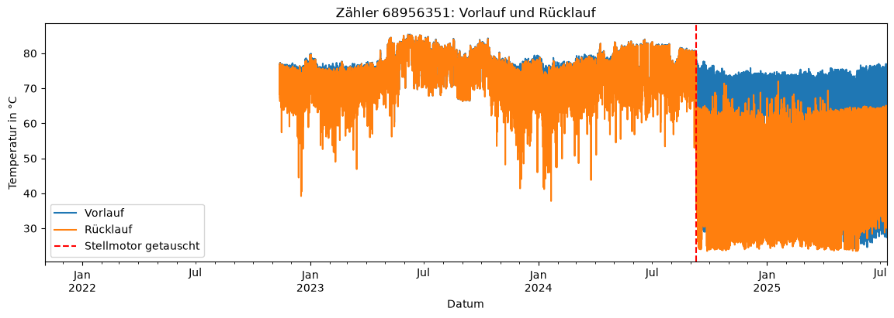
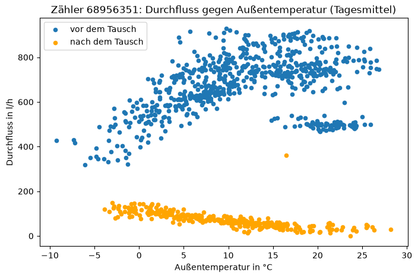
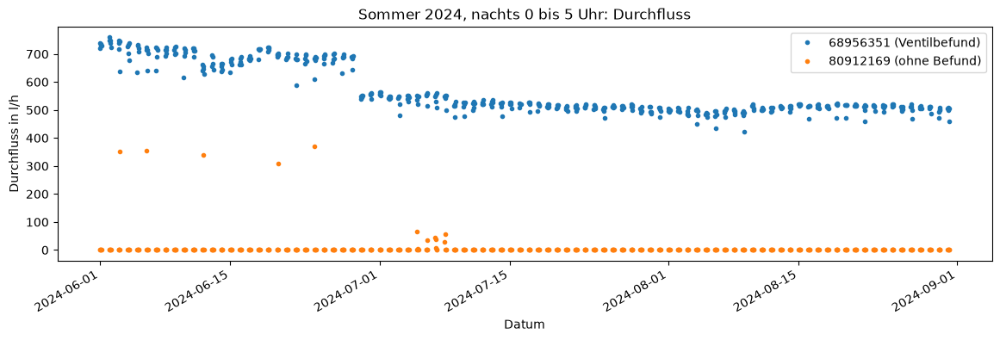
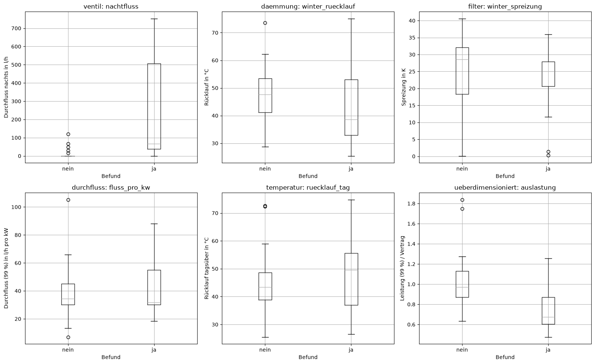

# Daten, Labels und Messlatte

Bevor ein Modell lernen kann, muss feststehen, was es erkennen soll, woran man einen Fehler in den
Zählerdaten überhaupt sieht und wie gut die einfachste Lösung ohne Lernen schon ist. Diese Seite
beschreibt die Datenbasis der lernenden Modelle und die Messlatte, an der sie sich messen lassen
müssen. Gerechnet wird in Notebook 25.

## Zwei verschiedene Fragen

Die Aufgabenstellung enthält zwei Fragen, die sich in allem unterscheiden, was ein Modell braucht:

| | Diagnose | Überwachung |
|---|---|---|
| Frage | Hatte eine Station einen Fehler, zum Beispiel ein Ventil, das nicht schließt? | Verhält sich eine Station heute anders als sonst? |
| ein Beispiel | eine Station | ein Tag einer Station |
| Label | Befund aus dem Begehungsprotokoll | keins nötig, gelernt wird das Normalverhalten |
| Aufteilung für die Prüfung | nach Stationen | nach der Zeit |

Für die Diagnose gibt es so viele Beispiele wie begangene Stationen, also gut 50. Daran ändern auch
die rund 68.000 vollständigen Messtage nichts, denn das Label gehört zur Station, nicht zum Tag. Die
Überwachung braucht keine Labels zum Lernen, nur zum Prüfen. Diese Unterscheidung bestimmt den Rest:
Für die Diagnose entsteht ein Fingerabdruck je Station (siehe [LSTM-Fingerabdruck](lstm.md)), für die
Überwachung ein Prognosemodell je Tag (siehe [Prognose-LSTM](prognose.md)).

## Datenbasis

- **Stundenwerte:** 93 Zähler aus Notebook 00 mit Vorlauf, Rücklauf, Spreizung, Durchfluss und
  Leistung, zusammen 2,1 Millionen Stundenzeilen vom November 2021 bis Juli 2026. 80 % der Stunden sind
  gemessen (siehe [Zählerdaten](../datengrundlage/zaehlerdaten.md)).
- **Außentemperatur:** stündlich von der DWD-Station Kitzingen. Ohne Wetter hielte ein Modell jeden
  kalten Tag für auffällig.
- **Nur vollständige Tage:** Ein Tag zählt nur, wenn alle 24 Stunden aller Größen gemessen sind. Das
  sind knapp 68.000 von knapp 89.000 Zähler-Tagen. Bis Ende Oktober 2022 lieferten viele Zähler nur einen Wert je
  Tag, immer um 23 Uhr. Diese Lücken zu füllen, hieße 23 von 24 Stunden zu erfinden. Deshalb werden
  Lücken nicht gefüllt.
- **Zeiträume:** Gelernt wird aus dem Winter 2023/24 (Oktober bis März) und dem Sommer 2024 (Juni bis
  August). Beide liegen vor den Begehungen. Im Median hat ein Zähler 180 von 182 vollständigen
  Wintertagen und 90 von 92 Sommertagen.

## Labels aus den Begehungen

Was ein Modell erkennen soll, steht im Begehungsprotokoll (siehe [Begehungen](../datengrundlage/begehungen.md)).
Labels gibt es für die 56 Zähler mit datierter Begehung. Je Zähler entstehen sechs Labels aus zwei Quellen, den angekreuzten Kästchen und dem
Freitext. Viele Befunde stehen nur im Freitext, etwa ein klemmendes Regelventil. Die Kodierung des
Freitexts stammt aus Notebook 14.

| Label | ja, wenn … | Fälle | Anteil |
|---|---|---|---|
| Ventil | Stellventil oder Stellmotor getauscht oder Ventilbefund im Freitext | 11 von 56 | 20 % |
| Dämmung | Leitungen gedämmt oder Dämmungsbefund im Freitext | 23 von 56 | 41 % |
| Filter | Filter gereinigt | 26 von 56 | 46 % |
| Durchfluss | Durchfluss neu eingestellt | 20 von 56 | 36 % |
| Temperatur | Rücklauf-Sollwert tagsüber gesenkt | 36 von 56 | 64 % |
| Überdimensioniert | Vertragsleistung verkleinert | 9 von 37 | 24 % |

Drei Eigenschaften dieser Labels prägen alle späteren Ergebnisse:

- **Wenige Fälle.** Beim Ventil sind es 11, bei der Überdimensionierung 9. Jede Kennzahl auf diesen
  Labels braucht deshalb ein Unsicherheitsintervall.
- **Leere Kästchen.** Ein ausdrückliches „nein“ steht beim Filter nur 4-mal, beim Durchfluss 6-mal, bei
  der Dämmung 8-mal. Ein leeres Kästchen wird als „nein“ gelesen. Das ist eine Annahme.
- **Routine statt Befund.** Der Sollwert wurde bei fast zwei Dritteln gesenkt. Das zeigt eher, was der
  Monteur üblicherweise tut, als einen Fehler der Station.

**Nur Daten vor der Begehung.** Ein Modell, das Fehler erkennen soll, darf nur sehen, was vor der
Reparatur gemessen wurde. Sonst sieht es die reparierte Station, und die Diagnose ist geschenkt
(Leakage). Gemeinsamer Stichtag ist der 1. September 2024. Nur zwei Zähler wurden früher begangen, bei
ihnen endet der Blick am Tag ihrer Begehung.

## Wie ein Fehler in den Daten aussieht

Bevor Kennzahlen gebaut werden, lohnt der Blick auf einzelne Stationen mit bekanntem Befund.

**Ventil.** Bei Zähler 68956351 wurde am 9. September 2024 der Stellmotor getauscht. Vorher war der
Rücklauf fast so heiß wie der Vorlauf, das Wasser lief ungenutzt durch die Station. Mit dem Tausch
fällt der Rücklauf von rund 75 °C auf unter 40 °C.

Am deutlichsten zeigt es die Kennlinie, also der Durchfluss gegen die Außentemperatur. Nach dem Tausch
fließt bei Kälte mehr Wasser, so wie es sein soll. Vorher war es umgekehrt: am meisten Wasser an warmen
Tagen. Bei Tagen um 0 °C flossen vorher rund 530 l/h, nachher rund 110 l/h. Am Wetter lag der
Unterschied also nicht.

**Die Sommernacht als Merkmal.** Ein Ventil, das nicht schließt, sieht man am besten im Sommer nachts.
Dann wird nicht geheizt, eigentlich sollte fast nichts fließen. Die Ventilstation hat dort im Median
520 l/h, eine Station ohne Befund 0 l/h. Über alle begangenen Stationen haben 82 % der Ventilfälle in
Sommernächten Durchfluss, aber nur 12 % der übrigen. Bei allen anderen Befundarten unterscheiden sich
die Gruppen hier um höchstens 10 Prozentpunkte. Die Sommernacht ist also ein Ventil-Merkmal.

**Die übrigen Befundarten.** Je Befundart wurde eine Station angesehen, bei der möglichst nur dieser
eine Befund notiert ist:

| Befund | sichtbar in den Stundenwerten? | wo man suchen muss |
|---|---|---|
| Ventil | ja, deutlich | Durchfluss in Sommernächten, Kennlinie gegen Außentemperatur |
| Überdimensioniert | nur im Verhältnis | Spitzenleistung gegen den Vertrag vor der Begehung: die Beispielstation brauchte höchstens zwei Drittel davon |
| Temperatur (Sollwert) | kaum | Rücklauf tagsüber, nach der Begehung meist 1 bis 3 K niedriger |
| Durchfluss | an einer Station | weniger Durchfluss bei 5 bis 12 °C nach dem Einstellen |
| Dämmung, Filter | nicht sichtbar | keine Änderung an Verlauf oder Kennlinie |

Dazu kommt: Viele Befunde treten gemeinsam auf. 6 der 11 Ventilstationen haben auch einen
Dämmungsbefund, 8 der 9 überdimensionierten Stationen auch einen Durchfluss-Befund. Eine Kennzahl, die
eigentlich zum Ventil gehört, kann deshalb auch bei der Dämmung auffallen. Jede Befundart wird einzeln
gegen „kein Befund dieser Art“ geprüft.

## Kennzahlen für die Modelle

Aus diesen Fehlerbildern entstehen Kennzahlen je Zähler, nur aus Daten vor der Begehung. Jede steht für
ein physikalisches Fehlerbild, etwa „Wasser läuft, obwohl niemand heizt“ oder „das Wasser kommt heiß
zurück“. Die Modelle zur Fehlerart nutzen zwölf davon:

| Kennzahl | Zeitraum | Fehlerbild |
|---|---|---|
| Nachtdurchfluss (Median, 0 bis 5 Uhr) | Sommer 2024 | Ventil schließt nicht |
| Anteil der Nachtstunden mit Durchfluss | Sommer 2024 | dasselbe, unempfindlich gegen Spitzen |
| Spreizung nachts, wenn Wasser fließt | Sommer 2024 | Wasser läuft ungenutzt durch |
| Rücklauf bei 0 °C (Gerade gegen Außentemperatur) | Winter 2023/24 | schlechte Auskühlung, wetterbereinigt |
| Spreizung unter Last | Winter 2023/24 | schlechter Wärmeübergang |
| 90-%-Quantil des Rücklaufs | Winter 2023/24 | zeitweise sehr heißer Rücklauf |
| Streuung des Durchflusses unter Last | Winter 2023/24 | unruhige Regelung |
| Durchfluss nachts gegen tagsüber | Winter 2023/24 | fehlende Nachtabsenkung |
| Anteil der Sommerlast am Jahr | 09/2023 bis 08/2024 | hohe Grundlast |
| Anteil Volumenstrom, Streubreite der Betriebspunkte, lastgewichteter Rücklauf | Winter 2023/24 | wie die Station ihre Leistung regelt |

**Ein Datenfehler beim Anschlusswert.** Für die Auslastung gibt es zwei Bezugsgrößen, den Anschlusswert
aus dem Netzplan und die Vertragsleistung vor der Begehung aus dem Protokoll. Bei 7 der 9 verkleinerten
Verträge steht im Netzplan schon der neue, kleinere Wert. Wer die Auslastung darauf bezieht, sieht bei
genau diesen Stationen eine normale Auslastung, und das Signal ist weg. Die Auslastung zum Anschlusswert
bleibt deshalb aus allen gelernten Modellen draußen. Für die Überdimensionierung zählt nur die
Auslastung zum alten Vertrag.

## Messlatte: eine Kennzahl je Fehlerart

Die einfachste Lösung kommt ohne Lernen aus: je Fehlerart eine Kennzahl aus der Physik, deren Richtung
vor dem Rechnen festgelegt wird. Jedes spätere Modell muss diese Messlatte schlagen, sonst lohnt es sich
nicht.

| Befund | Kennzahl und erwartete Richtung | Fälle | AUC | 95-%-Intervall | Zufall mind. so gut | Urteil |
|---|---|---|---|---|---|---|
| Ventil | Nachtdurchfluss im Sommer, höher | 11 von 53 | 0,88 | 0,73 bis 0,99 | 0 % | erkennbar |
| Überdimensioniert | Auslastung zum alten Vertrag, niedriger | 9 von 35 | 0,78 | 0,53 bis 0,98 | 0,8 % | erkennbar, wenige Fälle |
| Dämmung | Rücklauf im Winter, niedriger | 22 von 54 | 0,64 | 0,45 bis 0,81 | 4,7 % | schwach |
| Temperatur | Rücklauf tagsüber, höher | 34 von 54 | 0,60 | 0,45 bis 0,75 | 11 % | nein |
| Durchfluss | Durchfluss je kW, höher | 19 von 54 | 0,50 | 0,33 bis 0,66 | 49 % | nein |
| Filter | Spreizung im Winter, höher | 25 von 54 | 0,36 | 0,20 bis 0,51 | 97 % | nein, Vermutung falsch |

Beim Ventil ist die Messlatte der Median des Durchflusses in Sommernächten (0 bis 5 Uhr). Ab Notebook 34 läuft als
einfachster Gegner die Sommernacht-Regel mit. Sie misst dasselbe Fehlerbild mit einer anderen Kennzahl, dem Anteil der
Nachtstunden mit mindestens 5 l/h, und kommt auf 0,85.

**Warum die Richtung vorher feststeht.** Beim Filter geht die Kennzahl in die Gegenrichtung (AUC 0,36).
Sie wird trotzdem nicht umgedreht. Hätte man je Befund mehrere Kennzahlen probiert und die beste
genommen oder die Richtung nach dem Ergebnis gewählt, wäre die Zahl zu gut, weil die Auswahl die
Antworten schon kennt. Soll doch ausgewählt werden, muss das in jedem Prüfdurchgang nur auf den
Lernstationen passieren. So machen es die späteren Modelle (siehe [Prüfdesign und Statistik](../vergleich/pruefung.md)).

**Warum AUC und nicht Accuracy oder F1.** Beim Ventil haben 20 % der Stationen einen Befund. Wer immer
„kein Befund“ sagt, liegt zu 80 % richtig und findet nichts. Accuracy und F1 hängen zudem an einer
gewählten Grenze und an der Basisrate. Die AUC bewertet eine Kennzahl über alle Grenzen zugleich: Sie
ist die Wahrscheinlichkeit, dass von zwei Stationen, eine mit und eine ohne Befund, die mit Befund den
auffälligeren Wert hat. 0,5 ist Raten, 1 ist perfekt. Damit sind Fehlerarten mit 9 und mit 36 Fällen
vergleichbar. Für den Betrieb zählt zusätzlich die Precision an einer festen Grenze, also wie viele
Verdachtsfälle echt waren.

**Wie geprüft wurde.**

- **Bootstrap über Stationen:** 1000-mal die Stationen mit Zurücklegen ziehen und die AUC neu rechnen.
  Die mittleren 95 % sind das Intervall. Gezogen werden ganze Stationen, weil die Station die
  unabhängige Einheit ist. Ihre Tage hängen eng zusammen, und das Label gilt für die Station.
- **Zufallstest:** Die Labels werden durchgemischt, sodass kein Befund mehr zu seiner Station passt.
  Gezählt wird, wie oft der Zufall mindestens die echte AUC erreicht.
- **Nie auf den Lernstationen prüfen:** Eine logistische Regression auf reinen Zufallszahlen erreicht
  auf ihren eigenen Lernstationen eine AUC von 0,75, mehr als der echte Winter-Rücklauf. Mit
  Leave-one-out, wo jede Station von einem Modell ohne sie vorhergesagt wird, sind es 0,49, also Raten.
  Alle gelernten Modelle werden deshalb nur auf Stationen bewertet, die sie nicht gesehen haben.
- **Straßen auslassen:** Stationen derselben Straße hängen am selben Strang und wurden meist vom
  selben Techniker begangen. Lässt man beim Lernen ganze Straßen aus, ändert sich die AUC der
  logistischen Regression beim Ventil (0,77 zu 0,80) und bei der Dämmung (0,64 zu 0,66) kaum. Die
  Straße erklärt die Ergebnisse also nicht.

**Kombinieren hilft hier nicht.** Eine logistische Regression auf fünf einfachen Kennzahlen ist nirgends
besser als die passende einzelne Kennzahl: Ventil 0,77 statt 0,88, Dämmung 0,64. Bei gut 50 Stationen
muss ein Modell mit vielen Gewichten zu viel aus zu wenigen Fällen lernen.

## Was daraus folgt

- Beim Ventil ist die Messlatte hoch: Eine einzige Kennzahl ohne Lernen erreicht 0,88. Ein gelerntes
  Modell muss das erst einmal halten.
- Bei der Dämmung ist eine einzelne Kennzahl schwach (0,64). Hier könnte ein Modell helfen, das mehr
  vom Verhalten einer Station erfasst als eine Handvoll Kennzahlen. Das ist die Idee des
  [LSTM-Fingerabdrucks](lstm.md).
- Temperatur, Durchfluss und Filter erreicht schon die einfache Kennzahl nicht. Ob überhaupt eine Spur
  in den Daten steckt, prüft Notebook 36 (siehe [Verworfene Ansätze](../grenzen/verworfene_ansaetze.md#fehlerarten-ohne-messspur)).
