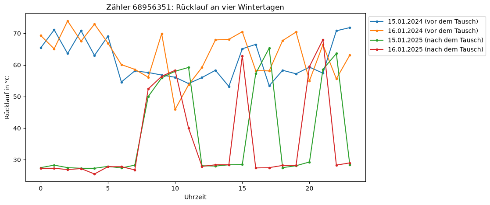
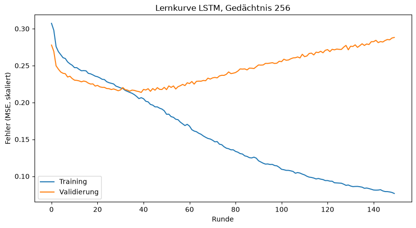
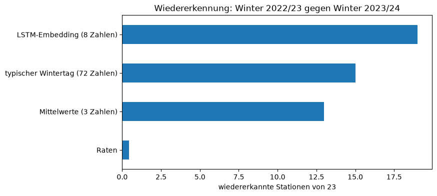
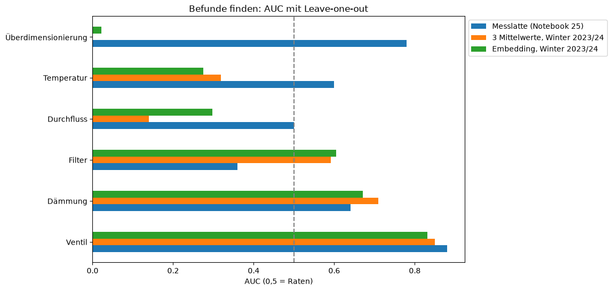

# LSTM-Fingerabdruck

Die Kennzahlen aus [Daten, Labels und Messlatte](daten.md) sind von Hand gebaut. Beim Ventil reicht
das, bei der Dämmung trennt die beste einzelne Kennzahl nur schwach (AUC 0,64). Ein LSTM soll aus den
Stundenwerten selbst lernen, was eine Station ausmacht, und das ganz ohne Labels. Das Ergebnis sind 16
Zahlen je Station, ihr Fingerabdruck. Darauf lernt eine logistische Regression die Befunde. Gerechnet
wird in Notebook 29, zuerst in Vorversuchen (Abschnitt 2 bis 5), dann mit dem endgültigen Netz
(Abschnitt 6 bis 11).

## Warum ein Netz, das vorhersagt

Für die Fehlerart gibt es gut 50 begangene Stationen, aber über 24.000 vollständige Tage. Ein Modell,
das direkt auf die Befunde lernt, hätte viel zu wenige Beispiele: Selbst das kleine Netz der Vorversuche
hat 283.856 Gewichte, und es gibt 11 Ventilfälle. Es würde jede Station auswendig lernen.

Deshalb gibt es eine Arbeitsteilung. Das LSTM lernt ohne Befunde aus allen Tagen eine Aufgabe, für die
es keine Labels braucht: aus einem Tag den nächsten vorherzusagen. Um das zu können, muss es erfassen,
wie sich eine Station verhält. Erst danach sieht eine logistische Regression mit wenigen Gewichten die
Befunde.

## Vom Tag zur Sequenz

Ein Median macht einen ganzen Winter zu einer Zahl, und wann am Tag etwas passiert, geht verloren. Für
das Netz wird deshalb jeder Tag ein Feld aus 24 Stunden mal mehreren Messgrößen, den Kanälen. Beim
Ventilfall 68956351 zeigt der Tagesverlauf, was eine Kennzahl nicht zeigt: Vor dem Tausch bleibt der
Rücklauf den ganzen Tag hoch, weil das Ventil nie schließt. Danach öffnet die Station nur, wenn Wärme
gebraucht wird, und dazwischen kühlt das stehende Wasser ab.



Drei Regeln für die Aufbereitung:

- **Nur vollständige Tage.** Lücken werden nicht gefüllt. Das Netz würde sonst erfundene Stunden lernen.
- **Skalierung nur aus der Lernzeit.** Durchfluss in l/h und Temperaturen in °C liegen in ganz
  verschiedenen Größenordnungen. Mittelwert und Streuung kommen nur aus Tagen vor der Begehung. Sonst
  steckt Wissen aus der Zukunft in der Skalierung.
- **Aufteilung nach der Zeit, in ganzen Wochen.** Nachbartage gleichen sich fast aufs Haar. Läge der
  14. Januar in der Validierung und der 13. im Training, wäre die Prüfung zu leicht.

## Messlatten und ein erstes LSTM

Bevor ein Netz lernt, stehen einfache Vorhersagen ohne Lernen. Für den Rücklauf von morgen liegt
„wie gestern“ im Mittel 5,7 K daneben, das Mittel der letzten 7 Tage 5,2 K. Eine Ridge-Regression ist
auf der Validierung besser als „wie gestern“, im Test, dem Sommer 2024, aber schlechter. Der Grund: Nur
1.833 Trainingstage stammen aus dem Sommer, 6.218 aus dem Kernwinter. Das Modell hat vor allem den
Heizbetrieb gelernt, und der Sommer muss getrennt geprüft werden.

**Was ein LSTM tut.** Ein LSTM liest einen Tag Stunde für Stunde und trägt dabei ein Gedächtnis mit,
einen Satz Zahlen, der nach jeder Stunde neu geschrieben wird. Drei Tore entscheiden, was vergessen,
was neu aufgenommen und was ausgegeben wird. Die Tore haben eine Sigmoid-Aktivierung mit Werten
zwischen 0 und 1, wie ein Regler, die Inhalte eine tanh-Aktivierung mit Werten zwischen −1 und 1. Der
Zustand nach der letzten Stunde fasst den ganzen Tag zusammen. Eine lineare Schicht ohne Aktivierung
macht daraus die Vorhersage.

**Lernkurve und Early Stopping.** Ein großes Netz mit 256 Gedächtniszahlen, 150 Runden lang ohne Bremse
trainiert, zeigt das Problem: Der Validierungsfehler ist in Runde 39 am kleinsten und steigt danach
wieder, während der Trainingsfehler weiter fällt. Das Netz lernt die Trainingstage auswendig. Mit Early
Stopping, also Abbruch nach 20 Runden ohne Besserung auf der Validierung, stoppt das Training in Runde 59
und behält den Stand aus Runde 39.



Auf der Validierung schlägt dieses LSTM das 7-Tage-Mittel knapp (5,07 gegen 5,29 K). Im Test, dem Sommer
2024, verliert es (4,84 gegen 4,28 K). Für einen Wächter ist das zu wenig, dazu mehr unter
[Prognose-LSTM](prognose.md). Für den Fingerabdruck zählt aber etwas anderes: ob das Netz beim
Vorhersagen gelernt hat, was eine Station ausmacht.

## Der Engpass: ein Tag in 8 Zahlen

Der **Encoder**, ein LSTM, liest den Tag und presst ihn in einer linearen Schicht auf 8 Zahlen. Der
**Decoder** bekommt nur diese 8 Zahlen und das Wetter von morgen und soll daraus Rücklauf, Durchfluss und
Vorlauf von morgen vorhersagen. Gelingt das, steckt in den 8 Zahlen, wie die Station sich verhält. Diese
8 Zahlen heißen **Embedding**.

Der Engpass kostet kaum etwas: Der Validierungsfehler ist mit 8 Zahlen nur gut 1 % größer als mit 256
(0,1925 gegen 0,1896). Die Größe des Engpasses wurde ohne Befunde verglichen, nur an Validierungsfehler
und Wiedererkennung:

| Engpass | Validierungsfehler | wiedererkannte Stationen (von 23) |
|---|---|---|
| 4 Zahlen | 0,201 | 17 |
| 8 Zahlen | 0,192 | 19 |
| 16 Zahlen | 0,191 | 20 |

Nach der vorher festgelegten Regel, dem kleinsten Validierungsfehler, wäre das 16. Bei den Befunden ist
16 aber nicht besser (Ventil 0,79 statt 0,83), und der Gewinn liegt im Rauschen. Das endgültige Netz
bleibt bei 8 Zahlen. Diese Abweichung von der Regel ist im Notebook offen benannt.

## Taugt der Fingerabdruck?

**Wiedererkennung ohne Labels.** Der Steckbrief einer Station ist der Durchschnitt ihrer 8 Zahlen über
einen Winter. Wenn er beschreibt, wie eine Station sich verhält, muss man sie im nächsten Winter
wiedererkennen: Liegt ihr Steckbrief aus dem Winter 2023/24 dem eigenen aus 2022/23 am nächsten?



Mit den 8 LSTM-Zahlen werden 19 von 23 Stationen wiedererkannt, mit 3 Wintermitteln 13, mit dem
typischen Wintertag aus 72 Zahlen 15. Raten ergäbe 0,4. Mehr Zahlen allein bringen es also nicht. Eine
Station wird gar nicht erkannt, und das zu Recht: Bei 68956372 stieg der Rücklauf von 41 auf 70 °C und
der Durchfluss von 51 auf 318 l/h. Dort ging im Sommer 2023 ein Ventil kaputt. Die Station verhält sich
seither wirklich anders. Genau das nutzt der Wächter.

**Befunde.** Eine logistische Regression auf dem Winter-Steckbrief findet Ventil (AUC 0,83) und Dämmung
(0,67) über dem Zufall, Filter, Durchfluss, Temperatur und Überdimensionierung nicht. Drei Wintermittel
kommen aber genauso weit (Ventil 0,85, Dämmung 0,71). Zum Wiedererkennen braucht es viele kleine
Eigenheiten, wie bei einem Fingerabdruck. Ein offenes Ventil ist eine grobe Abweichung, da reichen klare
Kennzahlen.



## Das endgültige Netz

Das endgültige Netz hat denselben Grundaufbau wie in den Vorversuchen: ein Tag als Eingabe, der nächste
als Ziel, ein Engpass von 8 Zahlen, Early Stopping. Es liest sechs statt vier Größen, skaliert
Durchfluss und Leistung je Station und ist kleiner.

```
heute (24 Stunden × 6 Größen) ──► LSTM-Encoder (96) ──► Linear 96 → 8 = Embedding
                                                              │
                                                       Linear 8 → 96, zu jeder Stunde
                                                              │
        Außentemperatur morgen (24 × 1) ──────────► LSTM-Decoder (97 → 96) ──► Linear 96 → 5
                                                                                   │
                                                              morgen (24 Stunden × 5 Größen)
```

| Schicht | Eingang | Ausgang | Aktivierung | Gewichte |
|---|---|---|---|---|
| LSTM-Encoder | 6 Größen je Stunde | Zustand mit 96 Zahlen | Sigmoid in den Toren, tanh im Inhalt | 39.936 |
| Linear (Engpass) | 96 | 8 | keine | 776 |
| Linear (zurück) | 8 | 96 | keine | 864 |
| LSTM-Decoder | 96 + Außentemperatur | 96 je Stunde | Sigmoid in den Toren, tanh im Inhalt | 74.880 |
| Linear (Ausgang) | 96 | 5 Größen je Stunde | keine | 485 |
| **zusammen** | | | | **116.941** |

- **Eingang:** ein vollständiger Tag mit Leistung, Durchfluss, Spreizung, Vorlauf, Rücklauf und
  Außentemperatur. Leistung und Durchfluss werden je Zähler durch sein 95-%-Quantil geteilt, damit
  gleiches Verhalten bei großen und kleinen Häusern gleich aussieht. Die Temperaturen werden für alle
  gleich standardisiert, denn 65 °C Rücklauf ist in jedem Haus schlecht.
- **Ausgang:** dieselben Größen ohne Außentemperatur, für den nächsten Tag. Die Außentemperatur von morgen bekommt der
  Decoder als Eingang, sie stünde im Betrieb im Wetterbericht.
- **Training:** mittlerer quadratischer Fehler, Optimierer Adam mit Lernrate 0,003, Stapel von 512
  Beispielen, Lernrate halbieren nach 5 Runden ohne Besserung, Early Stopping nach 20. Gelernt wird nur
  auf Tagen begangener Stationen vor der Begehung (24.236 Beispiele, Vorgabe der Betreuung). Das
  Training läuft 92 Runden, der beste Stand ist in Runde 72, auf der Grafikkarte dauert es 11 Sekunden.
- **Fingerabdruck:** Jeder Tag wird in seine 8 Zahlen übersetzt, auch Tage nie begangener Zähler. Je
  Station ergibt das Mittel über den Winter 2023/24 und über den Sommer 2024 (jeweils mindestens 30 Tage)
  zusammen 16 Zahlen.

**Ergebnisse des endgültigen Netzes (Notebook 29).**

- Wiedererkennung über zwei Winter: 83 % von 41 Stationen. Bei nie begangenen Stationen, die das Netz nie
  gesehen hat, sind es 78 %. Das Netz beschreibt also auch Stationen, auf denen es nicht gelernt hat.
- Drei Lernvarianten im Vergleich, alle ohne Befunde gewählt:

| Variante | Wiedererkennung | Ventil (Winter) | Ventil (Winter + Sommer) | Dämmung (Winter + Sommer) |
|---|---|---|---|---|
| nächsten Tag vorhersagen, nur begangene Stationen | 0,83 | 0,83 | 0,84 | 0,72 |
| nächsten Tag vorhersagen, alle Stationen | 0,88 | 0,85 | 0,87 | 0,67 |
| Tag nachbilden (Autoencoder) | 0,73 | 0,81 | 0,84 | 0,75 |

  Bei der Fehlererkennung liegen alle drei gleichauf. Die Wiedererkennung spricht gegen den
  Autoencoder: Er beschreibt den einzelnen Tag gut, die Station schlechter. Die Vorgabe „nur begangene
  Stationen“ kostet zwei von 41 wiedererkannten Stationen und bei den Befunden nichts Messbares.
- Fehlerart, erster Stand mit Leave-one-out: Die Regression auf Kennzahlen und LSTM-Zahlen kommt beim
  Ventil auf 0,89 [0,78; 0,97], die Sommernacht-Regel auf 0,85. Der Unterschied ist nicht gesichert.
  Nur mit Winterdaten liegen die LSTM-Zahlen vor den Kennzahlen (0,83 gegen 0,68, Differenz +0,15
  [+0,02; +0,32]). Dieser Vorsprung ist knapp: In früheren Läufen war er nicht gesichert, und ein einzelnes
  fragliches Label verschiebt die Winter-AUC um 0,06.
- Die strengere Prüfung in Notebook 39, mit dem Encoder je Teil ohne die Teststationen neu gelernt und
  der Modellwahl nur im Lernteil, kommt auf Ventil 0,84 und Dämmung 0,78 (siehe [Strenger Vergleich und Entscheidung](../vergleich/endmodell.md)).

## Was der Fingerabdruck leistet und was nicht

- **Er beschreibt Stationen,** auch nie gesehene, und erkennt sie wieder. Das ist die Grundlage, auch
  nie begangene Stationen einzustufen.
- **Er macht Befunde ohne Sommer sichtbar.** Im Winter, wenn die Sommernacht-Regel nicht rechnen kann,
  liegen die LSTM-Zahlen beim Ventil vorn. Abgesichert ist das nicht.
- **Er ist nicht besser als eine gute Regel,** wenn der Sommer vorliegt.
- **Er ist schwer zu erklären.** „LSTM-Zahl 5 ist hoch“ hilft keinem Techniker. Im Dashboard wird ein
  Verdacht deshalb mit Kennzahlen begründet.
