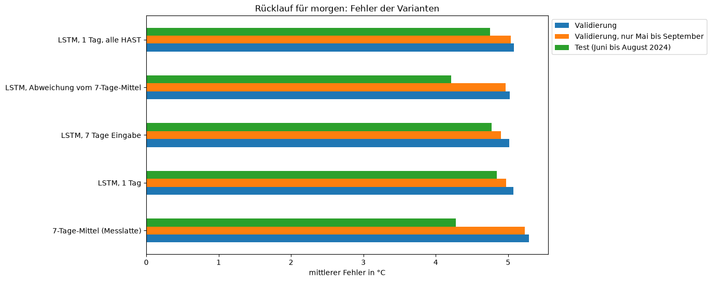
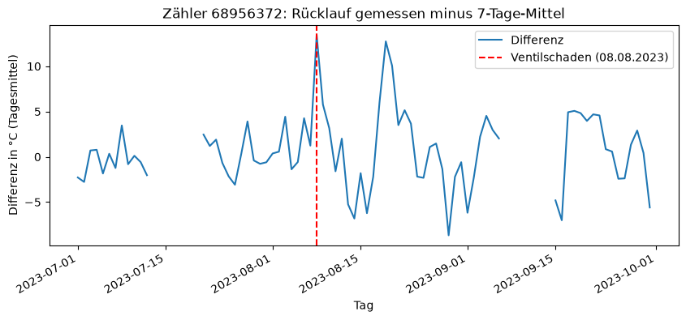
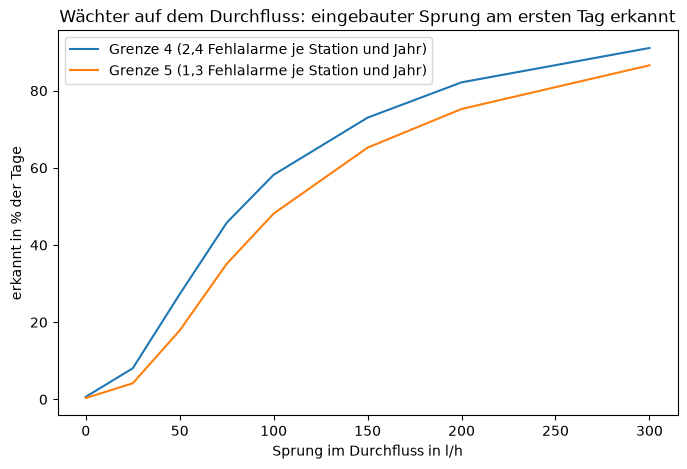

# Prognose-LSTM als Wächter

Der Fingerabdruck sucht Fehler, die eine Station schon hat. Der Wächter sucht neue Veränderungen. Er
vergleicht jede Station mit sich selbst: Ein schon immer undichtes Ventil ist für ihn normal, eines, das
ab morgen offen steht, nicht. Dafür sagt ein LSTM jeden Tag Rücklauf und Durchfluss einer Station
vorher, aus der letzten Woche, dem Wetter und der Vorlauftemperatur des Netzes. Weicht die Station
deutlich und anhaltend davon ab, gibt es eine Warnung. Labels braucht er zum Lernen nicht, nur zum
Prüfen. Gerechnet wird in Notebook 28, zuerst in Vorversuchen (Abschnitt 2 und 3), dann mit dem
endgültigen Wächter (Abschnitt 4 bis 13). In Notebook 35 wird er für das Endmodell neu gelernt.

## Wie viele Tage Vorgeschichte?

Die einfachste Erwartung für morgen ist das Mittel der letzten Tage. Wie viele Tage dafür am besten
sind, wurde auf der Validierung verglichen, für den Rücklauf aller begangenen Stationen:

| Fenster | 1 Tag („wie gestern“) | 3 Tage | 7 Tage | 14 Tage | 30 Tage |
|---|---|---|---|---|---|
| mittlerer Fehler in K | 6,05 | 5,38 | **5,32** | 5,52 | 6,20 |

Eine U-Form: Zu kurz nimmt den Zufall von gestern mit, etwa ob die Station gerade getaktet hat. Zu lang
nimmt das Wetter von vor Wochen mit. Erst nach der Wahl auf der Validierung wurde einmal im Test, dem
Sommer 2024, nachgesehen: Auch dort sind 7 Tage besser als „wie gestern“ (4,28 gegen 4,66 K). Der Wächter
sieht deshalb die letzten 7 Tage, und das 7-Tage-Mittel ist die Messlatte, die das Netz schlagen muss.

## Was ein LSTM bringt

Ein LSTM mit einem Tag als Eingabe (wie in [LSTM-Fingerabdruck](lstm.md)) schlägt die Messlatte auf der
Validierung knapp, im Test verliert es. Drei Ideen wurden verglichen, alle mit derselben Trainingsschleife
und Early Stopping:

1. dem LSTM 7 Tage zeigen statt einem,
2. nicht den Rücklauf vorhersagen, sondern die Abweichung vom 7-Tage-Mittel,
3. auf allen Stationen lernen statt nur auf den begangenen.

| Variante | Validierung | Validierung, Mai bis September | Test, Sommer 2024 |
|---|---|---|---|
| 7-Tage-Mittel (Messlatte) | 5,29 | 5,23 | 4,28 |
| LSTM, 1 Tag | 5,07 | 4,98 | 4,84 |
| LSTM, 7 Tage Eingabe | 5,02 | 4,90 | 4,77 |
| LSTM, Abweichung vom 7-Tage-Mittel | 5,02 | 4,97 | 4,21 |
| LSTM, 1 Tag, alle Stationen | 5,08 | 5,03 | 4,75 |

Mittlerer Fehler des Rücklaufs in K.



- Auf der Validierung liegen „7 Tage Eingabe“ und „Abweichung vom Mittel“ gleichauf vorn. Übernommen ist
  die Eingabe von 7 Tagen. Die Abweichung ist nur im Test knapp vorn, und das als Grund zu nehmen,
  hieße nach dem Test auszuwählen.
- Alle Stationen statt nur der begangenen bringen beim Vorhersagen kaum etwas.
- Warum sagt die Validierung so wenig über den Test? Die Validierungswochen liegen zwischen
  Trainingswochen. Das Netz kennt die Woche davor und danach und muss nur eine Lücke füllen. Der Test
  liegt nach dem Training, dort geht es wirklich in die Zukunft. Im Endmodell (Notebook 35) liegt die
  Probezeit deshalb zeitlich nach dem Lernen.
- Das Wetter von morgen ändert die Vorhersage kaum. Ohne diesen Eingang oder mit 1,5 K Fehler, etwa so
  gut wie eine Wettervorhersage, ändert sich der Fehler nur um Hundertstel. Die Wettervorhersage reicht
  also als Eingang.

## Ein einfacher Wächter ohne Netz

Wie weit kommt ein Wächter ganz ohne gelerntes Modell? Er sagt jeden Tag das 7-Tage-Mittel voraus und
misst die Differenz zur Messung. Was „viel“ ist, hängt an der Station: Bei einer ruhigen Station sind
2 K normal, bei einer taktenden 8 K. Deshalb wird die Differenz in Streuungen der letzten 8 Wochen
derselben Station gemessen, das ist der z-Wert. Alarm gibt es ab |z| ≥ 5. Diese Grenze ist nur über die
Fehlalarme festgelegt, etwa ein Alarm je Station und Jahr.

Geprüft wird er an dem einen Schaden, dessen Beginn sich klar in den Messdaten zeigt. Bei Zähler 68956372
springen am 8. August 2023 Nachtdurchfluss und Rücklauf nach oben, ab dem 19. August fließen nachts dauerhaft
rund 340 statt 25 l/h. Das Datum ist aus den Messdaten abgelesen, von der ÜZ gibt es dafür keins. Der Wächter
schlägt genau einmal an, am Schadenstag. Der Rücklauf liegt an diesem Tag 13 K über dem 7-Tage-Mittel,
eine Woche später ist die Differenz wieder 0. Dann besteht das Mittel nur noch aus Tagen mit kaputtem
Ventil, und der Wächter hat sich an den Schaden gewöhnt.



Drei weitere Befunde aus diesem Vorversuch:

- **Fehlalarme kommen aus der Übergangszeit.** Im Sommer liegt die Vorhersage etwa ±2,5 K daneben, im
  Oktober ±4,5 K. Ein Fenster aus August und September hält einen gewöhnlichen Oktobertag dann für
  auffällig.
- **Wie groß muss ein Schaden sein?** Ein rechnerisch eingebauter Sprung von 10 K im Rücklauf wird am
  ersten Tag nur an 37 % der Tage erkannt. Im Durchfluss werden 150 l/h zusätzlich an 65 % der Tage
  erkannt. Beim Ventil ist der Durchfluss der bessere Kanal.
- **An echten Begehungen bemerkt er nur den Eingriff.** In 16 von 41 Fällen gibt es in den 14 Tagen ab
  der Begehung einen Alarm, bei Kontrollstationen im selben Zeitraum in 20 %. 12 der 16 Treffer liegen
  aber am Begehungstag oder am Tag danach. Ab dem zweiten Tag sind es 9 von 41 gegen 18 %, kein
  Unterschied mehr. Eine Begehung verschiebt den Betrieb nur um etwa eine halbe Streuung, und eine feste
  Grenze von 5 Streuungen sieht so eine Verschiebung nie.



## Der endgültige Wächter

Aus den Vorversuchen folgt der Aufbau: eine gelernte Erwartung statt des 7-Tage-Mittels, Rücklauf und
Nachtdurchfluss als Kanäle, ein z-Wert je Station mit einem Faktor je Jahreszeit und eine Warnung erst
bei zwei auffälligen Tagen hintereinander.

```
7 Vortage (168 Stunden × 4 Größen) ──► LSTM-Encoder (64) ──► Zustand
                                                                 │
   Zieltag: Außentemperatur, Vorlauf (24 × 2) ──────────► LSTM-Decoder (64) ──► Linear 64 → 2
                                                                                     │
                                                       Rücklauf, Durchfluss (24 Stunden × 2)
```

| Schicht | Eingang | Ausgang | Aktivierung | Gewichte |
|---|---|---|---|---|
| LSTM-Encoder | Rücklauf, Durchfluss, Vorlauf, Außentemperatur je Stunde | Zustand mit 64 Zahlen | Sigmoid in den Toren, tanh im Inhalt | 17.920 |
| LSTM-Decoder | Außentemperatur und Vorlauf je Stunde des Zieltags, startet mit dem Zustand des Encoders | 64 je Stunde | Sigmoid in den Toren, tanh im Inhalt | 17.408 |
| Linear (Ausgang) | 64 | Rücklauf und Durchfluss je Stunde | keine | 130 |
| **zusammen** | | | | **35.458** |

- **Eingang:** die 7 Vortage Stunde für Stunde, dazu, was am Zieltag bekannt ist: die Außentemperatur aus
  dem Wetterbericht und den Vorlauf, den das Netz vorgibt. Ein Tag wird nur vorhergesagt, wenn die sieben
  Tage davor lückenlos vorliegen.
- **Skalierung:** Durchfluss je Station durch sein 95-%-Quantil, Temperaturen für alle gleich
  standardisiert, beides nur aus der Lernzeit.
- **Training:** mittlerer quadratischer Fehler, Adam mit Lernrate 0,002, Stapel von 512 Tagen, Lernrate
  halbieren nach 4 Runden ohne Besserung, Early Stopping nach 15. Gelernt wird bis Ende Mai 2024, nach
  Vorgabe nur auf begangenen Stationen (16.518 Trainings- und 1.478 Validierungstage). Der beste
  Validierungsfehler ist 0,1000, das Training dauert 24 Sekunden. Ein zweites Netz auf allen Stationen
  läuft zum Vergleich.
- **Von der Abweichung zur Warnung:** Je Tag zwei Abweichungen, gemessen minus vorhergesagt: der Rücklauf
  über den Tag und der Durchfluss zwischen 0 und 5 Uhr. Jede wird an der normalen Schwankung derselben
  Station gemessen, als robuster z-Wert: Abstand vom Median geteilt durch 1,4826 × MAD (Median der
  absoluten Abweichungen, unempfindlich gegen Ausreißer). Ein Faktor je Jahreszeit sorgt dafür, dass
  eine Schwelle an Heiztagen und an warmen Tagen gleich streng ist. Gewarnt wird bei z ≥ 4 an zwei Tagen
  hintereinander. Die Schwelle ist über die Fehlalarmrate in der Testzeit gewählt.

**Ergebnisse (Notebook 28).**

- Die Vorhersage des Rücklaufs ist deutlich besser als einfache Regeln: 4,3 K daneben gegen 6,2 K für
  „wie gestern“ (Validierung, begangene Stationen).
- An eingerechneten Fehlern bei 8 % Fehlalarmen: Bypass 150 l/h zu 84 % erkannt, Bypass 50 l/h zu 55 %,
  hängender Fühler zu 43 %, Sollwert +5 K zu 19 %. Ein um 5 K verstellter Sollwert liegt in der normalen
  Schwankung von Tag zu Tag.
- 2,9 Alarme je Station und Jahr, ähnlich wie das Normalverhaltensmodell (3,6).
- An echten Begehungen meldet der Wächter nicht öfter als an Vergleichsstationen. Ein möglicher Grund:
  Das Prognose-LSTM bekommt die letzten 7 Tage als Eingang, eine bleibende Veränderung wird so schnell
  Teil seiner Erwartung.

## Im Endmodell

In Notebook 35 wird der Wächter auf der gemeinsamen Zeitachse neu gelernt, jetzt auf allen Stationen, die
er überwachen soll. Der Grund: Für eine Vorhersage braucht es keine Labels, und ein Wächter muss jede
Station kennen, die er überwacht: Stationen, die es nie gesehen hat, sagt das Netz schlechter voraus,
auf 17 solchen Stationen beim Rücklauf um 0,54 K. Das Training läuft 143 Runden, der beste Stand ist in Runde 128. Statt der Warnung an
zwei Tagen summiert ein CUSUM-Konto die Abweichungen auf (k = 0,5). Seine Schwelle h = 10 gibt in der
Einstellzeit so viele Alarme wie das Monitoring-Modell.

- **Sommer:** Nur das Prognose-LSTM rechnet an warmen Tagen. Eingebaute Dauerdurchflüsse von 150 l/h
  findet es zu 78 % bei höchstens 5 % Fehlalarmen, das 7-Tage-Mittel zu 45 %.
- **Winter:** Zusammen mit dem Monitoring-Modell steigt die Trefferquote an eingebauten Fehlern von
  51 % auf 60 %, ohne mehr Fehlalarme.
- **Echte Begehungen:** Dort liegt das Prognose-LSTM auf Höhe der Kontrolle.

Im Dashboard ist das Prognose-LSTM deshalb der Wächter für die warmen Tage und für plötzliche Fehler, an
Heiztagen ein Hinweis neben dem Monitoring-Modell.
