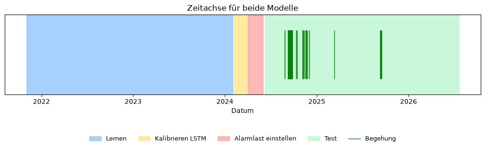
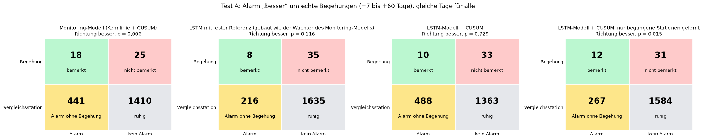
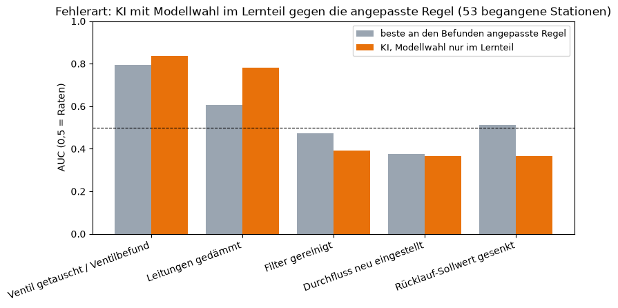

# Modellvergleich

Im Projekt sind viele Modelle und Regeln entstanden. Diese Seite zeigt, welches davon welche Aufgabe am besten löst
und wie der Vergleich zustande kam: Der erste Prüfstand war an mehreren Stellen zu großzügig, erst der strenge
Vergleich in Notebook 35 liefert die Zahlen, die gelten. Wie gemessen und gezählt wird, steht unter
[Prüfdesign und Statistik](vergleich/pruefung.md). Gerechnet wird in den Notebooks 30, 34 und 35, die Prüfungen liegen
in `src/pruefstand.py` und `src/finalvergleich.py`.

## Ergebnis auf einen Blick

Die Aufgaben kommen aus Folie 5 der Aufgabenstellung: Alarm, Fehler erkennen, Fehler unterteilen. Alle Zahlen stammen
aus dem strengen Vergleich in Notebook 35.

| Aufgabe | gewählt | Ergebnis | einfachste Alternative | gesichert? |
|---|---|---|---|---|
| Alarm in der Heizperiode | Monitoring-Modell: Kennlinie + CUSUM | 18 von 43 Begehungen als „besser“ bemerkt, Kontrolle 24 % | – | ja (p = 0,006) |
| Alarm an warmen Tagen | Prognose-LSTM + CUSUM | 78 % der Dauerdurchflüsse von 150 l/h bei höchstens 5 % Fehlalarmen | Wochenmittel 45 % | nur an eingebauten Fehlern |
| Fehlerart Ventil | Regression auf den 16 LSTM-Zahlen | AUC 0,84 | Sommernacht-Regel 0,85 | gleichauf |
| Fehlerart Dämmung | dasselbe Modell | AUC 0,78 | beste Einzelregel 0,61 | knapp nicht gesichert |
| Fehlerart Kapazität | Regel: Spitzenlast zum alten Vertrag | AUC 0,76 | gelernte Modelle höchstens 0,53 | die Regel gewinnt |
| Filter, Durchfluss, Sollwert | keins | AUC 0,26 bis 0,57 | – | nicht erkennbar |
| Klasse „Regelventil tauschen“ | LSTM-Modell | 8 von 11 Ventilfällen | Monitoring-Modell 4 von 11, dafür 4 von 4 richtig | – |
| Reihenfolge der Begehungen | Ventil-Score | 7 Ventilbefunde unter den ersten 10 | Monitoring-Modell 5, Zufall etwa 2 | – |

Beim Alarm in der Heizperiode gewinnt die Kennlinie, an warmen Tagen und beim Erkennen der Fehlerart die LSTM-Kette.
Wo eine einfache Regel gleich gut ist, begründet sie im Dashboard den Verdacht.

## Wie geprüft wurde: erst zu großzügig, dann streng

### Jedes Notebook prüfte sich selbst

Zuerst hatte fast jedes Notebook seine eigene Prüfung, mit eigenem Zeitraum, eigenen Stationen, eigener
Kontrollgruppe und eigener Alarmmenge. Das Normalverhaltensmodell bemerkte in Notebook 18 70 % der Begehungen gegen
53 % bei Kontrollstationen, das Prognose-LSTM in Notebook 28 11 bis 17 % gegen 13 %. Welcher Wächter besser ist, folgt
daraus nicht.

### Erster Prüfstand (Notebooks 30 und 34)

Notebook 30 vergleicht deshalb zuerst die beiden Wächter unter gleichen Bedingungen. Notebook 34 schickt dann alle
Kandidaten über dieselbe Prüfung: dieselben 79 Stationen mit 15.142 Heiztagen, dieselben 43 Begehungen, dasselbe Budget von 204 Alarmen, Regeln als Modelle ohne Lernen, Holm über alle
Tests. Geprüft wurden 15 Wächter und 27 Kandidaten für das Ventil. Die Rollen waren schon hier klar: Beim Alarm
gewinnt die Kennlinie, beim Erkennen die LSTM-Kette.

### Was zuerst nicht stimmte

Bei der Nachprüfung fielen Fehler auf. Einige machten die Zahlen zu gut, einer ließ das LSTM schlechter aussehen,
als es ist.

| Zuerst | Was daran nicht stimmte | Korrektur | Folge |
|---|---|---|---|
| Der LSTM-Encoder war einmal auf allen begangenen Stationen gelernt. | Er kannte die Teststationen schon. | In jedem der fünf Prüfteile ohne die Teststationen neu gelernt. | Ventil 0,89 auf 0,84, zusammen mit der nächsten Zeile |
| Das beste Modell für die Fehlerart wurde nach den Testwerten gewählt. | Wer den Sieger nach dem Test aussucht, bekommt eine zu gute Zahl. | Gewählt wird nur im Lernteil. | Die zuerst genannten 0,88 waren um etwa 0,05 zu optimistisch. |
| Die Parameter für das gleiche Alarmbudget wurden auf den Prüffällen gewählt. | Die Schwelle passte zu den Fällen, an denen gemessen wird. | Alarmlast auf eigenen Monaten eingestellt, April und Mai 2024. | Die p-Werte im ersten Prüfstand sind leicht zu günstig. |
| Die Auslastung wurde mit dem Anschlusswert gerechnet. | Der Anschlusswert zeigt oft schon den neuen Vertrag nach der Begehung, bei 7 von 9 verkleinerten Verträgen. | Auslastung zum alten Vertrag; im gelernten Modell ist das Merkmal ausgeschlossen. | Die erste Regel kam auf 0,51, mit dem alten Vertrag auf 0,78 bzw. 0,76. |
| Die 12 Kennzahlen gingen ins gelernte Modell ein. | Sie wurden festgelegt, als die Begehungsprotokolle schon bekannt waren. | Gewählt ist die Regression nur auf den 16 LSTM-Zahlen, die ohne Befunde gelernt sind. | gleich gut, ohne Vorwissen |
| Das Prognose-LSTM sah als Wächter klar schlechter aus, 16 gegen 30 Begehungen. | Ein Teil lag an der Alarmregel, der Rest an der Referenz der letzten 7 Tage, nicht am Modelltyp. | Dieselben z-Werte mit CUSUM; ein LSTM mit fester Referenz zum Vergleich. | mit CUSUM 24 statt 16; mit fester Referenz gleichauf mit der Kennlinie (46 % gegen 47 %) |
| Deutungen der Dämmung: Wärmeverlust ungedämmter Leitungen (Notebook 29), neue Kennzahlen mit 0,89 (Notebook 36). | Die Nachtspreizung ist mit Dämmungsbefund kleiner statt größer (AUC 0,29 in der vorab festgelegten Richtung). Die 0,89 hingen an einer einzigen Kennzahl und ihrer Bezugsgröße. | Beide verworfen. | Die Dämmung bleibt ein Hinweis. |

Durch die Korrekturen haben sich die Zahlen geändert, die Rollen der Modelle nicht. Für Aussagen gelten nur die Zahlen
aus Notebook 35.

### Strenger Vergleich (Notebook 35)

- **Gleiche Daten:** die 93 Stundenreihen aus Notebook 00.
- **Gleiche Zeitachse:** Lernen bis 31.01.2024, Kalibrieren vom 08.02. bis 31.03.2024, Alarmlast im April und Mai 2024
  einstellen, Test ab 08.06.2024. Teststationen und Testtage sind nie im Lernen.
- **Labels nur aus Begehungen:** Die nie begangenen Stationen gelten als unbekannt, nicht als gesund.

| Test | Frage | Grundlage |
|---|---|---|
| A | Bemerkt der Wächter echte Begehungen? | 43 Begehungen, Fenster −7 bis +60 Tage, Kontrollstationen |
| B | Findet der Wächter eingebaute Fehler? | 157 Fälle, 79 im Winter, 78 im Sommer |
| C | Erkennt das Modell die Fehlerart? | 53 begangene Stationen, fünffache Kreuzvalidierung über Stationsgruppen |
| D | Sagen Netzvergleich und Potenzial die Wirkung einer Begehung vorher? | begangene gegen nicht begangene Stationen |
| E | Taugt die Reihenfolge der Empfehlungen? | Ventilbefunde unter den ersten 10 von 53 |

## Alarm

**Erster Prüfstand.** Von 15 Wächtern bleibt nach Holm nur Kennlinie mit CUSUM gesichert:

| Wächter (Erwartung + Regel) | bemerkt | Kontrolle | p nach Holm |
|---|---|---|---|
| Tagesmonitor (Kennlinie + CUSUM, Notebook 20) | 33 von 43 | 53 % | 0,017 |
| Normalverhaltensmodell (Notebook 18) | 30 von 43 | 50 % | 0,08 |
| Wochenmittel + Schwelle (ohne Lernen) | 24 von 43 | 36 % | 0,07 |
| Prognose-LSTM + CUSUM | 24 von 43 | 40 % | 0,20 |
| Kennlinienmonitor (Notebook 13) | 27 von 43 | 53 % | 0,94 |
| Prognose-LSTM + Schwelle (Notebook 28) | 16 von 43 | 32 % | 1 |

Der Tagesmonitor mit Netzereignis-Filter (Notebook 24) kommt auf dasselbe Ergebnis. Die übrigen Wächter, etwa der
ARIMA-Wächter aus Notebook 06 und die Detektoren aus Notebook 16, bleiben nach Holm ungesichert.

**Strenger Vergleich.** An echten Begehungen (Test A) bemerkt das Monitoring-Modell 18 von 43 als „besser“ gegen 24 %
bei Kontrollstationen. Das Prognose-LSTM liegt auf Höhe der Kontrolle (10 von 43 gegen 26 %).

An eingebauten Fehlern im Winter (Test B, höchstens 10 % Fehlalarme):

| eingebauter Fehler im Winter | Monitoring-Modell | LSTM mit fester Referenz | Prognose-LSTM |
|---|---|---|---|
| Rücklauf +5 K | 47 % | 46 % | 33 % |
| schleichend +5 K in 30 Tagen | 42 % | 38 % | 27 % |
| Fühler hängt | 46 % | 44 % | 38 % |
| Dauerdurchfluss 150 l/h | 77 % | 74 % | 73 % |
| Dauerdurchfluss 50 l/h | 53 % | 49 % | 53 % |

- **Heizperiode:** Die Kennlinie gewinnt, weil sie gegen eine feste Referenz prüft. Ein LSTM mit fester Referenz liegt
  praktisch gleichauf. Bei Gleichstand bleibt die einfachere, erklärbare Kennlinie.
- **Warme Tage:** Die Kennlinie rechnet nur von Oktober bis April. Dort überwacht das Prognose-LSTM und schlägt das
  Wochenmittel deutlich (Dauerdurchfluss 50 l/h 44 % gegen 12 bis 14 %).
- **Zusammen:** Im Winter ergänzen sich beide bei plötzlichen Fehlern, über alle eingebauten Fehler von 51 % auf 60 %,
  ohne mehr Fehlalarme. An echten Begehungen meldet das Prognose-LSTM aber nicht öfter als an Vergleichsstationen. An
  Heiztagen bleibt es deshalb ein Hinweis.

## Fehler erkennen

**Erster Prüfstand.**

- **Ventil:** 27 Kandidaten laufen gepaart gegen die Sommernacht-Regel. Vorn liegen die Regression auf Kennzahlen und
  LSTM-Zahlen (0,89), der Sommer-Nachtdurchfluss (0,88) und die Schweregrad-Punkte aus Notebook 17 (0,87). Keiner ist
  gesichert besser als die Regel. Random Forest (0,77) und XGBoost (0,75) sind nicht besser, XGBoost ist gesichert
  schlechter. Flottenvergleiche wie Netzvergleich, Potenzial und K-Means liegen bei 0,67 bis 0,74: Sie messen
  „schlechter als andere“, und das ist nur zur Hälfte ein Ventil.
- **Dämmung:** Nur die Regression auf Kennzahlen und LSTM-Zahlen ist besser als Raten (0,75). Netzvergleich,
  Vergleichsgruppen, Potenzial und Rücklaufmaße zeigen in die umgekehrte Richtung (0,30 bis 0,39): Ein Dämmungsbefund
  kommt eher bei Stationen vor, die im Netz gut aussehen.

**Strenger Vergleich (Test C).**

| Fehlerart | gelerntes Modell | beste Regel | Unterschied |
|---|---|---|---|
| Ventil | 0,84 | Sommernacht-Regel 0,85 | −0,01 [−0,14; +0,12], gleichauf |
| Dämmung | 0,78 | beste Einzelregel 0,61 | +0,17 [−0,04; +0,38], knapp nicht gesichert |
| Kapazität | höchstens 0,53 | Spitzenlast zum alten Vertrag 0,76 [0,58; 0,93] | die Regel gewinnt |
| Filter, Durchfluss, Sollwert | alle Verfahren 0,26 bis 0,57 | – | nicht erkennbar |

Die Werte in eckigen Klammern sind 95-%-Intervalle über Stationen.

Das Bild stellt die KI der besten an den Befunden angepassten Regel gegenüber. Beim Ventil ist die feste
Sommernacht-Regel aus der Tabelle (0,85) noch etwas stärker als die angepasste (0,79).

### Warum das so ausgeht

Notebook 36 prüft, ob die Maßnahmen der Begehungen überhaupt eine Spur in den Zählerdaten hinterlassen:

- **Ventil:** Nach dem Tausch sinkt der Durchfluss in Sommernächten deutlich (AUC 0,81, nach Holm gesichert). Diese
  Spur findet auch eine einfache Regel. Deshalb liegen gelerntes Modell und Regel gleichauf.
- **Dämmung:** Das Muster besteht aus mehreren schwachen Hinweisen: ein kälterer Rücklauf im Winter, eine kleine
  Spreizung in Sommernächten und eine große Streubreite der Betriebspunkte. Keiner trennt allein, deshalb kommt die
  beste Einzelregel nur auf 0,61. Notebook 36 zeigt das an der Regression auf den Kennzahlen, weil sich die LSTM-Zahlen
  nicht deuten lassen. Das Muster ist in allen fünf Prüfteilen gleich und bleibt auch ohne die Ventilstationen und
  innerhalb von Stationstyp, Größe und Zeitraum der Begehung erhalten. Ein Teil davon beschreibt eher, wo gedämmt
  wurde, nämlich an gut laufenden Stationen. Ein erster physikalischer Hinweis ist die Abkühlrate im Stillstand
  (0,69, nicht gesichert).
- **Filter, Durchfluss, Sollwert:** Nach der Maßnahme ändert sich nichts Messbares. Sollwert (62 % der Begehungen) und
  Filter (47 %) sind eher Routine als gefundene Fehler. Kein Verfahren kann sie erkennen. Das liegt an den Labels,
  nicht am Modell.

## Fehler unterteilen und Reihenfolge

- **Regelventil tauschen:** Das LSTM-Modell trifft 8 von 11 Ventilfällen, das Monitoring-Modell 4 von 11. Dessen
  Fehlerbild „ventil“ ist dafür sehr genau (4 von 4 richtig) und dient im Dashboard als Bestätigung.
- **Regelparameter optimieren:** trifft keins der beiden Modelle, 24 bzw. 25 von 31 Fällen landen in
  „kein Handlungsbedarf“. K-Means „schlechter“ erkennt das Ventil mit 0,67 gesichert schlechter als die Regel (siehe
  [Was nicht getragen hat](nicht_getragen/index.md)).
- **Reihenfolge (Test E):** Unter den ersten 10 Stationen nach Ventil-Score hatten 7 einen Ventilbefund, nach der
  Priorität des Monitoring-Modells 5, Zufall wären etwa 2.
- **Lage im Netz (Test D):** Netzvergleich und Potenzial beschreiben eine Station, sagen die Wirkung einer Begehung aber
  kaum vorher (Rangkorrelation 0,16, p = 0,30). Das Dashboard zeigt deshalb Rang und Potenzial, aber keine
  Einspar-Schätzung.

## Haus oder Netz

Notebook 34 prüft auch, ob das Leitungsnetz hilft: Nachbar-Alarme abziehen, den Netzmedian abziehen, Merkmale der
Nachbarn bis zwei Kanten. Keine Variante verbessert Alarm oder Erkennung. Offene Ventile häufen sich nicht in Strängen,
die Fehler sitzen im einzelnen Haus. Das Netz zählt nur als Ganzes, über Wetter, Vorlauf und Begehungswellen, und das
fangen Kennlinie und Tagesmonitor schon ab.

## Was sich nicht vergleichen lässt

| Ansatz | Warum nicht | Eigenes Ergebnis |
|---|---|---|
| [GNN (Notebook 39)](nicht_getragen/gnn.md) | braucht die Kanten- und Positionsdateien aus Notebook 31 | kleiner Gewinn, kein Strang-Effekt; dieselbe Frage prüft „Haus oder Netz“ |
| [Bayes (Notebook 38)](nicht_getragen/bayes.md) | braucht die Handtabellen unter `data/manual/` | Ventil im Zweikampf AUC 0,92, mit einer Matrix, die noch nicht mit der ÜZ abgestimmt ist |
| Stationscluster (Notebooks 07 und 08) | Profile über die ganze Historie, also auch nach der Begehung | kein Cluster trennt die Begehungen; verglichen wird K-Means aus Notebook 26 |

Die Notebooks 01 bis 05 messen die Wirkung der Begehungen oder bereiten Daten auf. Sie liefern den Prüfstein und sind
selbst keine Kandidaten.

## Grenzen

- 43 Begehungen und 11 Ventilfälle: Unterschiede unter etwa 0,1 AUC oder unter etwa 5 Fällen sind nicht zu sehen.
- Das Prognose-LSTM ist nur an eingebauten Fehlern belegt, an echten Begehungen nicht.
- Die Dringlichkeitsstufen sind gesetzt, nicht getestet. Dafür braucht es einen Test nach vorn (siehe
  [Prüfung nach vorn](ausblick_pruefung.md)).

Weitere Grenzen stehen unter [Grenzen der Modelle](grenzen_modelle.md).
