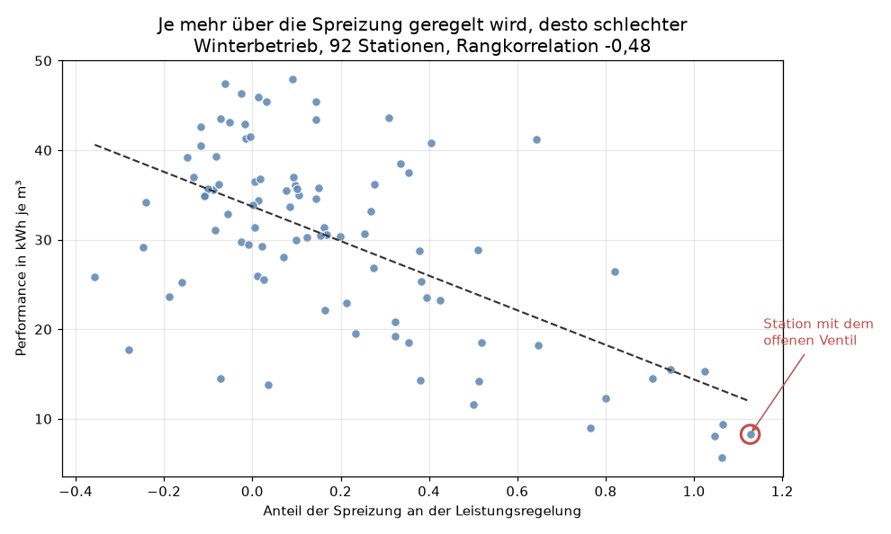
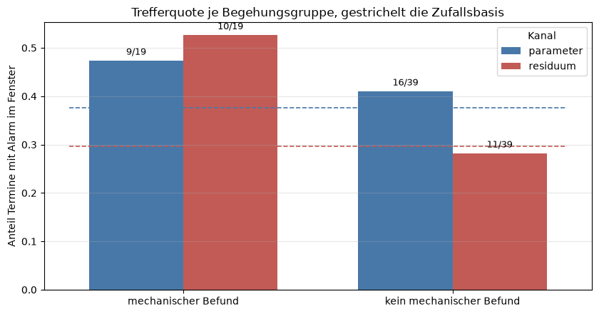

# Stationsbilder und Befunde

**Notebooks 11 bis 15:** `notebooks/4_stationsbilder/` · **Code:** `src/ternaer.py`, `src/stationsbilder.py`,
`src/kennlinien_monitor.py`, `src/befundcodes.py`, `src/fallsammlung.py`, Tests in den gleichnamigen Dateien unter
`tests/`

## Woher wir kommen

Das [Clustering](../clustering/index.md) hat zwei Dinge gezeigt. Die Stationen zerfallen nicht in klare Typen, aber
jede Station prägt ihre eigenen Tage. Ein Altbau mit Heizkörpern und ein Neubau mit Fußbodenheizung sehen verschieden
aus, ohne dass etwas kaputt ist. Ein Vergleich der Stationen untereinander trägt deshalb nicht weit.

Dieser Teil geht den umgekehrten Weg. Er sieht sich einzelne Stationen genauer an und vergleicht sie am Ende mit sich
selbst. In vier Schritten, von denen jeder die Frage des vorigen aufnimmt, entsteht so die Idee, auf der später das
[Monitoring](../monitoring/index.md) aufbaut.

**Testfall ist Zähler 68956351.** Dort stand ein Ventil rund drei Jahre offen, im September 2024 wurden Ventil und
Stellmotor getauscht (siehe [Einzelfall](../begehungen/wirkung.md#einzelfall-68956351)). Es ist der einzige Fall, bei
dem wir aus den Messdaten sicher wissen, was passiert ist. Jeder Ansatz muss ihn finden.

| Schritt | Notebook | Frage | Ergebnis | Nutzbar? |
|---|---|---|---|---|
| 1 | 11 Ternär | Lässt sich die Folie der ÜZ nachbauen? | ja, aber ihre Aussage zur Regelung über die Spreizung kehrt sich bei uns um | als Befund ja, als Werkzeug nein |
| 2 | 12 Stationsbilder | Kann man besser hinsehen? | Kennlinie, Carpet-Plot und Dauerlinie zeigen den Ventilfall auf einen Blick | ja, für das Auge |
| 3 | 13 Kennlinienmonitor | Lässt sich das automatisieren? | am bekannten Fall sehr klar, gegen alle Begehungen nicht signifikant | Prototyp |
| 4 | 14 Befunde | Liegt es an den Labels? | ja, mechanische Eingriffe trifft der Monitor häufiger als Zufall | erste Prüfung über dem Zufall |

## 1 Lässt sich die Folie der ÜZ nachbauen? (Notebook 11)

**Idee:** Eine Station kann ihre Leistung über mehr Wasser (Volumenstrom) oder über mehr Wärmeentzug (Spreizung)
anpassen. Die ÜZ hat das auf einer Folie als Dreieck gezeigt. Das Dreieck zeigt, welcher Weg gerade benutzt wird.

- Sechs Dreiecke für dieselbe Station: oben vor, während und nach der Begehung, unten die drei Jahreszeiten.
- Jeder Punkt ist eine Betriebsstunde, die Farbe ist die Effizienz (gelb gut, blau schlecht).
- Vorher liegt der Median bei 3,4 kWh/m³, nachher bei 36,4, also rund zehnmal so hoch.

- Jeder Punkt ist eine Station im Winter: waagerecht der Anteil der Spreizung an der Leistungsregelung, senkrecht die
  Effizienz.
- Die Folie sagt: Wer über die Spreizung regelt, arbeitet effizient. Bei uns ist es umgekehrt. Je größer der Anteil
  der Spreizung, desto schlechter (Rangkorrelation −0,48, 92 Stationen).
- Die Lage der Punktwolke nahe der Spreizungsecke ist dagegen auch bei uns ein gutes Zeichen (+0,75). Vielleicht meint
  die Folie die Lage und nicht die Regelung.
- Erklärung: Eine Station mit festsitzendem Ventil kann ihre Leistung nur noch über die Spreizung ändern und zählt
  deshalb automatisch als spreizungsgeregelt. 68956351 liegt im Bild ganz rechts unten.

**Funktioniert:**

- Die Rechnung stimmt, die Kontrollsumme liegt über alle 766 belegten Panels zwischen 0,975 und 1,096.
- Das Teilnetz ist überwiegend durchflussgeregelt: 74 von 92 Stationen im Winter, nur 12 spreizungsdominiert.

**Funktioniert nicht:**

- Stationstypen clustern: Drei Gruppen trennen die Effizienz um Faktor 3,7, aber die Silhouette liegt nur bei 0,319.
  Das ist eher ein Gefälle als echte Typen.
- Die Regelungsart ändert sich durch die Begehung nicht (p = 0,70 auf Stunden-, 0,34 auf Tagesebene).

**Daraus folgt:** Das Dreieck ist ein guter Befund zum Vorzeichen, aber kein Werkzeug zur Fehlererkennung. Es rechnet
die Größen auf Anteile um und verliert dabei das Niveau, also wie viel Wasser fließt und wie warm es zurückkommt.
Gesucht sind Bilder, die das Niveau zeigen.

## 2 Kann man besser hinsehen? (Notebook 12)

### Kennlinie

- Waagerecht die Leistung, senkrecht der Volumenstrom, beides logarithmisch. Die Farbe ist die Rücklauftemperatur.
- Vor der Begehung: eine flache rote Wolke. Egal wie viel Leistung, es fließen rund 600 l/h (500 bis 1.000), der
  Rücklauf liegt bei 65 bis 75 °C. So sieht ein offenes Ventil aus.
- Nach der Begehung: eine saubere Gerade mit Steigung 1,28, der Rücklauf ist blau.
- Die Steigung ist rechnerisch derselbe Wert wie der Durchflussanteil aus dem Dreieck. Zusätzlich sieht man, ob die
  Punkte überhaupt auf einer Linie liegen (R² im Median 0,02 bei flacher, 0,81 bei steiler Steigung).

### Carpet-Plot

- Waagerecht die Kalenderzeit, senkrecht die Tagesstunde. Oben der Rücklauf, unten der Volumenstrom.
- Ende 2022 bis September 2024: durchgehend rot, Tag und Nacht, Sommer wie Winter.
- Danach blau mit Tagesstruktur (Nachtabsenkung, Warmwasserspitze am Morgen).
- Nebenbefund: Bis Ende 2022 lieferte die Station nur einen Wert pro Tag statt 24.

### Dauerlinie

- Alle Stundenwerte nach Größe sortiert: In wie viel Prozent der Zeit wird ein Wert überschritten?
- Vorher liegt der Rücklauf fast durchgehend über 50 °C, nachher nur noch in rund 40 % der Zeit.
- Als einzige der drei Darstellungen deutet sie über alle Stationen einen Begehungseffekt an: Der Anteil der Stunden
  über 50 °C sinkt um 1,4 Prozentpunkte (47 Stationen, p = 0,096, nicht gesichert). Die Kennliniensteigung zeigt
  nichts (p = 0,67).

**Funktioniert:** Die Darstellungen messen verschiedene Dinge. Die zehn auffälligsten Stationen nach
Kennlinienstreuung und nach warmem Rücklauf überschneiden sich gar nicht.

**Achtung:** Die Performance in kWh/m³ ist auf Stundenebene dasselbe wie die Spreizung (Performance = 1,163 × ΔT).
Korrelationen gegen die Performance beweisen deshalb wenig. Unabhängig sind nur Prüfungen gegen die Begehungen.

**Daraus folgt:** Die Bilder zeigen den Ventilfall auf einen Blick, aber 93 Stationen von Hand anzuschauen ist keine
Automatisierung. Die Kennlinie eignet sich jedoch als eigenes Modell jeder Station. Wenn sie sich plötzlich
verschiebt, ist etwas passiert.

## 3 Die Station mit sich selbst vergleichen (Notebook 13)

**Idee:** Der Kennlinienmonitor vergleicht jede Station nur mit sich selbst. Hat sich ihre Kennlinie gegenüber den
Wochen davor plötzlich verschoben? Das braucht keine Labels, und Altbau und Neubau stören sich nicht mehr gegenseitig.

- Oben die Steigung der Kennlinie: zwei Jahre flach bei null (offenes Ventil), am Begehungstermin ein Sprung auf rund
  1,4.
- In der Mitte die Abweichung vom gewohnten Arbeitspunkt: vorher meist zwischen +0,5 und +0,8, danach im Minus.
- Unten der Alarmkanal: Der Ausschlag am 12.09.2024 erreicht 74, der größte Wert in der Geschichte dieser Station, drei
  Tage nach der Begehung. Der zweite große Ausschlag im Juni 2025 (knapp 50) ist ungeklärt.

Der Monitor findet den bekannten Fall, ohne zu wissen, wonach er sucht. Der erste Entwurf fand ihn nicht: Im Juli und
August 2024 läuft die Station nur rund 60 Stunden im Monat, ein starres 14-Tage-Fenster hat dann zu wenige Punkte.
Das Fenster dehnt sich jetzt bis auf 60 Tage.

**Funktioniert:** das Prinzip, und der bekannte Fall sehr deutlich.

**Funktioniert nicht:**

- Gegen alle 53 Begehungen mit Monitorverlauf liegt die Trefferquote nur 25 bis 34 % über Zufall, nicht signifikant
  (p = 0,10 und 0,077).
- 16 Einstellungen wurden probiert. Der Hebel gegenüber dem Zufall steigt mit der Alarmschwelle bis rund 2,1 (kleinstes
  p 0,012). Bei so vielen Versuchen ist ein einzelnes p aber nicht belastbar.
- Der stärkste Alarm je Station trifft die Begehungen schlechter als Zufall.
- Im Parameterkanal schneiden Begehungen ohne dokumentierten Eingriff sogar besser ab als die mit (Hebel 1,57 gegen
  1,14).

**Daraus folgt:** Liegt es am Monitor oder am Maßstab? Bei 68956351 kennen die Spalten der Begehungstabelle nur eine
Sollwertänderung, nicht den Tausch von Ventil und Stellmotor.

## 4 Liegt es an den Labels? (Notebook 14)

**Bisherige Labels:** die Alt-Neu-Spalten der Begehungstabelle (Heizzeit, Rücklaufsollwert). Daneben gibt es eine
Freitextspalte des Monteurs, vorhanden bei 57 von 66 Begehungen und bisher ungenutzt. Bei 68956351 steht der
Stellmotortausch nur dort.

**Vorgehen:** Die 57 Notizen werden regelbasiert in neun Fehlerkategorien kodiert, abgesichert mit 37 Tests. Knifflig
sind Verneinungen: „Schmutzfänger stark voll“ ist ein Fehler, „fast leer“ nicht.

- Häufigkeit der Fehlerarten in den 57 Notizen, rot sind mechanische Eingriffe.
- Das ist die Häufigkeit in den Notizen, nicht im Netz.

- 6 Begehungen nennen im Text einen Fehler, ohne dass sich ein Sollwert geändert hat. Sie galten bisher als „nichts
  passiert“.
- 18 Begehungen haben eine Sollwertänderung, aber keinen Befund im Text.
- Keine der beiden Quellen ist vollständig.

**Gegenprobe:** Der Monitor sieht nur hydraulische Änderungen. Ein getauschtes Ventil ändert die Kennlinie, eine
verschobene Heizzeit nicht. Bei mechanischen Eingriffen müsste er also besser treffen.

- Links die Begehungen mit mechanischem Befund, rechts alle anderen. Blau ist der Parameterkanal, rot der
  Residuenkanal, die gestrichelten Linien sind die Zufallsbasis des jeweiligen Kanals.
- Der Residuenkanal trifft 10 von 19 mechanischen Begehungen, erwartet wären 5,6 (p = 0,030). Der Parameterkanal
  trifft 9 von 19 und trennt nicht.
- Alle übrigen Begehungen liegen auf Zufallsniveau (Residuenkanal 11 von 39).

Das ist die erste Prüfung gegen die Befunde der Begehungen, die über den Zufall hinauskommt.

**Einschränkungen:**

- 19 Termine sind wenig, ein Fall verschiebt die Quote um 5 Prozentpunkte.
- Die Teilung wurde erst nach dem Nullergebnis gewählt. Sauber wäre: Regel vorher festlegen und an neuen Begehungen
  prüfen.
- Die p-Werte sind einseitig, zweiseitig sind es 0,041 und 0,086.
- 58 Termine auf 51 Stationen, also nicht alle unabhängig.

## Am Rand: die Fallsammlung (Notebook 15)

Notebook 15 kehrt noch einmal zum Dreieck aus Schritt 1 zurück und sammelt die Begehungen als Einzelfälle.

- **Methodischer Befund:** Ein Vorher-Nachher-Vergleich ohne gleiche Jahreszeit kann das Ergebnis umdrehen. Naiv
  verbessern sich die Stationen ohne Begehung (+1,28 kWh/m³ gegen −0,29), im reinen Winterschnitt die begangenen
  (+0,81 gegen −0,76). Das betrifft auch Notebook 11.
- **Screening:** 12 Stationen regeln überwiegend über die Spreizung, 10 davon liegen im schwächsten Viertel der
  Effizienz. Daraus entstehen 7 Vorschläge für Stationen, die noch nie begangen wurden.

## Wie es weiterging

Am Ende dieser Schritte stand die Frage: Monitor weiterverfolgen oder zurück zum Clustering? Das Projekt hat den
Monitor weiterverfolgt. Mitgenommen wurde:

- ein Prototyp, der ohne Labels läuft und die einzige bekannte Reparatur am stärksten anzeigt,
- zum ersten Mal ein Prüfergebnis über dem Zufall,
- die Erkenntnis, dass der Residuenkanal nützlich ist und der Parameterkanal nicht trennt,
- ein Beleg statt einer Vermutung, dass die bisherigen Labels unvollständig waren.

Daraus ist das [Monitoring](../monitoring/index.md) geworden:

- Das [Normalverhaltensmodell](../monitoring/normalverhalten.md) (Notebook 18) vergleicht jede Station mit sich
  selbst, wetterbereinigt auf Tageswerten. Es übernimmt den Befund aus den Schritten 1 und 2, dass Begehungen eher das
  Niveau der Performance verschieben als die Form der Kennlinie, und nutzt die Befundcodes aus Schritt 4 weiter.
- Der [Tagesmonitor](../monitoring/tagesmonitor.md) (Notebook 20) setzt diese Idee als Modul für den Betrieb um und
  ersetzt den Fensteralarm des Kennlinienmonitors.
- Der [Netzvergleich](../monitoring/netzvergleich.md) (Notebook 19) baut auf dem Modul des Kennlinienmonitors auf und
  vergleicht jede Station zusätzlich mit allen anderen.

## Was offen bleibt

- **Entscheidungsbaum:** Die größte Fehlerkategorie hat 9 Fälle. Das reicht nicht für Training und Test.
- **Kontrollgruppe:** In diesen Notebooks fehlt ein Vergleich mit Stationen ohne Begehung. Für den Vergleich jeder
  Station mit sich selbst bringen ihn das Normalverhaltensmodell und der Tagesmonitor.
- **Zählertausch:** Ein Teil der großen Ausschläge könnte ein gewechselter Zähler sein. Ein Tauschdatum gibt es
  nirgends.
- **Drei Notizen** lassen sich nicht einordnen: ein Defekt ohne klare Zuordnung und zwei Messwerte ohne Bewertung.

Die Fragen an die ÜZ, etwa nach Tauschdaten und nach dem Zuschnitt der Fehlerkategorien, stehen gesammelt unter
[Offene Fragen an die ÜZ](../grenzen/offene_fragen.md).
