# Lern- und Experimentprotokoll

Ein Eintrag pro Schritt. Jeder Eintrag beginnt mit der Frage, die vom vorigen Schritt offen
geblieben ist, und endet mit dem, was daraus folgt. Umwege stehen dort, wo sie passiert sind.
Fragen, die erst später aufkamen, aber zu einem früheren Schritt gehören, stehen bei diesem Schritt
(mit Hinweis, wann sie aufkamen). Tippfehler im Code stehen nur hier, nicht im Report.

---

## Schritt 1 – Was soll das Modell beantworten?

**Datum:** 20.10.2026, noch ohne Code

**Ausgangsfrage:** Bevor ich Code schreibe: Was genau soll bewertet werden? Was ist ein Sample, was
das Label, und wie trenne ich Training und Test?

**Zwei Fragen.** Das Projekt hat eigentlich zwei Fragen. Die **Diagnose** fragt: Hat eine HAST
einen Fehler, zum Beispiel ein Ventil, das nicht schließt? Ein Sample ist dann eine HAST, das Label
kommt aus dem Begehungsprotokoll. Ich hatte zuerst eine Gruppe von HAST als Sample angenommen, den
Befund bekommt aber jede HAST einzeln. Die **Überwachung** fragt: Verhält sich eine HAST heute
anders als sonst? Ein Sample ist dann ein Tag einer HAST. Ich dachte zuerst, auch dafür braucht man
Labels, „weil dort die Fehler sind“. Die Überwachung lernt aber nur das normale Verhalten aus den
Messdaten. Labels braucht man erst, um hinterher zu prüfen.

**Die Labels.** Bei der Begehung wurden sechs Arten von Befunden notiert: Ventil (11 Fälle),
Dämmung (23), Filter (26), Durchfluss (20), Temperatur (36) und Überdimensionierung (9 von 37 mit
bekanntem Vertrag). Zuerst habe ich nur an das Ventil gedacht, mehr dazu in Schritt 6.

**Aufteilung und Zeitgrenze.** Die Diagnose soll Stationen beurteilen, die das Modell nicht kennt.
Also wird nach Station aufgeteilt: Eine HAST ist entweder im Training oder im Test, nie in beiden,
zum Beispiel mit Leave-one-out. Außerdem dürfen nur Tage vor der ersten Begehung ins Modell. Sonst
sieht es schon die reparierte Station, und das Ergebnis wirkt besser, als es im Einsatz wäre. Das
heißt Leakage. Ich hatte Leakage zuerst mit Overfitting verwechselt: Overfitting heißt, die
Übungsblätter auswendig zu lernen, Leakage heißt, dass in der Prüfung die Lösung daneben liegt.

**Viele Tage, wenige Fälle.** Es gibt rund 24.000 Messtage, aber jede HAST hat nur einen Befund.
Für die Diagnose zählt jede HAST deshalb nur einmal, und beim Ventil sind das 11 Fälle. Ein großes
Netz würde diese Fälle auswendig lernen. Das LSTM soll deshalb ohne Labels vorhersagen lernen, und
erkannt wird erst danach mit einem kleinen Modell.

**Was daraus folgt:** Bevor irgendein Modell kommt, muss ich verstehen, wie die Daten einer Station
aussehen und ob man einen Fehler darin überhaupt sieht. → Schritt 2.

---

## Schritt 2 – Wie sieht ein Fehler in den Daten aus?

**Datum:** 20.10.2026, Notebook `A_frage_und_daten.ipynb`

**Ausgangsfrage:** Wie sehen die Messdaten einer Station aus, und sieht man darin, dass etwas kaputt
war?

**Eine Station mit Ventilbefund.** Ich habe die erste Station mit Ventilbefund aus den Labels
genommen: Zähler 68956351, Begehung am 09.09.2024, dort wurde der Stellmotor getauscht. Eine Zeile
ist eine Stunde, 32.342 Zeilen vom 01.11.2021 bis 11.07.2025. `Energy` und `Volume` sind
Zählerstände wie beim Stromzähler, sie wachsen immer weiter und werden nicht gebraucht. Der Vorlauf
ist wärmer als der Rücklauf, weil die Station dem Wasser Wärme entzieht. Die Differenz heißt
Spreizung.

**Der Tausch ist deutlich zu sehen.** Der Rücklauf fällt von etwa 75 auf 37 °C
([Abbildung 2.1](#abb-2-1)). Vorher war er fast so heiß wie der Vorlauf, das Wasser lief ungenutzt
durch. Beim Durchfluss hatte ich erwartet, dass er nach dem Tausch steigt: Wenn der Rücklauf kälter
ist, muss doch mehr Wasser fließen. Es ist umgekehrt, er fällt von etwa 480 auf 100 l/h (Januar
2024 gegen Januar 2025, [Abbildung 2.2](#abb-2-2)). Die Wärme ist ungefähr Durchfluss mal
Spreizung. Kühlt das Wasser stärker ab, reicht weniger davon.

**Abbildung 2.1:** Vorlauf und Rücklauf von Zähler 68956351. Bis zum Tausch
(rote Linie) liegt der Rücklauf fast auf dem Vorlauf, danach deutlich darunter.

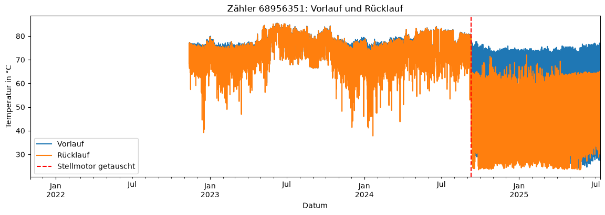

**Abbildung 2.2:** Durchfluss von Zähler 68956351. Nach dem Tausch fließt
viel weniger Wasser.

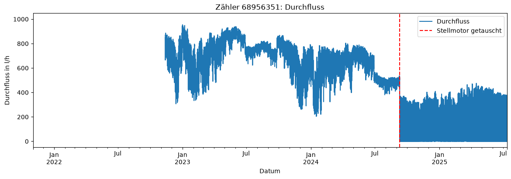

**Die anderen fünf Befundarten** (nachgeholt am 21.10., siehe Schritt 6). Für jede Art habe ich
eine Station gesucht, bei der möglichst nur dieser Befund notiert ist und das Datum bekannt ist
([Abbildung 2.3](#abb-2-3)). Bei Dämmung (69527340) und Filter (68956352) ändert sich an der
Begehung kaum etwas Sichtbares. Beim Durchfluss (80912197) ändert sich der Verlauf, danach läuft er
fast konstant bei etwa 80 l/h. Bei der Temperatur (68956344) sieht man erst im Tagesprofil etwas:
Tagsüber liegt der Rücklauf nach der Begehung 1 bis 3 Grad niedriger ([Abbildung 2.4](#abb-2-4)).
Bei der Überdimensionierung (80912173) wurde der Vertrag von 10 auf 8 kW verkleinert, und selbst in
den stärksten Stunden brauchte die Station nur etwa 6,7 kW. Das sieht man nur im Vergleich mit dem
Vertrag, nicht am Verlauf.

**Abbildung 2.3:** Beispielstationen der anderen fünf Befundarten.

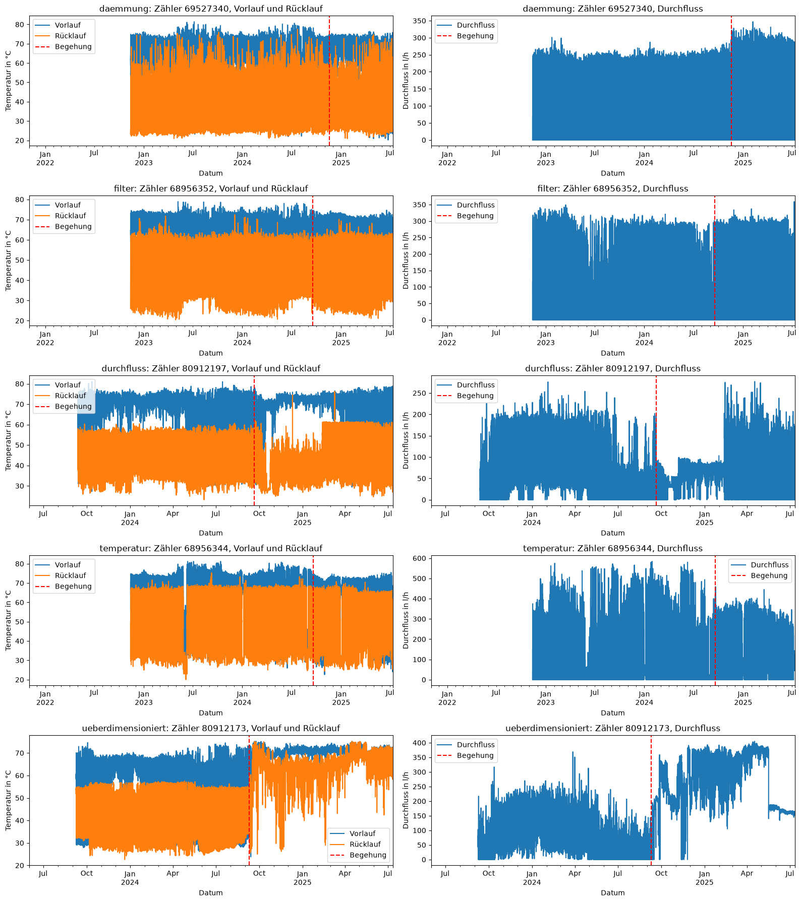

**Abbildung 2.4:** Rücklauf über den Tag bei 68956344, vor und nach der
Begehung.

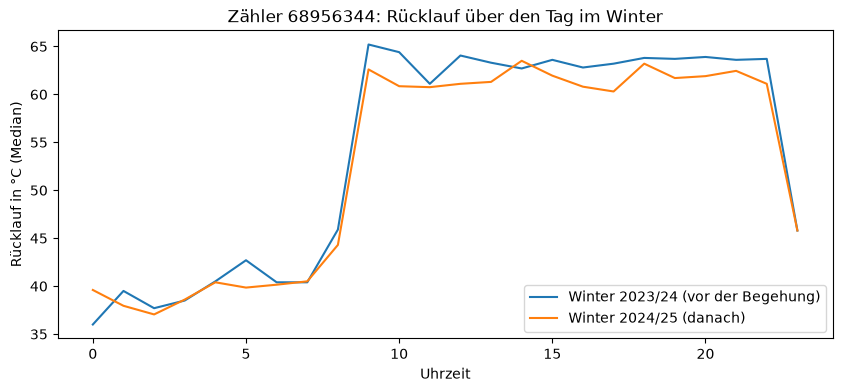

**Was daraus folgt:** Ein Ventilfehler ist in den Daten klar zu sehen, die meisten anderen Befunde
kaum. Fürs Modell zählen nur Daten vor der Begehung. In den Abbildungen ist außerdem vor November
2022 nichts zu sehen, obwohl die Daten 2021 anfangen. Wie viel ist überhaupt brauchbar? →
Schritt 3.

---

## Schritt 3 – Wie viel von den Daten ist brauchbar?

**Datum:** 20.10.2026, Notebook `A_frage_und_daten.ipynb`

**Ausgangsfrage:** Warum ist vor November 2022 nichts zu sehen, und wie viele Werte fehlen
insgesamt?

**Eine Station.** Bei 68956351 fehlen 27 % der Stunden (`isna().mean()`), fast alle in 2021 und
2022. Zuerst dachte ich, der Zähler wurde erst Ende 2021 eingebaut. Dann fiel auf, dass es im
November und Dezember 2021 genau 61 Werte gibt, so viele wie Tage. Meine nächste Vermutung war,
dass sich Zeilen überlappen. Erst ein Blick auf die Uhrzeiten hat es gezeigt: Bis Ende Oktober 2022
gibt es nur einen Wert pro Tag, immer um 23 Uhr. Einzelne Punkte verbindet `df.plot` nicht zu einer
Linie, deshalb sieht man dort nichts. Die Lücken aufzufüllen (Imputation) habe ich verworfen: Bei
23 von 24 fehlenden Stunden müsste man den Tagesverlauf erfinden. Nutzbar ist November 2022 bis zum
Tausch, und dort fehlen nur noch rund 2 %.

**Alle 96 Zähler.** Im Mittel fehlen 26 %, die Station ist also normal. Am schlechtesten sind
72135441 und 72135443 mit je 83 %. 72135441 ist einer der 11 Ventilfälle und hat vom Sommer 2024
nur den Juni. Bei so wenigen Fällen tut schon eine schlechte Station weh.

**Unmögliche Werte.** `df.describe()` zeigt eine Spreizung bis −17 °C und eine Leistung bis −6 kW.
Der Rücklauf kann aber nicht wärmer sein als der Vorlauf. In diesen Stunden fließt im Median 0 l/h:
Das Wasser steht, und die beiden Fühler kühlen unterschiedlich schnell ab. Das ist ein Messeffekt,
kein Fehler der Station. Die Spreizung wird deshalb nur in Stunden mit Durchfluss ausgewertet. Bei
anderen Zählern gibt es außerdem Durchflüsse bis −999 l/h, das sind Fehlercodes und gehören auf
`NaN`.

**Warum gerade der Sommer zählt.** Dass bei 72135441 der Sommer fehlt, ist besonders ärgerlich. Ein
Ventil, das nicht schließt, sieht man am besten im Sommer nachts: Dann wird nicht geheizt, und es
sollte kaum Wasser fließen. Bei 68956351 waren es im Sommer 2024 zwischen 0 und 5 Uhr im Median
520 l/h. Ob das viel ist, zeigt erst eine Station ohne Befund. Als Vergleich hatte ich zuerst
80912202 genommen, weil ich dachte, sie hat keine Begehung. In der Tabelle fehlte aber nur das
Datum, `NaN` bei `erste_begehung` heißt „Datum fehlt“, nicht „keine Begehung“. 72135443 fiel wegen
der Lücken weg. Genommen habe ich 80912169: kein Befund, Begehung erst im November 2024. Dort
fließen nachts 0 l/h, mit einzelnen Spitzen ([Abbildung 3.1](#abb-3-1)). Deshalb der Median, den
verschieben solche Spitzen kaum.

Über alle Ventilstationen: 9 von 11 haben nachts Durchfluss, 5 davon über 300 l/h, bei 2 sieht man
nichts. Aber auch 5 der 42 Stationen ohne Ventilbefund haben nachts Durchfluss (16 bis 121 l/h).
Jede Grenze ist also ein Kompromiss:

| Grenze | Ventilfälle gefunden | Fehlalarme |
|---|---|---|
| über 0 l/h | 9 von 11 | 5 von 42 |
| über 300 l/h | 5 von 11 | 0 von 42 |

Für die anderen Befunde ist die Sommernacht kein Merkmal (nachgeholt am 21.10.): Nachts mit
Durchfluss sind beim Ventil 82 % mit Befund gegen 12 % ohne, bei allen anderen 20 bis 30 % mit
und ohne.

**Tippfehler unterwegs:** In der zweiten Schleife stand noch `nachtfluss[z]` statt
`nachtfluss_ohne[z]`, das Ergebnis war leer. Eine leere Ausgabe ist ein Fehler, kein Ergebnis.
Außerdem `.sort_values` ohne `()`, dann wird nicht sortiert.

**Abbildung 3.1:** Durchfluss in Sommernächten 2024, Station mit
Ventilbefund gegen Station ohne Befund.

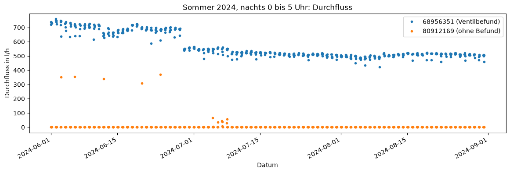

**Was daraus folgt:** Brauchbar ist November 2022 bis zur Begehung. Der Nachtdurchfluss im Sommer
ist das Ventil-Merkmal. Offen ist aber noch, ob der Rückgang von 480 auf 100 l/h aus Schritt 2
wirklich am Tausch liegt oder an einem milderen Winter. → Schritt 4.

---

## Schritt 4 – Liegt es am Wetter?

**Datum:** 20.10.2026, Notebook `A_frage_und_daten.ipynb`

**Ausgangsfrage:** Ein kalter Tag braucht mehr Wasser als ein warmer. Ist der Rückgang beim
Durchfluss der Tausch oder das Wetter?

**Grob verglichen.** Die Außentemperatur kommt von der DWD-Station Kitzingen (`src/weather.py`).
Der Januar 2024 hatte im Mittel 1,5 °C, der Januar 2025 2,7 °C. Ein Grad Unterschied erklärt nicht,
dass nur noch ein Fünftel fließt.

**Sauber verglichen.** Besser ist der Vergleich bei gleicher Temperatur. Dafür Stundenwerte und
Wetter zusammengeführt (`merge`), Tagesmittel gebildet (`resample("D")`) und den Durchfluss gegen
die Außentemperatur gezeichnet ([Abbildung 4.1](#abb-4-1)). An Tagen um 0 °C flossen vor dem Tausch
etwa 530 l/h, danach etwa 120 l/h. Nach dem Tausch fließt an kalten Tagen mehr Wasser, so wie es
sein soll. Vorher war es umgekehrt, am meisten floss an warmen Tagen: Das Ventil hat nicht nach
Bedarf geregelt. So ein Bild heißt Kennlinie. Ab etwa 15 °C wird sie flach (Heizgrenze), dann
braucht die Station nur noch Warmwasser. Tage darunter sind Heiztage.

**Die anderen Befundarten** (nachgeholt am 21.10.). Bei Dämmung, Filter und Temperatur bleibt die
Kennlinie fast gleich ([Abbildung 4.2](#abb-4-2)). Nach dem Einstellen des Durchflusses fließt bei
mittleren Temperaturen weniger. Bei der Station mit verkleinertem Vertrag fließt nach der Begehung
viel mehr, an warmen Tagen sogar mehr als an kalten, wie beim kaputten Ventil. Da wurde wohl etwas
verstellt, mit der Überdimensionierung selbst hat das nichts zu tun.

**Abbildung 4.1:** Tagesmittel von Durchfluss und Außentemperatur bei
Zähler 68956351, vor und nach dem Tausch.

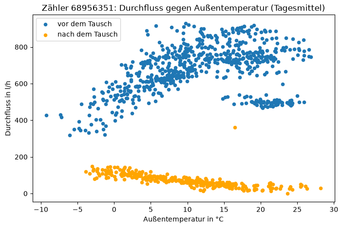

**Abbildung 4.2:** Kennlinien der Beispielstationen der anderen Befundarten.

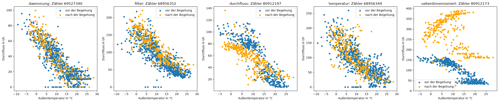

**Was daraus folgt:** Stationen sind nur bei gleichem Wetter vergleichbar, also im selben Zeitraum.
Welche Tage einer Station erlaubt sind, hängt aber von ihrer Begehung ab. → Schritt 5.

---

## Schritt 5 – Welche Tage dürfen ins Modell?

**Datum:** 20.10.2026, Notebook `A_frage_und_daten.ipynb`

**Ausgangsfrage:** Nur Tage vor der Begehung, aber wann wurde begangen? Und gilt für jede Station ein
anderer Zeitraum?

**Wann begangen wurde.** Die Begehungen pro Monat gezählt (`pd.to_datetime`,
`.dt.to_period("M")`, `value_counts`). Die meisten waren im September 2024 (32 von 51 mit Datum),
vor dem 01.09.2024 nur 2, beide im August 2024. Einzelne kamen erst 2025, bei 5 Stationen fehlt das
Datum.

**Ein gemeinsamer Stichtag.** Für die Diagnose gilt der 01.09.2024: nur Daten davor, bei den 2
Augustfällen bis zu ihrem eigenen Datum. So haben alle Stationen denselben Zeitraum und dasselbe
Wetter, und das geht auch für Stationen ohne Datum.

**Befunde kommen selten allein** (nachgeholt am 21.10.). 6 der 11 Ventilstationen haben auch einen
Dämmungsbefund, 8 der 9 überdimensionierten auch einen Durchfluss-Befund. Eine Kennzahl, die zu
einem Befund gehört, kann deshalb auch bei einem anderen auffallen.

**Was daraus folgt:** Phase A ist abgeschlossen. Kennzahlen je Station nur aus Daten ab November
2022 und vor dem Stichtag. Das Ventil hat mit dem Nachtdurchfluss ein Merkmal, die anderen Befunde
brauchen eigene. → Schritt 6.

---

## Schritt 6 – Eine Kennzahl pro Befund

**Datum:** 21.10.2026, Notebook `B_baseline.ipynb`

**Ausgangsfrage:** Jeder Befund braucht seine eigene Kennzahl. Welche, und trennen sie Stationen
mit und ohne Befund?

**Erst die Vermutung, dann die Zahl.** Zuerst habe ich nur Ventil und Dämmung angeschaut, weil aus
der Vorarbeit des Teams bekannt war, dass es dort ein Signal gibt. Das ist aber eine Auswahl mit
Vorwissen. In echt probiert man erst alle Fehlerarten aus und konzentriert sich dann auf die
erkennbaren. Deshalb habe ich Phase A und B am selben Tag für alle sechs Befundarten neu gemacht.
Damit ich die Kennzahl nicht nach dem Ergebnis aussuche, steht für jeden Befund vorher fest,
woran man ihn erkennen könnte und in welche Richtung die Zahl gehen sollte:

| Befund | Idee | Kennzahl | Erwartung bei Befund |
|---|---|---|---|
| Ventil | Wasser läuft nachts im Sommer durch | Median Durchfluss Sommer 2024, 0 bis 5 Uhr | höher |
| Dämmung | Wasser verliert im Keller zusätzlich Wärme | Median Rücklauf Winter 2023/24 | niedriger |
| Filter | verstopfter Filter bremst das Wasser, es kühlt stärker ab | Median Spreizung im Winter, nur mit Durchfluss | höher |
| Durchfluss | zu hoch eingestellt | 99-%-Wert Durchfluss im Winter / Anschlusswert | höher |
| Temperatur | Rücklauf tagsüber zu hoch | Median Rücklauf im Winter, 8 bis 20 Uhr | höher |
| Überdimensioniert | Vertrag wird nie ausgeschöpft | 99-%-Wert Leistung im Winter / alter Vertrag | niedriger |

Zur Dämmung: Ein kalter Rücklauf gilt beim Netzbetreiber eigentlich als gutes Zeichen. Eine
schlecht gedämmte Station sieht auf den ersten Blick also aus wie eine besonders gute.

**Stimmen die Vermutungen?** Median mit gegen ohne Befund: Ventil 67 gegen 0 l/h, stimmt. Dämmung
38,6 gegen 47,6 °C, stimmt. Hier hatte ich zuerst die `groupby`-Ausgabe verwechselt und gesagt, es
stimmt nicht (`True` ist die Zeile mit Befund). Temperatur 49,6 gegen 43,4 °C, stimmt.
Überdimensionierung: Auslastung 0,67 gegen 0,97, stimmt. Filter: Spreizung 25,0 gegen 28,6, also
kleiner statt größer, die Vermutung ist falsch. Durchfluss 31,6 gegen 35,8 l/h pro kW, auch nicht
wie vermutet.

Beim Ventil zeigt der Winter-Rücklauf übrigens in die andere Richtung als bei der Dämmung (55 gegen
42 °C). Und weil 6 der 11 Ventilstationen auch einen Dämmungsbefund haben, können sich die beiden
Effekte aufheben. Jeder Befund braucht seine eigene Kennzahl.

**Wie stark überlappen die Gruppen?** Ein Median sagt nur etwas über die Mitte. Im Boxplot sah es
für mich zuerst so aus, als könnte man die Dämmung bei 40 °C trennen ([Abbildung 6.1](#abb-6-1)).
Unter 40 °C liegen aber nur 12 der 22 Dämmungsstationen und dazu 7 der 32 ohne Befund. Für alle
sechs ([Abbildung 6.2](#abb-6-2)): Beim Ventil und bei der Überdimensionierung liegen die Kästen
deutlich auseinander, bei Dämmung und Temperatur ist die Mitte verschoben, aber sie überlappen
stark, bei Filter und Durchfluss liegen sie fast übereinander.

**Tippfehler unterwegs:** `(1/h)` mit der Ziffer Eins statt `(l/h)` und ein doppeltes Leerzeichen
im Spaltennamen, beides gibt einen `KeyError`. Im Sommerfenster stand 2023 statt 2024, dann ist ein
ganzer Winter drin.

**Abbildung 6.1:** Winter-Rücklauf nach Dämmungsbefund.

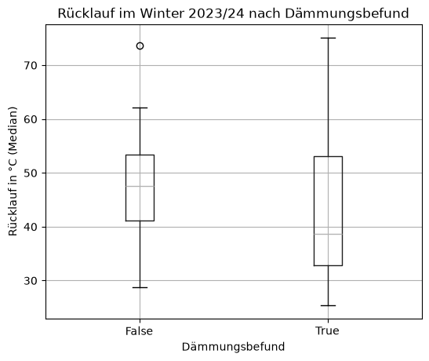

**Abbildung 6.2:** Alle sechs Kennzahlen nach Befund.

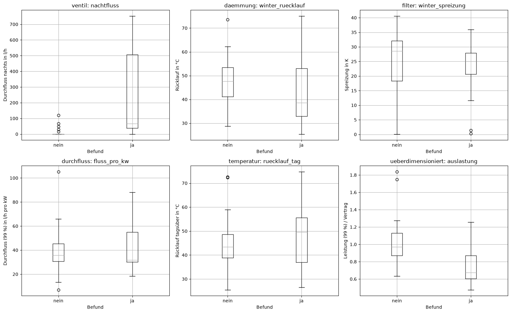

**Was daraus folgt:** Mittelwerte und Kästen zeigen eine Richtung, aber noch keine Zahl dafür, wie
gut eine Kennzahl trennt. Eine Grenze wie die 40 °C ist dafür ungeeignet, das hat schon die
Sommernacht in Schritt 3 gezeigt. → Schritt 7.

---

## Schritt 7 – Wie bewertet man eine Kennzahl, und hilft Kombinieren?

**Datum:** 21.10.2026, Notebook `B_baseline.ipynb`

**Ausgangsfrage:** Wie misst man, wie gut eine Kennzahl trennt, ohne sich auf eine Grenze
festzulegen? Und werden die schwachen Befunde besser, wenn man mehrere Kennzahlen kombiniert?

**Grenze oder AUC?** (Diese Frage habe ich erst am 23.10. in Phase E gestellt, sie gehört aber
hierher.) Üblich sind Accuracy, Precision, Recall und F1. Alle brauchen eine Grenze, ab der Alarm
gegeben wird. Mit dem Nachtdurchfluss fürs Ventil (11 Ventile unter 53 Stationen):

| Alarm, wenn nachts mehr fließt als | Alarme | Accuracy | Precision | Recall |
|---|---|---|---|---|
| nie Alarm | 0 | 79 % | – | 0 % |
| 0 l/h | 14 | 87 % | 64 % | 82 % |
| 50 l/h | 9 | 89 % | 78 % | 64 % |
| 100 l/h | 6 | 87 % | 83 % | 45 % |
| 300 l/h | 5 | 89 % | 100 % | 45 % |

Nie Alarm geben bringt schon 79 % Accuracy, und zwischen den Grenzen bewegt sie sich kaum. Die
Accuracy sagt hier also nichts. Precision (wie viele Alarme sind echt?) und Recall (wie viele
Ventile werden gefunden?) tauschen sich je nach Grenze gegeneinander, wie schon in Schritt 3. Die
Grenze wählt der Betrieb: Bei nur 5 Besuchen im Monat zählt die Precision. Zum Vergleichen nehme ich
deshalb die AUC. Sie ist die Wahrscheinlichkeit, dass von einem Paar aus einer Station mit und
einer ohne Befund die mit Befund den auffälligeren Wert hat, und bewertet so alle Grenzen auf
einmal. 0,5 ist Raten, 1 ist perfekt.

**Die Regeln.** Jede Kennzahl mit ihrer Richtung aus Schritt 6 (`roc_auc_score`): Ventil 0,88,
Überdimensionierung 0,78, Dämmung 0,64, Temperatur 0,60, Durchfluss 0,50, Filter 0,36. Hier wird
nichts gelernt, die Stationen werden nur sortiert. Den Filter drehe ich nicht um, sonst wäre die
Richtung nach dem Ergebnis gewählt.

**Prüfen auf denselben Stationen?** Bevor ich Kennzahlen kombiniere, ein Test mit 10 Spalten reiner
Zufallszahlen: Gelernt und auf denselben Stationen geprüft, kommt eine AUC von 0,75 heraus. Das
habe ich zuerst für „besser“ gehalten als die 0,64 des echten Rücklaufs. Das Problem habe ich dann
so beschrieben, dass das Modell weiß, dass alle einen Befund haben. Es weiß aber, welche Station
welchen Befund hat, und merkt sich das. Mit Leave-one-out, bei dem jede Station von einem Modell
vorhergesagt wird, das sie nie gesehen hat, kommen die Zufallszahlen auf 0,49. Eine AUC zählt nur,
wenn das Modell die geprüften Stationen beim Lernen nicht gesehen hat. Die Zufallszahlen haben
einen festen Startwert (`np.random.seed(4)`), damit das Notebook immer dasselbe zeigt.

**Kombinieren.** Logistische Regression mit `StandardScaler` und Leave-one-out. Mit
Nachtdurchfluss und Winter-Rücklauf: Dämmung 0,67 (allein 0,64), Ventil 0,84 (allein 0,88). Mit
allen fünf Kennzahlen: Ventil 0,78, Dämmung 0,64, Filter 0,55, Durchfluss 0,34, Temperatur 0,35.
Mehr Kennzahlen machen es nirgends besser. Bei rund 50 Stationen muss das Modell seine Gewichte aus
zu wenigen Fällen lernen. Die einfache Regel bleibt die Messlatte.

**Was daraus folgt:** Bei der Dämmung 0,67 gegen 0,64, beim Ventil 0,84 gegen 0,88. Sind solche
Unterschiede bei 11 und 22 Fällen überhaupt echt? → Schritt 8.

---

## Schritt 8 – Wie genau ist eine AUC bei so wenigen Fällen?

**Datum:** 21.10.2026, Notebook `B_baseline.ipynb`

**Ausgangsfrage:** Mit anderen Stationen käme eine andere AUC heraus. Wie groß ist dieser Zufall,
und welche Signale sind echt?

**Bootstrap.** Ich hatte zuerst gedacht, mit anderen Stationen käme dieselbe AUC heraus. Der
Bootstrap zieht 1000-mal die Stationen mit Zurücklegen und rechnet jedes Mal die AUC. 95-%-Bereich:

| Befund | AUC | 95-%-Bereich |
|---|---|---|
| Ventil | 0,88 | 0,72 bis 0,99 |
| Überdimensioniert | 0,78 | 0,52 bis 0,98 |
| Dämmung | 0,64 | 0,46 bis 0,81 |
| Temperatur | 0,60 | 0,44 bis 0,76 |
| Durchfluss | 0,50 | 0,32 bis 0,66 |
| Filter | 0,36 | 0,22 bis 0,52 |

Nur beim Ventil und bei der Überdimensionierung liegt der ganze Bereich über 0,5, bei der
Überdimensionierung sehr breit, weil es nur 9 Fälle gibt. 0,64 gegen 0,67 bei der Dämmung ist kein
echter Unterschied.

**Straßen auslassen.** Stationen in derselben Straße hängen am selben Strang und wurden meist vom
selben Techniker begangen. Deshalb ganze Straßen weglassen (`LeaveOneGroupOut` mit
`strasse_gruppe`): Dämmung mit zwei Kennzahlen 0,66 statt 0,67, mit fünf Kennzahlen Ventil 0,81
statt 0,78 und Dämmung 0,65 statt 0,64. Die Deutung hatte ich zuerst verdreht. Fiele die AUC stark,
hätte das Modell von der Straße profitiert. Dass sie kaum fällt, heißt, es klappt auch bei Straßen,
die es nie gesehen hat.

**Zufallstest.** Befunde durchmischen und schauen, was der Zufall schafft. Bei der logistischen
Regression für die Dämmung kam nur 1 von 200 Durchläufen auf 0,67. Das Ergebnis „0“ einer früheren
Fassung hatte ich erst für gut, dann für schlecht gehalten. Es heißt: Der Zufall schafft es nie.
Bei Leave-one-out liegt der Zufall im Mittel sogar unter 0,5, bei etwa 0,35. Das ist eine Eigenheit
bei wenigen Fällen und der Grund, warum man mit gemischten Labels vergleicht statt mit 0,5. Es
erklärt auch die Werte unter 0,5 in Schritt 7. Für die Regeln mit 1000 Durchläufen, wie oft der
Zufall mindestens so gut ist: Ventil 0 %, Überdimensionierung 0,8 %, Dämmung 4,7 %, Temperatur
12,5 %, Durchfluss 50 %, Filter 97 %.

**Auswahl.** Wer pro Befund zehn Kennzahlen ausprobiert und die beste berichtet, hat wieder auf die
Antworten geschaut. Deshalb standen Kennzahl und Richtung in Schritt 6 vorher fest. Will man doch
auswählen, muss das in jedem Durchlauf nur auf den Trainingsstationen passieren (verschachtelte
Kreuzvalidierung) oder ganz ohne Labels.

**Was daraus folgt:** Phase B ist abgeschlossen. Erkennbar sind das Ventil (0,88) und die
Überdimensionierung (0,78, wenige Fälle), die Dämmung nur schwach. Temperatur, Durchfluss und Filter
nicht. Diese einfachen Regeln sind die Messlatte für alles Weitere. Jede Kennzahl macht aber einen
ganzen Winter zu einer Zahl. Was steckt in den einzelnen Tagen? → Schritt 9.

---

## Schritt 9 – Ein Tag als Tabelle

**Datum:** 21.10.2026, Notebook `C_sequenzen.ipynb`

**Ausgangsfrage:** Eine Kennzahl fasst einen Winter in einer Zahl zusammen. Was geht dabei verloren,
und wie bekommt ein LSTM die Daten später zu sehen?

**Tag × Stunde.** Mit `pivot` die Stundenwerte von 68956351 in eine Tabelle mit einem Tag pro Zeile
und 24 Stunden als Spalten umgebaut. Die Größe habe ich zuerst mit `head()` abgelesen und kam auf
5 × 24, `head()` zeigt aber nur die ersten fünf Zeilen. Tatsächlich sind es 1349 Tage, davon 960
vollständig (71 %).

**Was man nur im Tag sieht.** Vor dem Tausch ist der Rücklauf den ganzen Tag hoch (55 bis 71 °C),
danach springt er zwischen etwa 28 und 60 °C ([Abbildung 9.1](#abb-9-1)). Das ruhige Bild ist der
Fehler: Das Ventil schließt nie. Nach dem Tausch taktet die Station, so wie es sein soll. Das sieht
man nur in der Sequenz, nicht in einer Kennzahl.

**Mehrere Kanäle und Skalierung.** Rücklauf, Durchfluss und Vorlauf zusammen (`pd.concat`,
`reshape`, `transpose`) ergeben 960 Tage × 24 Stunden × 3 Kanäle. Jeder Kanal wird skaliert, denn
sonst zählt im Netz und beim Vorhersagefehler der Kanal mit den größten Zahlen am meisten.
Mittelwert und Streuung kommen nur aus der Zeit vor dem Tausch, sonst steckt Wissen aus der Zukunft
in der Skalierung. Nach dem Tausch liegen alle drei Kanäle im Mittel 4 bis 6 Streuungen unter dem
vorherigen Normalbetrieb. Das habe ich zuerst als „starke Streuung“ gelesen, es ist aber eine
Verschiebung. Genau das ist die Idee des Wächters: Weit weg vom Normalen heißt „anders als sonst“.

**Alle Stationen.** Für alle begangenen Stationen mit der Außentemperatur als viertem Kanal, ab
November 2022 und vor dem Stichtag: 24.684 Tage × 24 Stunden × 4 Kanäle, die rund 24.000 Messtage
aus Schritt 1. Ich dachte, es sind alle 56 Stationen. Bei 80912191 und 81019433 gibt es vor dem
Stichtag aber keinen vollständigen Tag, es sind also 54.

**Abbildung 9.1:** Rücklauf an vier Wintertagen bei 68956351, vor und nach
dem Tausch.

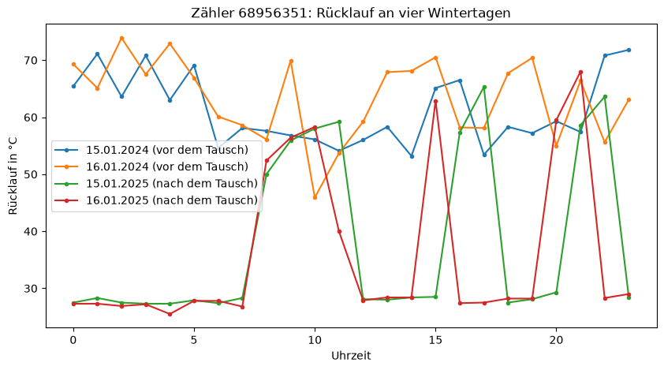

**Was daraus folgt:** Der Tensor ist gespeichert (`X_tage.npy`, `info_tage.csv`). Das LSTM soll den
nächsten Tag vorhersagen. Vorher braucht es eine Messlatte ohne Lernen und, weil ab jetzt gelernt
wird, eine ehrliche Trennung von Training und Test. → Schritt 10 und 11.

---

## Schritt 10 und 11 – Messlatte für den nächsten Tag, Aufteilung nach der Zeit

**Datum:** 21.10.2026, Notebook `C_sequenzen.ipynb`

**Ausgangsfrage:** Wie gut kann man den Rücklauf von morgen ohne Lernen vorhersagen? Und wie teilt
man Tage auf, wenn gelernt wird?

**Ohne Lernen.** Gemessen mit dem mittleren absoluten Fehler in °C, Stunde für Stunde. Über alle
Tage liegt „wie gestern“ 5,7 °C daneben, das Mittel der letzten 7 Tage 5,2 °C. Das Mittel glättet
den Zufall des Taktens weg.

**Aufteilung.** Nachbartage gleichen sich fast aufs Haar. Bei einer zufälligen Aufteilung nach Tagen
dachte ich zuerst an Daten nach der Begehung, die sind im Tensor aber gar nicht drin. Das Problem
sind die Nachbartage: Das Modell hätte den Tag davor und danach schon gesehen. Deshalb nach der
Zeit: Training November 2022 bis Mai 2024, davon 10 % ganze Kalenderwochen als Validierung, Test
Juni bis August 2024. Das sind 18.689 Tage Training, 1.511 Validierung und 4.484 Test.

**Fensterlänge.** Meine eigene Idee war, verschiedene Fenster auszuprobieren. Auf der Validierung:
1 Tag 6,05, 3 Tage 5,38, 7 Tage 5,32, 14 Tage 5,52, 30 Tage 6,20. Das ist eine U-Form: Zu kurz nimmt
den Zufall mit, zu lang altes Wetter. Ausgewählt wird auf der Validierung, nicht im Test: 7 Tage.
Erst dann einmal im Test: 4,28 (wie gestern 4,66).

**Ein erstes gelerntes Modell.** Eine Ridge-Regression mit heute (24 × 4 Werte) und der
Außentemperatur von morgen: Validierung 5,31 (wie gestern 5,85), Test 4,84 (wie gestern 4,71). Im
Sommer ist das gelernte Modell schlechter als die einfachen Regeln. Im Training sind nur 1.833 Tage
aus Juni bis August, aber 6.218 aus Dezember bis Februar. Ridge hat vor allem den Heizbetrieb
gelernt, und der Test sieht anders aus als das Training (Verteilungsverschiebung).

**Was daraus folgt:** Phase C ist abgeschlossen. Das LSTM muss das 7-Tage-Mittel schlagen
(Validierung 5,32, Test 4,28), und der Sommer muss getrennt geprüft werden. → Schritt 12 und 13.

---

## Schritt 12 und 13 – Schlägt ein LSTM die Messlatte?

**Datum:** 22.10.2026, Notebook `D_lstm.ipynb`

**Ausgangsfrage:** Kann ein LSTM den Rücklauf von morgen besser vorhersagen als das 7-Tage-Mittel?

**Was ein LSTM tut.** Mit PyTorch (`nn.LSTM` plus lineare Schicht): Das LSTM liest den Tag Stunde
für Stunde und trägt ein Gedächtnis mit (`hidden_size`). Eine Ausgabe von 1 × 24 × 8 heißt 8
Gedächtniszahlen nach jeder Stunde. Ich hatte die 8 zuerst als „8 Tage, bis sich das Gedächtnis
füllt“ gelesen. Es ist die Größe des Gedächtnisses, gefüllt wird es Stunde für Stunde. Das
Gedächtnis nach der letzten Stunde (`h`) ist die Zusammenfassung des Tages. Eingabe: 4 Kanäle von
heute und die Außentemperatur von morgen.

**Wetter von morgen.** Ich habe gefragt, woher man die Temperatur von morgen im Einsatz kennen soll,
denn dort gibt es nur die Wettervorhersage. Nachgeprüft: ganz ohne sie 5,13 / 4,80 °C, mit
absichtlich 1,5 Grad Fehler 5,10 / 4,86 °C, statt 5,07 / 4,84 °C (Validierung / Test). Macht kaum
etwas aus, das Wetter von heute steckt schon in den anderen Kanälen.

**Lernkurve und Early Stopping.** Training mit `MSELoss` und `Adam`. Mit Gedächtnis 256 und 150
Runden sinkt der Trainingsfehler ab etwa Runde 40 weiter (bis 0,08), der Validierungsfehler steigt
(bis 0,29): Overfitting ([Abbildung 13.1](#abb-13-1)). Den Validierungsfehler hatte ich zuerst
„Testfehler“ genannt. Early Stopping merkt sich den besten Stand und hört nach 20 Runden ohne
Verbesserung auf, hier in Runde 59 mit dem Stand aus Runde 39 (0,214). Fertig eingebaut gibt es das
in PyTorch nicht (nur in Zusatzpaketen wie Lightning oder skorch), deshalb von Hand wie im
Team-Notebook 29. TensorBoard habe ich kurz eingerichtet, aber nicht benutzt.

**Gegen die Messlatte.** Fehler in °C auf denselben Tagen ([Abbildung 13.2](#abb-13-2)), dazu zwei
eigene Ideen: mehrere Tage als Eingabe und Lernen auf allen HAST statt nur den begangenen.

| Variante | Validierung | Validierung Mai–Sep | Test (Sommer 2024) |
|---|---|---|---|
| 7-Tage-Mittel (Messlatte) | 5,29 | 5,23 | 4,28 |
| LSTM, 1 Tag | 5,07 | 4,98 | 4,84 |
| LSTM, 7 Tage Eingabe | 5,02 | 4,90 | 4,77 |
| LSTM, Abweichung vom 7-Tage-Mittel | 5,02 | 4,97 | 4,21 |
| LSTM, 1 Tag, alle HAST | 5,10 | 5,01 | 4,76 |

Zuerst habe ich gesagt, das LSTM schlägt die Messlatte. Das stimmt nur auf der Validierung, im Test
verliert es. Meine nächste Erklärung war der Winter in der Validierung, aber auch auf ihren
Sommertagen gewinnen alle LSTMs. Der eigentliche Grund ist die Lage in der Zeit: Die
Validierungswochen liegen zwischen Trainingswochen, das Modell muss nur eine Lücke füllen. Der Test
liegt nach dem ganzen Training, da muss es wirklich in die Zukunft vorhersagen. Alle HAST bringen
nichts, es bleibt bei den begangenen.

**Auswahl.** Gewählt habe ich die Abweichung vom 7-Tage-Mittel: Auf der Validierung gleichauf mit
„7 Tage Eingabe“, sie startet aber bei der Messlatte. Den Test hatte ich dabei schon von allen
Varianten gesehen, das gehört ehrlich in den Bericht.

**Abbildung 13.1:** Lernkurve mit Gedächtnis 256.

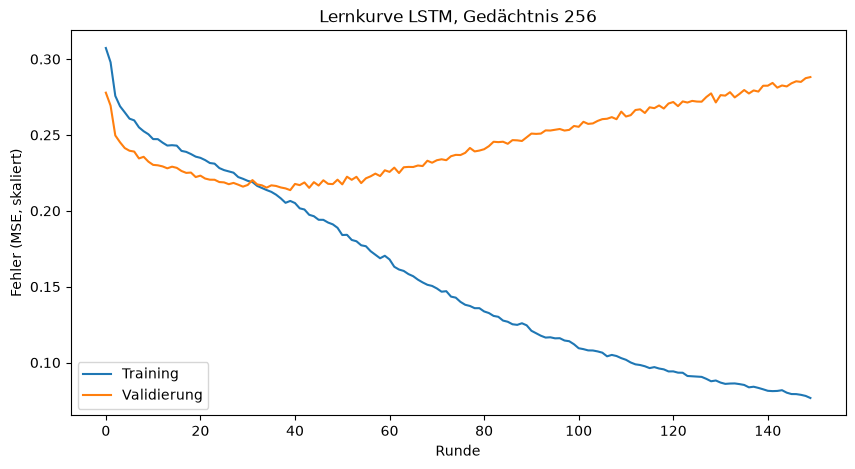

**Abbildung 13.2:** Fehler der Varianten.

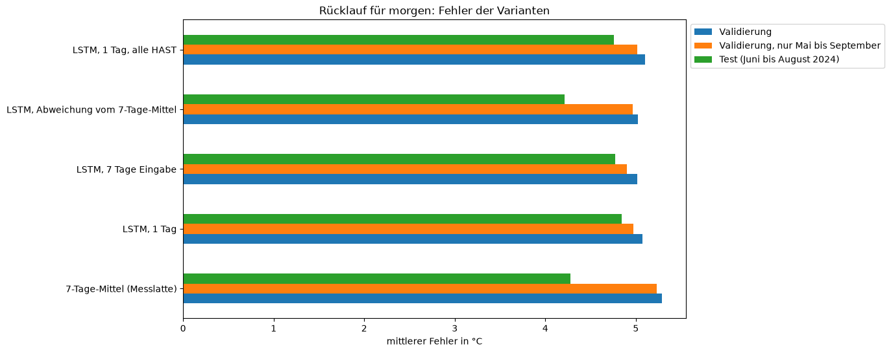

**Was daraus folgt:** Ein LSTM sagt den nächsten Tag knapp besser vorher, im Test nur als
Abweichung vom 7-Tage-Mittel. Für die Fehlererkennung braucht es aber etwas anderes: einen kurzen
Steckbrief, der beschreibt, wie eine Station tickt. Das Gedächtnis hat dafür 256 Zahlen. →
Schritt 14.

---

## Schritt 14 – Ein Tag in 8 Zahlen

**Datum:** 22.10.2026, Notebook `D_lstm.ipynb`

**Ausgangsfrage:** Lässt sich ein Tag auf wenige Zahlen zusammenpressen, ohne dass die Vorhersage
schlechter wird?

**Encoder–Decoder.** Das LSTM (256) liest einen Tag, eine lineare Schicht presst ihn auf 8 Zahlen
(Engpass). Ein kleiner Decoder sagt nur aus diesen 8 Zahlen und der Außentemperatur von morgen
Rücklauf, Durchfluss und Vorlauf von morgen vorher. Alle drei Kanäle sind das Ziel, nicht nur der
Rücklauf. Sonst könnte das Modell den Durchfluss weglassen, und gerade dort sieht man das Ventil.

**Was der Engpass kostet.** Mit Engpass liegt der Validierungsfehler bei 0,1925, ohne Engpass
(256 Zahlen) bei 0,1896, also nur gut 1 % höher. Beim Rücklauf 5,22 statt 5,07 °C, Durchfluss und
Vorlauf fast gleich. Fast alles Wichtige über einen Tag passt in 8 Zahlen. Für jeden der 24.684 Tage
sind die 8 Zahlen gespeichert (`embedding_tage.npy`, Gewichte in
`notebooks/models/lernpfad/embedding_8.pt`).

**Wie prüft man 8 Zahlen ohne Namen?** Darauf hatte ich zuerst keine Antwort. Man prüft sie an dem,
was man mit ihnen machen kann: dieselbe Station in einem anderen Zeitraum wiedererkennen und die
Befunde finden.

**Was daraus folgt:** Phase D ist abgeschlossen. Ob in den 8 Zahlen etwas über die Station steckt,
zeigt Phase E. → Schritt 15.

---

## Schritt 15 – Erkennt man eine Station an ihren 8 Zahlen wieder?

**Datum:** 23.10.2026, Notebook `E_embedding.ipynb`

**Ausgangsfrage:** Seit Schritt 14 hat jeder Tag 8 Zahlen. Die Zahlen haben aber keine Namen.
Steckt darin wirklich etwas über die Station, oder nur über das Wetter des Tages?

**Vom Tag zur Station.** Für die Fehlersuche brauche ich einen Steckbrief pro Station, nicht pro
Tag. Zuerst dachte ich, jeder Tag behält einfach seine 8 Zahlen. Gebraucht wird aber eine
Zusammenfassung über alle Tage, so wie die Zeugnisnote aus vielen Noten: der Durchschnitt. Über
alle Tage zu mitteln ist aber unfair, denn je nach Datenzeitraum liegen 42 bis 65 % der Tage einer
Station im Winter. Ein Durchschnitt mit vielen Wintertagen wäre „kälter“, ohne dass mit der Station
etwas anders ist. Deshalb nehme ich nur Tage von November bis März, jede Station hat davon
mindestens 141.

**Wiedererkennen als Prüfung.** Wenn die 8 Zahlen beschreiben, wie eine Station tickt, muss man sie
ein Jahr später wiedererkennen. Dafür baue ich einen Steckbrief aus dem Winter 2022/23
(23 Stationen) und einen aus dem Winter 2023/24 (alle 54). Für jede Station aus dem ersten Winter
suche ich im zweiten den ähnlichsten Steckbrief. Ähnlich heißt kleiner Abstand, also die
Luftlinie zwischen den beiden Listen von 8 Zahlen (`cdist`, dann `argmin`). Dabei ist nur wichtig,
ob die eigene Station den **kleinsten** Abstand hat, nicht ob der Abstand klein ist.

Ergebnis: 19 von 23 Stationen werden wiedererkannt. Zum Einordnen: Blind geraten hat jede Station
eine Chance von 1 zu 54, das ergibt 23 × 1/54 ≈ 0,4 Treffer. Ich hatte zuerst 54 gesagt.

**Liegt das am LSTM?** Raten ist eine niedrige Latte, deshalb vergleiche ich mit einem einfachen
Steckbrief ohne LSTM: die Mittelwerte von Rücklauf, Durchfluss und Vorlauf im Winter. Dabei kam die
nächste Frage auf: Rechnet man den Abstand direkt aus, bestimmt ihn fast allein der Durchfluss,
weil er in l/h große Zahlen hat (Streuung 142 l/h gegen 10 °C beim Rücklauf). Ich hatte zuerst auf
den Rücklauf getippt. Deshalb wird vorher standardisiert, mit Mittelwert und Streuung aus
Winter 2. Ergebnis: 13 von 23.

Dagegen lässt sich einwenden, dass das LSTM 8 Zahlen hat und die Mittelwerte nur 3. Deshalb noch
ein Steckbrief mit mehr Zahlen: der typische Wintertag, bei dem jede Stunde einzeln gemittelt wird
(24 × 3 = 72 Zahlen). Ich habe erwartet, dass er das LSTM schlägt. Es kamen 15 heraus. Mehr Zahlen
allein bringen es also nicht.

Das LSTM erkennt alle 15 Stationen des typischen Wintertags und 4 weitere, umgekehrt keine. Wären
beide gleich gut, würden die strittigen Stationen wie beim Münzwurf auf beide Seiten fallen.
Viermal Kopf passiert in 1 von 16 Fällen. Das ist ein deutlicher Hinweis, aber kein Beweis.

| Steckbrief | Zahlen | wiedererkannt von 23 |
|---|---|---|
| Raten | | 0,4 |
| Mittelwerte | 3 | 13 |
| typischer Wintertag | 72 | 15 |
| LSTM-Embedding | 8 | 19 |

**Die Station, die herausfällt.** Von den 4 nicht erkannten Stationen sind 3 knapp daneben (die
richtige auf Platz 2, 4 und 9). 68956372 landet aber auf Platz 51 von 54. Zwischen den Wintern stieg
ihr Rücklauf von 41 auf 70 °C und der Durchfluss von 51 auf 318 l/h: Das Wasser läuft durch, ohne
seine Wärme abzugeben, wie bei einem offenen Ventil. Bei der Begehung am 14.10.2024 gab es dort
tatsächlich einen Ventilbefund. Zuerst habe ich das für eine Schwäche des Embeddings gehalten. Es
ist aber gewollt: Die Station verhält sich seit dem Schaden wirklich anders, und ein Steckbrief, der
sie trotzdem wiedererkennt, hätte den Schaden übersehen.

**Abbildung 15.1:** Wiedererkennung über zwei Winter.

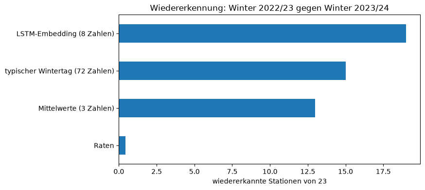

**Was daraus folgt:** In den 8 Zahlen steckt, wie eine Station tickt, und sie ändern sich, wenn
etwas kaputtgeht. Offen ist, ob man an ihnen auch erkennt, **was** kaputt ist. → Schritt 16.

---

## Schritt 16 – Findet der Steckbrief die Befunde?

**Datum:** 23.10.2026, Notebook `E_embedding.ipynb`

**Ausgangsfrage:** Die 8 Zahlen erkennen eine Station wieder. Erkennt man an ihnen auch die
Befunde aus der Begehung, und besser als mit der einfachen Regel aus Phase B?

**Welcher Zeitraum?** Ich nehme nur den Steckbrief aus dem Winter 2023/24 (`s2`). Er liegt am
nächsten an den Begehungen (ab Ende August 2024), alle 54 Stationen haben ihn, und alle Tage liegen
vor der Begehung. Beide Winter zu mitteln würde Schäden verwässern, die erst im zweiten Winter da
sind, wie bei 68956372.

**Erwartung vorher.** Bevor gerechnet wird, steht im Notebook, was ich erwarte: Ventil, Dämmung und
Überdimensionierung findet das Embedding, Filter, Durchfluss und Temperatur nicht. Sonst sucht man
sich hinterher das Passende aus.

**Prüfung wie in Phase B.** Logistische Regression mit `StandardScaler`, Leave-one-out (jede
Station wird aus den anderen 53 vorhergesagt), AUC. Ich hatte das Verfahren zuerst
Leave-one-group-out genannt, das war aber der Straßentest aus Schritt 8. Dazu der Zufallstest: die
Befunde 100-mal mischen und zählen, wie oft der Zufall mindestens so gut ist.

| Befund | AUC | Zufall mindestens so gut |
|---|---|---|
| Ventil | 0,83 | 0 von 100 |
| Dämmung | 0,67 | 1 von 100 |
| Filter | 0,60 | 18 von 100 |
| Durchfluss | 0,30 | 88 von 100 |
| Temperatur | 0,28 | 92 von 100 |
| Überdimensionierung | 0,02 | 100 von 100 |

Echt sind nur Ventil und Dämmung. Den Filter mit 0,60 hielt ich zuerst für besser als Zufall,
gemischte Befunde schaffen das aber in 18 von 100 Fällen. Die übliche Grenze ist 5 von 100.

**Überdimensionierung.** Die 0,02 habe ich zuerst als Bestätigung meiner Erwartung gelesen. 0,5 ist
aber Raten, 0,02 ist fast genau falsch herum. Überdimensioniert heißt, die Station braucht viel
weniger, als ihr Vertrag erlaubt. Die Regel aus Phase B hat den Verbrauch deshalb durch den Vertrag
geteilt. Das Embedding kennt den Vertrag nicht. Ich hatte zuerst das Alter des Hauses als fehlende
Information vermutet, das wäre aber nur ein Umweg. Die 0,02 einfach auf 0,98 umzudrehen, ist nicht
erlaubt: Die Richtung lernt die logistische Regression selbst, und hinterher umdrehen hieße, auf
die Antworten zu schauen.

**Ist das LSTM besser als einfache Mittel?** Für einen sauberen Vergleich ändere ich nur den
Steckbrief: dieselbe Rechnung mit den 3 Mittelwerten aus demselben Winter. Ich habe geschätzt, dass
sie besser sind, und das stimmte:

| Befund | Regel (Phase B) | 3 Mittelwerte | Embedding |
|---|---|---|---|
| Ventil | 0,88 | 0,85 | 0,83 |
| Dämmung | 0,64 | 0,71 | 0,67 |

Alle drei liegen gleichauf. Bei der Dämmung habe ich 0,67 gegen 0,64 zuerst als Gewinn für das LSTM
gesehen. Genau diesen Unterschied hatte ich in Schritt 8 aber schon als bedeutungslos eingestuft
(Bootstrap 0,46 bis 0,81).

Warum ist das LSTM beim Wiedererkennen besser, hier aber nicht? Zum Wiedererkennen braucht man viele
kleine Eigenheiten, wie bei einem Fingerabdruck. Ein offenes Ventil ist dagegen eine grobe
Abweichung, wie Fieber, und dafür reicht ein Thermometer, also der Mittelwert. Außerdem lernt die
logistische Regression aus 11 Ventilfällen mit 3 klaren Zahlen leichter als mit 8 ohne Namen.

**Abbildung 16.1:** AUC für alle sechs Befundarten.

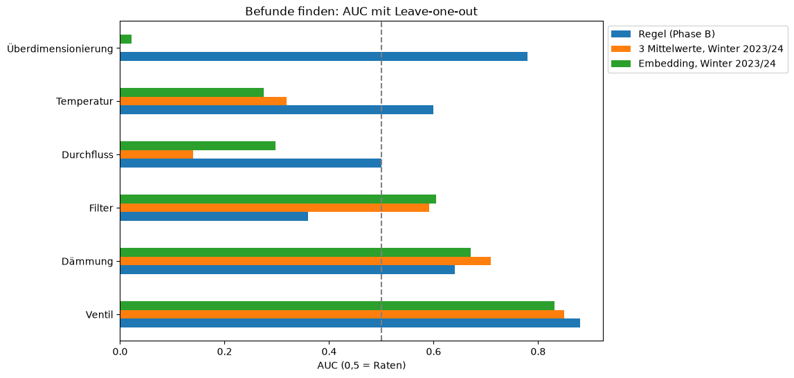

**Was daraus folgt:** Für die Befunde bringt das LSTM nichts über drei Mittelwerte hinaus. Damit
stellen sich zwei Fragen: Warum dann überhaupt der Umweg über „morgen vorhersagen“? Und war der
Engpass von 8 Zahlen gut gewählt? → Schritt 17.

---

## Schritt 17 – Warum der Umweg, und wie groß soll der Engpass sein?

**Datum:** 23.10.2026, Notebook `E_embedding.ipynb`

**Ausgangsfrage:** Man könnte ein LSTM auch direkt auf die Befunde trainieren. Und in Phase D habe
ich 8 Zahlen festgelegt, ohne andere Größen zu prüfen.

**Warum nicht direkt auf die Befunde?** Das LSTM aus Phase D hat 283.856 gelernte Zahlen, für das
Ventil gibt es 11 Fälle. Direkt auf die Befunde trainiert, würde es jede Station auswendig lernen.
Schon 10 Spalten Zufallszahlen haben in Schritt 7 auf den Lernstationen eine AUC von 0,75
vorgetäuscht. Deshalb lernt das LSTM aus 24.684 Tagen, den nächsten Tag vorherzusagen, und braucht
dafür keine Befunde. Die Befunde sieht nur die logistische Regression mit 9 Zahlen. Als Grund hatte
ich zuerst Data Leakage genannt. Das ist aber ein anderes Problem, bei dem Informationen ins
Training rutschen, die man im Einsatz nicht hätte.

**Wie wählt man den Engpass, ohne auf die Befunde zu schauen?** Wer bei den Befunden die beste
Variante aussucht, hat wieder auf die Antworten geschaut (Schritt 8). Es gibt aber zwei Messungen,
die ganz ohne Befunde auskommen: den Validierungsfehler aus Phase D und die Wiedererkennung aus
Schritt 15. Ich hatte zuerst den Zufallstest genannt, der braucht aber die Befunde, er mischt sie
ja nur. Vor dem Training habe ich die Regel festgelegt, dass der kleinste Validierungsfehler gewinnt.
Erwartet habe ich, dass mehr Zahlen ab einem Punkt schlechter werden.

Dafür die Vorbereitung aus Phase D übernommen und mit 4, 8 und 16 Zahlen neu trainiert, jeweils mit
demselben Startwert:

| Engpass | Validierungsfehler | wiedererkannt von 23 |
|---|---|---|
| 4 Zahlen | 0,2013 | 17 |
| 8 Zahlen | 0,1925 | 19 |
| 16 Zahlen | 0,1906 | 20 |

Bei 8 kommen genau die Werte aus Phase D und Schritt 15 heraus, das Training ist also
wiederholbar. Meine Erwartung hat sich nicht bestätigt: Bis 16 wird es leicht besser. Von 4 auf 8
ist der Gewinn deutlich, von 8 auf 16 kaum noch. Nach der Regel ist es 16.

**Erst jetzt die Befunde.** Die gewählte Variante, mit Zufallstest: Ventil 0,79 (0 von 100),
Dämmung 0,68 (3), Filter 0,69 (2), Durchfluss 0,53 (25), Temperatur 0,25 (96),
Überdimensionierung 0,35 (81). Ventil und Dämmung sind nicht besser als mit 8 Zahlen. Besser
vorhersagen und wiedererkennen heißt also nicht besser Fehler finden.

Der Filter liegt jetzt unter der Grenze von 5 von 100. Ich habe inzwischen aber 12 Tests gemacht
(6 Befunde mal 2 Varianten). Bei der Grenze 5 von 100 erwartet man dabei 12 × 0,05 = 0,6
Zufallstreffer, ich hatte 2 geschätzt. Ein Treffer, den ich vorher nicht erwartet habe und der nur
in einer Variante auftaucht, ist deshalb nur ein Hinweis.

**Was daraus folgt:** Phase E ist abgeschlossen. Das Embedding beschreibt Stationen gut, findet die
Befunde aber nicht besser als drei Mittelwerte. Seine Stärke hat 68956372 gezeigt: Wenn sich eine
Station verändert, verändert sich ihr Steckbrief. Daraus kommt die Idee für Phase F: jede Station
mit sich selbst vergleichen, statt Stationen untereinander. → Schritt 18, der Wächter.

---

## Schritt 18 – Ein Wächter, der jede Station mit sich selbst vergleicht

**Datum:** 23.10.2026, Notebook `F_waechter.ipynb`

**Ausgangsfrage:** Bei 68956372 hat sich der Steckbrief nach dem Ventilschaden verändert, gemerkt
haben wir das aber erst ein Jahr später. Kann ein Wächter so etwas Tag für Tag bemerken?

**Die Idee.** Der Wächter sagt jeden Tag den Rücklauf vorher und schaut, wie weit die Messung
danebenliegt. Solange die Station tickt wie immer, liegt die Vorhersage ungefähr so daneben wie
sonst auch. Wird die Differenz unnormal groß, verhält sich die Station anders. Als Vorhersage nehme
ich das 7-Tage-Mittel aus Phase C. Das LSTM hat es in Phase D kaum geschlagen, und es muss nichts
trainiert werden. Die Differenz ist Messung minus Vorhersage, gemittelt über die 24 Stunden.
Positiv heißt: wärmer als erwartet.

**Der Schadenstag von 68956372.** Ich habe in den Tageswerten nachgesehen, wann der Schaden kam: am
08.08.2023. Davor flossen nachts etwa 25 l/h, ab dem 19.08. dauerhaft rund 340 l/h, der Rücklauf
stieg von etwa 61 auf 75 °C. Am Schadenstag lag die Differenz bei +13 Grad, normal sind bei dieser
Station im Sommer 2 bis 3 Grad. Eine Woche später ist sie aber wieder bei 0
([Abbildung 18.1](#abb-18-1)), weil das 7-Tage-Mittel dann nur noch aus Tagen mit kaputtem Ventil
besteht. Ich hatte das zuerst mit der Begehung durcheinandergebracht, die war aber erst im Oktober
2024. Der Wächter gewöhnt sich also an einen Schaden und muss in den ersten Tagen anschlagen,
sonst gar nicht.

**Was ist unnormal?** Bei einer ruhigen Station sind 2 Grad Differenz normal, bei einer taktenden
8 Grad. Deshalb bekommt jede Station ihr eigenes Fenster: Mittelwert und Streuung ihrer Differenzen
in den letzten 8 Wochen (`rolling(56, min_periods=28)`, `shift(1)`, damit der heutige Tag nicht
in seinem eigenen Normalbereich steckt). Die Differenz von heute in Streuungen gemessen ist der
z-Wert. Am Schadenstag hatte 68956372 z = 5,9.

**Die Grenze.** Zu hoch heißt kein Alarm, auch beim echten Schaden, zu niedrig heißt Alarm bei
jeder Kleinigkeit. Ich lege sie nur über die Alarme an normalen Tagen fest, ohne auf gefundene
Schäden zu schauen. Fast alle Tage sind normal, also sind das fast alles Fehlalarme. Gezählt über
etwa 56 Stationsjahre, beide Richtungen (`abs()`):

| Grenze | Alarmtage | je Station und Jahr |
|---|---|---|
| 2 | 1.329 | 23,8 |
| 3 | 327 | 5,8 |
| 4 | 118 | 2,1 |
| 5 | 63 | 1,1 |

Bei einem Budget von 1 bis 2 Alarmen pro Station und Jahr ist das Grenze 5. Damit schlägt der
Wächter bei 68956372 in fast zwei Jahren genau einmal an, am 08.08.2023 ([Abbildung
18.2](#abb-18-2)).

**Woher die anderen Alarme kommen.** Die 63 Alarmtage verteilen sich auf 25 Stationen und häufen
sich im Mai und von Oktober bis Dezember, also beim Heizende und Heizbeginn. Wir dachten zuerst,
das liegt am schnellen Wetterwechsel, den das 7-Tage-Mittel nicht kennt. Nachgerechnet: Zieht man
den Wettereinfluss ab, sinken die Alarme nur von 1,13 auf 1,02. Die eigentliche Ursache ist das
Fenster. Im Sommer liegt die Vorhersage etwa ±2,5 Grad daneben, im Oktober ±4,5. Am 1. Oktober
enthält das Fenster aber vor allem August und September und hält ±2,3 für normal. Ein ganz
gewöhnlicher Oktobertag, an dem die Heizung anspringt, ist dann über 4 Streuungen weg.

**Winter und Sommer trennen?** Meine Idee war, Heiztage nur mit Heiztagen und Sommertage nur mit
Sommertagen zu vergleichen. Ergebnis: 1,08 statt 1,13 Alarme pro Station und Jahr, im Oktober 3
statt 10, im Mai aber 13 statt 11. Gelohnt hat es sich nicht. Der Rückgang im Oktober ist sogar
eine Falle: Stationen mit Daten erst ab September 2023 haben vorher keine Heiztage und bekommen in
den ersten 4 Wochen gar keinen z-Wert (Oktober 707 statt 878 Tage). Weniger Alarme heißt dort
„schaut weniger hin“. Ich bleibe beim einfachen Wächter.

**Abbildung 18.1:** Differenz bei 68956372 im Sommer 2023.

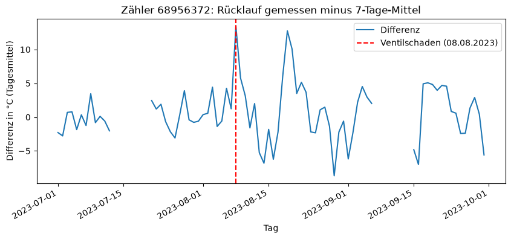

**Abbildung 18.2:** z-Wert bei 68956372 über die ganze Zeit, Grenze ±5.

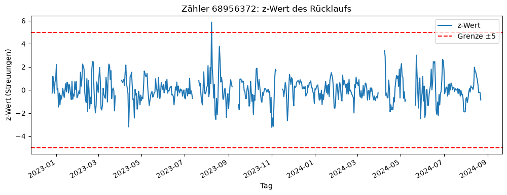

**Was daraus folgt:** Der Wächter hat etwa 1 Fehlalarm pro Station und Jahr und erkennt den einen
echten Fall mit bekanntem Datum. Ein Fall ist aber kein Beweis. Wie oft findet er einen Schaden,
und wie groß muss der sein? → Schritt 19.

---

## Schritt 19 – Wie groß muss ein Schaden sein, damit der Wächter ihn bemerkt?

**Datum:** 23.10.2026, Notebook `F_waechter.ipynb`

**Ausgangsfrage:** Der Wächter hat den einen Schaden mit bekanntem Datum erkannt. Ist das die
Regel oder Glück, und ab welcher Größe merkt er einen Schaden?

**Wie prüft man das ohne Schadensdaten?** Meine erste Idee war, die Stationen mit Befund mit den
gesunden zu vergleichen. Das ist aber der Weg aus Phase B und E: Er zeigt, **welche** Station
auffällig ist, nicht **wann** sie sich verändert. Dann kam der Einwand, dass jede Begehung ein
bekanntes Datum hat. Das stimmt, und das prüfen wir in Schritt 20. Die Begehung ist aber das Ende
eines Schadens (die Reparatur), nicht sein Anfang, und unsere Tage enden am Stichtag vor fast allen
Begehungen. Außerdem wurde nicht bei jeder Begehung ein Schaden gefunden.

Deshalb zuerst künstliche Schäden, wie beim Rauchmelder-Test mit Prüfspray: Ich tue so, als würde
an einem Tag der Rücklauf plötzlich um einen festen Betrag steigen. Am ersten Tag ist das Fenster
noch unverändert, nur die Differenz von heute wird größer. Der z-Wert steigt also um
Sprung / Streuung des Fensters. So kann jeder der rund 20.000 Tage einmal Schadenstag sein.

**Rücklauf.** Ich habe geschätzt, dass ein Sprung von 10 Grad immer erkannt wird. Es sind 37 %:

| Sprung im Rücklauf | 2 Grad | 5 Grad | 10 Grad | 15 Grad | 20 Grad |
|---|---|---|---|---|---|
| am ersten Tag erkannt | 4 % | 11 % | 37 % | 60 % | 76 % |

Bei einer ruhigen Station mit ±2 Grad sind 10 Grad 5 Streuungen, bei einer unruhigen mit ±5 Grad
nur 2. 68956372 war ein günstiger Fall: großer Sprung im ruhigen Sommer.

**Durchfluss.** Bei 68956372 stieg der Rücklauf um ein Viertel, der Durchfluss nachts aber auf das
14-Fache (25 auf 340 l/h). Für das Ventil ist der Durchfluss also der bessere Kanal, das passt zur
Kennzahl aus Phase B. Derselbe Wächter auf dem Durchfluss: 1,27 Fehlalarme pro Station und Jahr bei
Grenze 5, am Schadenstag von 68956372 z = 12,8 statt 5,9. Mit Prüfspray:

| Sprung im Durchfluss | 25 l/h | 50 l/h | 100 l/h | 150 l/h | 200 l/h | 300 l/h |
|---|---|---|---|---|---|---|
| Grenze 5 (1,3 Fehlalarme je Jahr) | 4 % | 18 % | 48 % | 65 % | 75 % | 87 % |
| Grenze 4 (2,4 Fehlalarme je Jahr) | 8 % | 27 % | 58 % | 73 % | 82 % | 91 % |

Grenze 4 findet bei 150 l/h 8 Prozentpunkte mehr, kostet aber fast doppelt so viele Fehlalarme,
bei 54 Stationen etwa 130 statt 70 im Jahr. Die Grenze bleibt bei 5, sie war vorher über das
Budget festgelegt ([Abbildung 19.1](#abb-19-1)).

**Abbildung 19.1:** Eingebauter Sprung im Durchfluss, am ersten Tag erkannt,
für Grenze 4 und 5.

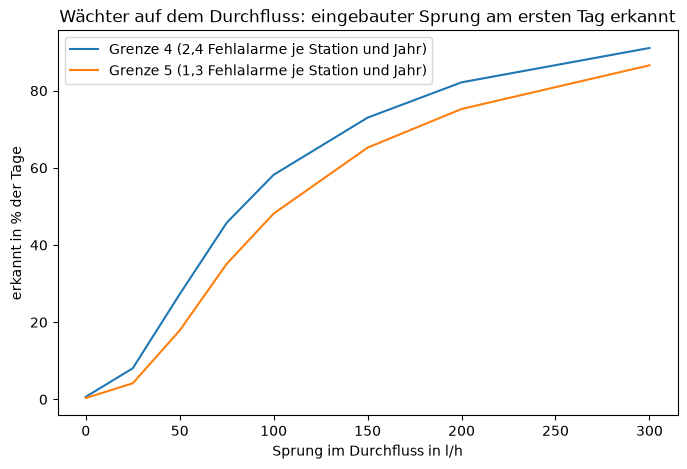

**Was daraus folgt:** Der Wächter findet große Sprünge zuverlässig, kleine kaum. Beim Ventil ist
der Durchfluss das bessere Signal. Offen ist, wie er sich an den echten Begehungen schlägt und wie
er gegen die Wächter des Teams (Notebook 20 und 30) abschneidet. → Schritt 20.

---

## Schritt 20 – Der Wächter an den echten Begehungen

**Datum:** 23.10.2026, Notebook `F_waechter.ipynb`

**Ausgangsfrage:** Mit Prüfspray findet der Wächter große Sprünge. Bemerkt er auch die echten
Eingriffe bei den Begehungen, und wie schneidet er gegen die Wächter des Teams ab?

**Die Daten nach dem Stichtag.** Bisher endeten alle Tage am 01.09.2024, vor fast allen
Begehungen. Jetzt lade ich alle 96 Zähler ab November 2022 bis zum Ende der Daten, auch die 40, die
nie begangen wurden. Den Stunden-Tensor braucht es dafür nicht: Die Differenz zum 7-Tage-Mittel,
gemittelt über den Tag, ist dasselbe wie Tagesmittel minus 7-Tage-Mittel der Tagesmittel. Das
ergibt 70.632 vollständige Tage. Derselbe Wächter für Rücklauf und Durchfluss, Alarm, wenn einer
der beiden |z| ≥ 5 hat. Zur Kontrolle kommen bei 68956372 am Schadenstag wieder 5,9 und 12,8
heraus.

**Womit vergleichen?** Die meisten Begehungen waren im September bis November 2024, also zum
Heizbeginn, wo es auch ohne Schaden viele Alarme gibt. Mein erster Gedanke war, abzuziehen, was
sowieso kommt. Dafür braucht es eine Kontrollgruppe: die 40 nie begangenen Zähler im selben
Zeitfenster. Sie erleben denselben Heizbeginn, aber keinen Techniker, wie die Placebo-Gruppe bei
einem Medikamententest. Ob der Unterschied Zufall sein kann, prüft ein Binomialtest.

**Ergebnis in den 14 Tagen nach der Begehung.** 16 von 41 Begehungen mit Alarm (39 %), bei den
Kontrollstationen im selben Zeitraum 20 %, p = 0,003. Beim Ventiltausch an 68956351 schlägt der
Wächter am Tag des Tauschs an (Durchfluss z = −15). Zum Vergleich Notebook 32, ebenfalls 14 Tage:

| Wächter | Begehungen mit Alarm | Kontrolle | p | 68956351 |
|---|---|---|---|---|
| unser Wächter (7-Tage-Mittel, z ≥ 5) | 39 % | 20 % | 0,003 | am selben Tag |
| Normalverhaltensmodell (Notebook 20) | 39 % | 19 % | 0,008 | nach 2 Tagen |
| Prognose-LSTM (Notebook 30) | 18 % | 20 % | kein Signal | nach 7 Tagen |

Die Bedingungen sind nicht ganz gleich (das Team nur Heiztage ab Juni 2024, etwas andere
Kontrollgruppe, angeglichenes Alarmbudget).

**Ein Verdacht.** Am Begehungstag arbeitet der Techniker an der Station. Kommen die Alarme
vielleicht nur davon? Nachgesehen: 12 der 16 Treffer liegen am Tag der Begehung oder am Tag danach.
Lässt man diese beiden Tage weg, sind es 9 von 41 gegen 17 %, p = 0,28, also kein Unterschied
mehr. Bei den Ventilstationen schlägt er in 6 von 9 Fällen an, dort wurde am Begehungstag wirklich
etwas getauscht. Der Wächter bemerkt also den Eingriff selbst, aber nicht die kleinere bleibende
Veränderung danach. Ob ein Alarm am Tag 0 vom Besuch oder von der Reparatur kommt, lässt sich nicht
trennen. Damit sieht der Vergleich mit dem Normalverhaltensmodell weniger gut aus, als die
gleichen 39 % vermuten lassen. Laut Notebook 32 verschiebt eine Begehung den Betrieb im Mittel nur
um etwa eine halbe Streuung. Sebs CUSUM zählt so eine kleine Verschiebung Tag für Tag auf, unsere
Grenze von 5 Streuungen sieht sie nie.

**Grenzen des Wächters.**

- **Er gewöhnt sich an jeden Zustand.** Nach 7 Tagen ist ein Schaden der neue Normalzustand. Ein
  Schaden, der schon da war, als die Überwachung begann, oder einer, der sich langsam einschleicht,
  fällt nie auf. Bei 68956351 stand das Ventil etwa drei Jahre offen, bemerkt wurde nur der Tausch.
- **Er sieht nur große Sprünge.** 10 Grad im Rücklauf zu 37 %, 100 l/h im Durchfluss zu 48 %. Die
  Veränderung nach einer Begehung ist meist viel kleiner.
- **Fehlalarme in der Übergangszeit.** Beim Heizbeginn und Heizende vergleicht das Fenster mit
  einer ruhigeren Zeit.
- **Er sagt nur „anders“, nicht „was“.** Ob ein Ventil hängt, jemand im Urlaub ist oder der
  Techniker da war, muss danach die Diagnose aus Phase B und E klären.

**Was daraus folgt:** Phase F ist abgeschlossen. Ein Wächter aus dem 7-Tage-Mittel mit z-Werten je
Station fängt große, plötzliche Veränderungen schnell, auch ohne gelerntes Modell. Für kleine,
bleibende Veränderungen braucht es eine Regel, die Abweichungen aufsummiert, wie das CUSUM im
Normalverhaltensmodell. Offen ist noch der Abschluss: alle Ergebnisse gegen die Notebooks 27 bis
32 und die Vorarbeit stellen.

---

## Schritt 21 – Was die Folien verlangen, und Kennzahlen für alle 96 Zähler

**Datum:** 23.10.2026, Notebook `G_folie5.ipynb`

**Hinweis:** Phase G habe ich aus Zeitgründen nicht Schritt für Schritt selbst abgetippt, sondern
von Claude bauen lassen. Die Entscheidungen sind in den Einträgen begründet, das Notebook läuft mit
Ausgaben durch.

**Ausgangsfrage:** Am Ende soll das Projekt drei Dinge liefern: Alarm, Fehler erkennen, Fehler
unterteilen. Den Alarm gibt es seit Phase F, das Erkennen seit Phase B und E. Es fehlt die
Einteilung jeder Station nach Folie 5. Was braucht es dafür?

**Folie 5.** Drei Klassen mit je einer Empfehlung: Station läuft gut (kein Handlungsbedarf),
läuft schlechter als möglich bei intakter Technik (Regelparameter optimieren), Regelventil
schließt nicht (Regelventil tauschen). Die Reihenfolge übernehme ich vom Team (Notebook 28 und
31): erst das Ventil, dann für den Rest „Optimum oder schlechter“.

**Davor eine Zweifelsfrage.** Ich war unsicher, ob unser Ergebnis überhaupt gut ist, weil nur zwei
Befundarten sicher erkennbar sind, und warum wir nicht mehr getunt oder ein Modell pro Fehlerart
gebaut haben. Die Antwort: Gegen das Team liegen wir fast überall gleichauf (Ventil 0,88 gegen
0,89, Überdimensionierung 0,78 gegen 0,78, Wiedererkennung 83 % gegen 86 %). Tuning an einem
einzigen Schaden mit Datum und 41 Begehungen hieße, auf die Antworten zu schauen. Für ein Modell
pro Fehlerart fehlen Stationen: Nur 5 begangene haben gar keinen Befund, nur 3 Ventilstationen
keinen weiteren. XGBoost war nicht wegen eines Labels schlecht. Die Bezugsgröße für die
Überdimensionierung war im Team-Lauf der schon geänderte Anschlusswert. Mit dem Vertrag vor der
Begehung kommt Notebook 31 auf 0,78, genau wie die einfache Regel.

**Kennzahlen.** Dieselben wie in Phase B, jetzt für alle 96 Zähler und mit demselben Stand (vor
dem Stichtag, die Augustfälle vor ihrer Begehung): Nachtdurchfluss im Sommer 2024, Rücklauf und
Spreizung im Winter 2023/24. Nachtdurchfluss gibt es für 87 Zähler, Winterwerte für 90. Die
begangenen Stationen haben 5 bis 24 kW, unter den nie begangenen gibt es welche bis 500 kW und
welche ohne Anschlusswert. Diese 13 werden markiert, weil die Regeln nur an kleinen Stationen
geprüft wurden.

**Was daraus folgt:** Mit den Kennzahlen lässt sich zuerst das Ventil prüfen. → Schritt 22.

---

## Schritt 22 – Ventil-Verdacht für jede Station

**Datum:** 23.10.2026, Notebook `G_folie5.ipynb`

**Ausgangsfrage:** Die Nachtdurchfluss-Regel hat eine AUC von 0,88. Für eine Klasse braucht es aber
eine Grenze. Welche?

**Die Grenze.** Aus der Tabelle in Schritt 7: Über 0 l/h finden 82 % der Ventile, nur 64 % der
Alarme sind aber echt. Über 100 l/h sind 83 % echt, gefunden werden aber nur 45 %. „Regelventil
tauschen“ heißt, dass ein Techniker hinfährt, deshalb zählt die Precision, und trotzdem soll mehr
als die Hälfte gefunden werden. Das ist die Grenze 50 l/h. Gewählt wurde sie auf denselben
Stationen, auf denen sie geprüft wird, die Werte sind also eher zu gut.

**Ergebnis.** An den begangenen Stationen 9 mit Verdacht, davon 7 mit Ventilbefund (Precision
78 %, Recall 7 von 11). Unter den nie begangenen 7 mit Verdacht. Drei davon liegen außerhalb:
80956410 hat 50 kW, da sind 69 l/h nachts wenig. Bei 81050517 und 81062289 fehlt der
Anschlusswert, und 2.100 bzw. 5.100 l/h sind so extrem, dass man erst die Daten ansehen sollte.
Bleiben 4 klare Kandidaten (68956360, 69513891, 72167793, 72135480) mit 200 bis 800 l/h nachts und
Rücklauf um 70 °C, genau das Bild aus Phase A.

**Was daraus folgt:** Für die übrigen Stationen bleibt die Frage, ob sie so gut laufen wie möglich.
→ Schritt 23.

---

## Schritt 23 – Optimum oder schlechter

**Datum:** 23.10.2026, Notebook `G_folie5.ipynb`

**Ausgangsfrage:** Für „läuft schlechter als möglich“ gibt es kein Label. Wie teilt man die Stationen
trotzdem ein?

**K-Means.** Wie im Team (Notebook 28) teilt K-Means die Stationen in zwei Gruppen, hier nach
Winter-Rücklauf und Spreizung. Eine Station, die gut regelt, kühlt das Wasser stark ab. Vorher wird
skaliert, sonst bestimmt die Größe mit den größeren Zahlen den Abstand, wie beim Durchfluss in
Schritt 15. Ergebnis: 65 Stationen mit etwa 41 °C Rücklauf und 29 K Spreizung (Optimum), 25 mit
64 °C und 9 K (schlechter) ([Abbildung 23.1](#abb-23-1)).

**Ventil zuerst.** Fast alle Ventil-Verdachtsfälle liegen in „schlechter“. Beim Ventil kommt der
Rücklauf heiß zurück. Ohne die Reihenfolge würde ein kaputtes Ventil als „Regelparameter
optimieren“ eingestuft.

**Gegenprobe.** An den begangenen Stationen hat „schlechter“ deutlich mehr Ventilbefunde (46 %
gegen 12 %, Fisher p = 0,02), wie im Team (56 % gegen 13 %, p = 0,012). Bei sechs Tests ist das
nicht ganz sicher. Bei allen anderen Befunden gibt es keinen Unterschied, auch nicht bei Durchfluss
und Temperatur, also genau den Eingriffen an den Regelparametern. „Regelparameter optimieren“ heißt
deshalb „hier ist Luft nach oben“, nicht „hier wurde etwas eingestellt“. Dass man diese Eingriffe
kaum in den Daten sieht, wissen wir seit Phase A.

**Abbildung 23.1:** Optimum oder schlechter im Winter 2023/24, rot umkreist
der Ventil-Verdacht.

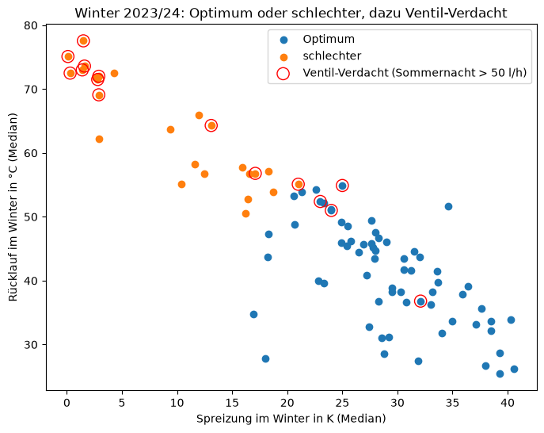

**Was daraus folgt:** Ventil-Verdacht und Einstufung lassen sich zu den Klassen der Folie 5
zusammensetzen. → Schritt 24.

---

## Schritt 24 – Folie 5 für alle Zähler, Alarm dazu, Vergleich mit dem Team

**Datum:** 23.10.2026, Notebook `G_folie5.ipynb`

**Ausgangsfrage:** Wie sieht die fertige Tabelle aus, wie passt der Alarm dazu, und wie weit stimmt
sie mit Notebook 31 überein?

**Die Klassen.** Ventil-Verdacht → Regelventil tauschen, sonst „schlechter“ → Regelparameter
optimieren, sonst „Optimum“ → kein Handlungsbedarf, ohne Winterdaten → nicht einstufbar. Ergebnis
für 96 Zähler: 61 kein Handlungsbedarf, 14 Regelparameter optimieren, 16 Regelventil tauschen, 5
nicht einstufbar ([Abbildung 24.1](#abb-24-1)). Gespeichert in
`data/processed/lernpfad/folie5_je_station.csv`.

**Der Alarm.** Derselbe Wächter wie in Phase F, gezählt im Jahr vor dem Stichtag. Stationen mit
Ventil-Verdacht hatten im Schnitt 2,8 Alarmtage, Stationen ohne Handlungsbedarf 0,9. Mit
Ventilbefund 2,0, ohne 1,4. Ein lange offenes Ventil ist für den Wächter normal. Die Klasse
beschreibt deshalb den Dauerzustand, der Alarm die Veränderung. Beide ergänzen sich.

**Gegen Notebook 31.** 83 % der Zähler bekommen dieselbe Klasse, „Optimum oder schlechter“ stimmt
bei 75 von 90 mit Notebook 28 überein.

| | Lernpfad | Team |
|---|---|---|
| kein Handlungsbedarf | 61 | 62 |
| Regelparameter optimieren | 14 | 8 |
| Regelventil tauschen | 16 | 21 |
| nicht einstufbar | 5 | 5 |

Das Team hat mehr Ventilfälle, weil sein gelerntes Modell (Kennzahlen und LSTM) auch bei 10 bis
48 l/h Nachtdurchfluss anschlägt. An den begangenen Stationen hat es dadurch einen Treffer mehr
(72135442 mit nur 30 l/h), aber auch mehr Fehlalarme: 8 richtige von 12 gegen 7 von 9 bei uns. Wir
haben 7 Stationen mehr bei „Regelparameter optimieren“. Sie liegen mit 50 bis 58 °C Rücklauf an der
Grenze zwischen den Gruppen, und das Team nimmt für K-Means andere Kennzahlen.

**Abbildung 24.1:** Klassen nach Folie 5 für alle 96 Zähler.

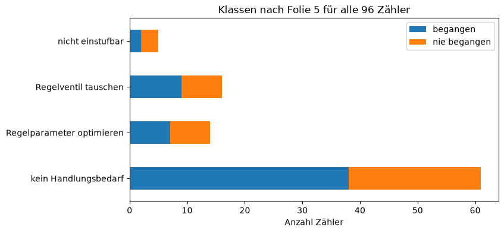

**Was daraus folgt:** Das Projekt kann für jede Station Alarm, Erkennen und Unterteilen liefern. Es
bleibt der Abschluss, also alle Ergebnisse gegen die Notebooks 27 bis 32 und die Vorarbeit zu
stellen.

---

## Abschluss – Vergleich mit dem Team und der Vorarbeit

**Datum:** 23.10.2026

**Ausgangsfrage:** Wo liegt der Lernpfad gegenüber den Notebooks 27 bis 32 und der Vorarbeit, und
warum weicht er ab?

**Ergebnis.** Die Tabelle steht im Report unter „Abschluss“. Kurz: Ventil 0,88 gegen 0,89 im Team
(Vorarbeit 0,92), Überdimensionierung 0,78 gegen 0,78 (Vorarbeit 0,87, im ersten Team-Lauf 0,66
wegen des schon geänderten Anschlusswerts), Dämmung 0,64 bis 0,71 gegen 0,77, Wiedererkennung 83 %
gegen 86 %, Folie 5 zu 83 % gleich. Alle Unterschiede bei den AUCs liegen innerhalb der
Unsicherheit aus Schritt 8. Beim Wächter kommt der einfache Ansatz auf dieselben 39 % wie das
Normalverhaltensmodell, aber fast nur über den Tag des Eingriffs.

**Was daraus folgt:** Bei 56 begangenen Stationen reichen einfache Verfahren mit ehrlicher Prüfung.
Das LSTM lohnt sich zum Beschreiben von Stationen, nicht zum Finden von Befunden. Die nächste
sinnvolle Verbesserung wäre eine aufsummierende Alarmregel (CUSUM) für den Wächter.
